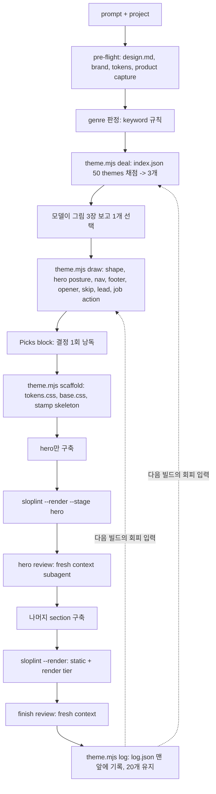

# Hallmark: 알고리즘과 내부 동작

> 원본: [Nutlope/hallmark](https://github.com/Nutlope/hallmark) (MIT) | 정리일: 2026-11-18 | 분석 기준: v2.0.0 (SKILL.md, package.json), commit `04977e1` (2026-11-11)

같은 폴더의 다른 문서(floor-rules.md, ai-slop-gates.md, build-flow.md, genres.md, themes-catalog.md, macrostructures.md, custom-direction.md)는 "무엇을 금지하고 어떤 순서로 만드는가"를 다룬다. 이 문서는 그 규칙을 **어떻게 계산하고 판정하는가**를 다룬다. `scripts/theme.mjs`, `scripts/sloplint.mjs`, `scripts/sloplint-render.mjs`, `scripts/refcheck.mjs`, `references/flow.md`, `references/gates.md`, `references/layout.md`, `references/craft.md`, `references/macrostructures.md`의 실제 코드와 본문을 읽고 정리했다.

## 1. 전체 아키텍처

Hallmark의 기계 장치는 세 축이다. **(1) 방향을 정하는 dealer**(theme deal, draw), **(2) 결과를 재는 linter**(sloplint static tier + render tier), **(3) 문서 자체의 정합성을 지키는 refcheck**. 그리고 이들을 잇는 상태 저장소가 CSS 첫 줄의 **stamp**와 `.hallmark/log.json`이다.



설계 요점:
- **stamp가 linter의 입력이다.** CSS 첫 비어있지 않은 줄의 `/* Hallmark · ... */` 블록에 shape, theme, hero posture, nav, footer, colour posture, waiver, answered, dismissed, dropped, `copy: verbatim`, `redesign: <depth>`를 쓴다. sloplint는 이 텍스트를 정규식으로 읽어 판정 규칙을 바꾼다. 즉 "선언한 의도"와 "검사 기준"이 같은 곳에 있다.
- **log가 회전(Rotation)의 메모리다.** 대화가 compaction되어도 stamp와 log는 남는다. flow.md는 "다시 유도하지 말고 다시 읽어라"라고 명시한다.
- **tier 지도는 gates.md가 원본이다.** sloplint의 `TIERS` 표는 gates.md에서 파생되며, refcheck가 둘이 어긋나면 에러를 낸다.

## 2. 테마 deal 알고리즘

### 2.1 데이터: `references/themes/index.json`

테마 `.md` 파일의 front matter를 파싱해 만든다(`theme.mjs index`). 50개 테마, genre 분포는 editorial 20, modern-minimal 12, playful 9, atmospheric 9.

```text
{ name, slug, genre, posture,
  paper:   { band: light|mid|dark, L, hue },
  display: { class: roman-serif|high-contrast-serif|slab-serif|grotesk-sans|grotesk-heavy|
                    geometric-sans|rounded-sans|display-condensed|display-heavy|mono|
                    pixel|handwritten|blackletter, face },
  accent:  { band: warm|cool|neutral|chromatic-<hue>, hue },
  keywords: [..],            # 예: almanac -> yearbook, field guide, dataset, specifications ...
  material: "한 문장 묘사",   # 종이, 잉크, 서체, 모서리, 신호색
  photo: natural|warm|muted|mono|duotone ..,   # 사진 처리
  pictured: "Workbench, Stage hero",           # 대표 이미지가 이미 보여준 shape와 hero
  picture: references/themes/<slug>.jpg }
```

**axes triple** = `paper.band/display.class/accent.band`(예: `mid/grotesk-sans/chromatic-magenta`). 반복 회피의 기본 단위다.

### 2.2 genre 판정 (SKILL.md Step 1, 모델이 조용히 수행)

```text
AI tool, generative, music, video, voice, dark, atmospheric      -> atmospheric
SaaS, enterprise, API, platform, developer tool, infra, B2B     -> modern-minimal
playful, fun, friendly, soft, kids, games, community             -> playful
otherwise                                                        -> editorial
```

테마가 deal된 뒤에는 테마의 genre가 이긴다. 기본값이 아닌 genre 두 개가 동시에 걸리면 질문 메시지에 양자택일 하나를 추가한다.

### 2.3 채점과 선택 (`deal()`)

```text
words(prompt): 소문자, 영숫자만, 3자 이상
promptWords:   ASK 불용어 제거(build, make, page, site, website, landing, for, the, with ...)
stem(w):       -ing/-ed 제거(3자 미만이 되면 원형), 끝 's' 제거(-ss는 유지)
bw = set(stem(w) for w in promptWords)

df[k] = keyword k를 가진 테마 수         # 문서 빈도
recent = log[0:3]                        # log는 최신이 앞
recentNames = recent의 theme 이름
lastAxes = recent[0].axes
occupied = recent의 axes 집합

for t in themes:
  fit = 0
  for k in t.keywords:                   # 다단어 keyword는 모든 단어가 있어야 hit
    if all(stem(w) in bw for w in k.split()):
      fit += 3 if df[k] <= 2 else 2 if df[k] <= 4 else 1   # 희귀 keyword일수록 가산 (IDF식)
  fit += 2 if t.genre == genre else -1
  blocked = t.name in recentNames or triple(t) == lastAxes
  sibling = triple(t) in occupied
  if sibling and not blocked: fit -= 1
  r = rand()                             # 시드 고정 난수, 동점 정렬용

pool = [t not blocked] sorted by (fit desc, r asc)
```

**시드**: `seedBase = <prompt 앞 4단어>-<sha1(prompt)[:4]> · <project salt> · <YYYY-MM-DD>`. project salt는 `.hallmark/salt`에 최초 1회 생성되는 4바이트 hex다. 결과적으로 **같은 프로젝트, 같은 프롬프트, 같은 날에는 같은 패**가 나오고(재현성), 다른 프로젝트는 같은 프롬프트라도 다른 패를 받는다. 난수 생성기는 sha256 digest를 4바이트씩 읽고 소진되면 digest를 다시 해시하는 스트림이다.

**3장 고르기** (`pickFrom`):

```text
pickFrom(pool, n, exclude):
  avail = pool - exclude
  hand = [avail[0]]                                  # 1장: 최고 점수
  if n >= 2:
    second = first s in rest where s.paper.band != hand[0].paper.band
                                and s.fit >= best_rest.fit - 2
                                and triple(s) != triple(hand[0])
    else first s in rest with triple(s) != triple(hand[0])
    else best_rest
  while len(hand) < n:
    hand += first s in rest whose triple differs from every card in hand, else rest[0]
```

두 번째 카드는 점수를 최대 2점 양보하면서 **종이 밝기가 다른** 테마를 고른다. 모델에게 "다 비슷한 3장"이 아니라 실질적으로 다른 선택지를 주려는 장치다.

### 2.4 reroll과 소진

```text
previously = {}
for r in 0 .. reroll-1:
   hand = pickFrom(pool, n, previously)
   if hand empty: break            # 소진되면 루프 즉시 종료
   previously += hand
picked = pickFrom(pool, n, previously)
if picked empty: exit 1 "nothing left to deal at reroll N; use a lower --reroll"
```

- reroll k는 "앞선 k개의 패를 모두 뺀 다음 패"다. 시드는 `seedBase`로 같으므로 순서가 안정적이고, 첫 패와 다음 패는 겹치지 않는다(테스트로 보장).
- `reroll-exhaustion.test.mjs`는 `--reroll 1000000000`도 3초 안에 exit 1로 끝나는지 검사한다. 패가 비는 순간 break하기 때문에 루프 횟수가 카탈로그 크기(50/3, 약 17회)에 묶인다. 사용자 입력이 계산량을 정하지 못하게 한 방어 설계다.

### 2.5 custom 방향의 충돌 검사 (`check`)

custom 디자인이 카탈로그나 최근 빌드와 겹치는지 본다.
- `--axes` triple이 카탈로그 테마와 같으면 `near`: 그 테마 그림을 옆에 놓고 비슷해 보일 때만 축 하나를 옮겨라.
- `--face`의 family 이름 앞부분 토큰이 카탈로그 display face와 같으면 `collision`, exit 1(유일하게 막는 경우).
- `--hue`: axes와 함께면 같은 paper, display class이면서 hue 차 20도 이내, hue만이면 10도 이내를 `near`.
- 최근 3개 log가 같은 axes면 `recent`: 다른 결정(shape, 사진, type scale)을 바꿔라.

## 3. draw 알고리즘과 fingerprint

### 3.1 draw가 하는 일

"모델이 혼자 두면 수렴하는 구조적 결정"을 빌드마다 새로 뽑는다. 같은 프롬프트를 같은 테마로 두 번 만들어도 다른 페이지가 나오게 하는 것이 목적이다. 입력은 `--material photo|product|words`, `--job`, `--theme`, `--log`, `--seed`(기본은 매번 새 3바이트 hex).

| 결정 | 후보(material별) | 회피 입력 |
|---|---|---|
| shape | photo: Photographic, Marquee Hero, Split Studio, Catalogue, Narrative Workflow, Bento Grid, Conversational FAQ, Letter, Feature Stack / product: Workbench, Feature Stack, Bento Grid, Narrative Workflow, Marquee Hero, Split Studio, Conversational FAQ, Map / Diagram, Stat-Led / words: Long Document, Manifesto, Letter, Index-First, Conversational FAQ, Marquee Hero, Narrative Workflow | log 최근 3개의 shape + 테마 그림이 보여준 것(`pictured`) |
| hero posture | photo: Poster, Stage, Ledge, Settled / product: Stage, Settled, Banner, Corridor / words: Corridor, Ledge, Banner, Settled. job이 있으면 job.heroes를 앞에 두고, Settled/Stage는 job이 허용할 때만 | log 최근 1개의 hero + pictured |
| nav | edge-aligned, floating pill, masthead, slab, search-led bar, banner over a retracting bar | log 최근 3개 |
| footer | mast, statement, colophon block, newsletter-first(subscribe job만), letter close, index columns | log 최근 3개 |
| 첫 section(opener) | job.open 또는 14개 composition | 직전 빌드의 첫 section |
| leave out(skip) | Split, Grid, Band, Statement, Steps, Figures 중 2개(opener 제외) | 없음 |
| hero lead | photo: the place, the thing itself close, the making, the offer and its price ... / product: the job it does, the screen at work ... / words: the claim, the question ... | 없음 |
| job action, native sections 3개, close | job별 표(아래) | 없음 |

```text
near(options, n, key, extra):
   bad = { log[i][key] for i < n } + extra
   ok  = [o for o in options if no b in bad contains lower(o)]   # 부분 문자열 포함 비교
   return ok if ok else options                                  # 다 막히면 원래 목록
take(options, m): 중복 제거한 뒤 seeded rand로 m개 비복원 추출
```

- 회피는 **부분 문자열 포함**으로 비교한다. log에 "Stage hero"라고 적혀 있어도 "Stage"를 막는다.
- [관찰] hero 후보에서 job.heroes를 두 번 나열하지만 `take()`가 `new Set`으로 중복을 제거하므로 코드상 가중 효과는 없다. photo material 목록의 Poster, Stage 중복도 같다.
- job 동의어: download, app -> try / software, saas -> sign up / newsletter, waitlist -> subscribe / watch, read -> listen. "application"은 try가 아니다(전체 단어 일치).

**job 표**(10개, anatomy.md와 대응): 각 job은 `sections`(카테고리 고유 section 후보), `close`, `open`, `heroes`, `action`(action이 놓이는 곳)을 가진다. 예:

```text
book:   sections = [menu as Switcher by lunch and dinner, room as full-bleed photo with no head,
                    hours and address as own section, next free times as buttons]
        open = [Switcher, Index, Schedule, Split, Showcase]
        heroes = [Counter, Poster, Stage, Index]
        action = [sticky booking bar | booking times in hero | booking beside menu or rooms]
subscribe: hero = Counter|Corridor|Index|Banner, action = subscribe field beside latest issue
```

draw는 "모델이 받되, 프롬프트의 material이 거부할 때만 바꾸고 Picks block에 이유를 쓴다"가 규칙이다. 결과 seed는 stamp에 `draw: <seed>`로 남고, 같은 seed를 `theme.mjs photos`에도 넘겨 사진 선택까지 빌드 고유로 만든다("라이브러리 최고의 한 장을 찾지 말고 첫 적합 사진을 써라").

### 3.2 fingerprint: 6개 구조 축 (macrostructures.md)

| 축 | 선택지 |
|---|---|
| 1. Heading placement | Left-margin, Hanging, Centred display, Bottom-aligned, Overlapping, Sticky/pinned, Numbered by structure, Inline with body |
| 2. Body composition | Single column, Two-column asymmetric, Multi-column justified, Marginalia, Three equal columns, Full-bleed with margin reset, Asymmetric spans |
| 3. Divider language | Hairline rule, Ornament, Negative space, Bleed-colour block, Double rule |
| 4. Button voice | Solid, Outlined, Unstyled link, Oversized solid, Typographic only, Form as CTA |
| 5. Image treatment | Full-bleed, Tightly cropped to grid, Inline, Margin-aligned, None |
| 6. Reveal pattern | Fade-up stagger, Horizontal sweep, Type-unmask, Number-tick, Typewriter, None |

- 표기: `Hanging|Asymmetric spans|Hairline|Outlined|Margin-aligned|None`. log의 `fingerprint` 필드로 저장한다.
- 규칙 두 개: **coherence**(같은 세계의 선택: justified 신문 본문에는 oversized solid가 아니라 typographic CTA), **anti-repetition**(최근 3개 log 각각과 공유하는 축이 3개 이하). 테마나 material이 강제한 None은 공유로 치지 않는다.
- 집행: gate 8(shape가 최근 3개와 달라야 함, Reflex)과 gate 32(같은 composition을 같은 순서로, 또는 fingerprint 4축 이상 공유, **Ledger** tier로 `NOTE`만). 반복은 판정 대상이 아니라 장부라는 위치다. "기억이 아니라 log의 fingerprint와 비교하라"고 명시한다.
- pre-emit critique의 V(Variety) 축: 3점 = log와 6축 중 3축이 다름, 5점 = 최근 3개와 거의 공유 없음. 3점 미만 축이 있으면 빌드 전에 수정한다.

### 3.3 log 엔트리 (`theme.mjs log`)

```text
entry = { date, mode: build|redesign, depth?(polish|restyle|full), scope?,
          shape, theme, axes, hero, nav, footer, imagery, photos[], entry,
          fingerprint, sections, signature, waived, prompt }
composed = scope != app and (mode == build or depth == full)
필수 누락 경고: composed면 shape..signature, polish가 아니면 theme, 항상 prompt
log = [entry] + log, 최대 20개, tmp 파일에 쓰고 rename(원자적 기록)
```

컴포넌트 scope는 log를 남기지 않는다("components do not rotate").

## 4. sloplint 구조와 판정 로직

### 4.1 두 tier

| | static tier (`sloplint.mjs`) | render tier (`sloplint-render.mjs`) |
|---|---|---|
| 입력 | `.css`, `.html`, `.jsx`, `.tsx`, `.vue`, `.svelte`, `.astro` 파일 텍스트 | HTML 파일 또는 `--url`(dev server) |
| 의존성 | 없음(Node 18+) | `puppeteer-core` + Chrome/Chromium |
| 방법 | CSS rule 파서, `:root` token 해석, HTML tag 스캐너, Tailwind class 문자열 해석 | 실제 렌더 후 computed style, getBoundingClientRect, 스크린샷 픽셀 |
| 범위 | 약 85개 check 함수(`CHECKS` 배열) | 34, 44a~d, 58, 59, 62, 73, 76~83, 85, 26a, 40, 41 등 + F17~F26 |
| 실패 시 | 항상 실행 | 실행 못 하면 "render tier not run"을 출력, 절대 render pass로 주장하지 않음 |

**static 매칭 방식**: 파일을 디렉터리별로 묶고, HTML 페이지마다 `<link rel=stylesheet>`와 `@import`를 따라가 그 페이지가 실제로 로드하는 CSS만 묶어 context를 만든다. 남은 CSS와 컴포넌트 파일은 디렉터리 context가 된다. `package.json` 루트를 공유하는 컴포넌트 전용 context는 형제 context의 token, focus, reduced-motion 사실을 빌린다(컴포넌트 폴더는 전역 스타일시트에 있는 focus ring을 스스로 가질 수 없기 때문). context는 `{rules, tokens, docs, cssFiles, stampText, allCss, posture, genre}`이고, 각 check는 이를 받아 `report(gate, grade, file, line, evidence, fix)`를 호출한다. 예:

```text
check10:  rule.decls에서 transition: all 또는 transition-property: all -> 10a FAIL
check48:  token rule 밖의 font-family literal(generic family 제외), color literal -> 48 FAIL
          token 값이 scaffold placeholder "FILL ME"면 FAIL
check20:  모든 CSS 소스 중 하나라도 첫 비어있지 않은 줄(@charset 뒤)이 /* Hallmark 로 시작해야 함
check54:  컨테이너의 직계 자식 A, B(사이 hr, aria-hidden 무시)에서 A가 eyebrow 패턴이고 B가 heading이면 FAIL
check58Static: h1 > 7단어 WARN, hero 첫 p > 12단어 WARN, 화면 단어 예산
```

Tailwind는 class 문자열(`cn`, `clsx`, `cva` 호출 포함)을 해석해 `uppercase tracking-widest text-xs`, `transition-all`, `min-h-screen` hero, 보라에서 파랑 `from-/to-`, `bg-[#hex]`를 CSS와 같은 gate로 잡는다.

### 4.2 render tier의 측정 순서와 8개 폭

```text
WIDTHS = [320, 375, 414, 768, 1024, 1280, 1440, 1920]
emulate prefers-reduced-motion: reduce          # reveal은 끝 상태로 찍힘
for w in WIDTHS (height 800):
   observe():  34 가로 스크롤(scrollWidth > innerWidth+1), 375에서 clip에 가려진 overflow,
               버튼/링크 줄바꿈, 44b(1280x800 fold에 h1과 primary CTA), 40/41 대비,
               23 accent 면적(1280x800 viewport 비율), 25 본문 measure, 72 가장자리 텍스트 ...
   대비 후보는 pixelBehind(): 글자색을 투명하게 바꾸고 그 영역을 캡처해 실제 배경 픽셀로 재계산,
               threshold - 0.05 이상이면 finding 취소 (gradient, 사진 위 텍스트 오탐 제거)
   375, 1280에서 lineBreaks(): 줄 끝 고아 단어(F26)
for (w,h) in [(1440,900), (1920,1080)]:
   observeSpace(): 44a hero 내용 위아래 여백 비, 44c hero가 900px를 넘거나 짧음, 44d 1920 컨테이너,
                   59 section 간격 단조로움, 77 얇은 section, 78 section head 크기, 79 hero 아래 공백,
                   83 사진 비율, 85 이메일 가입으로 끝나는 페이지
1440: observeQuality(), observeOcclusion()(73 다른 요소 밑에 칠해진 텍스트), DOM inventory
1440: Tab 16회, 각 focus ring 대비를 주변 픽셀과 비교, 2.95 미만 26a FAIL, ring 없음 26a FAIL
1440 -> 375: 데스크톱에서 보이던 텍스트가 폰에서 40단어 이상 사라지면 F25 WARN,
             표 첫 행 셀 2개 이상이 화면 밖이면 F25 WARN
script error -> render FAIL, font/stylesheet 로드 실패 -> render WARN(fallback face를 리뷰하지 말 것)
screenshots: 1280x800, 1440x900, 1920x1080 fold, 1440과 375 전체 페이지
```

`--stage hero`는 375x812와 1280x800, 1440x900, 1920x1080 첫 화면만 찍고 페이지 전체 gate(8, 9, 32, 59, 76, 77, 78, F8, F15)를 건너뛴다. hero review의 입력이 이 4장이다.

### 4.3 tier와 grade

| tier | 의미 | waive |
|---|---|---|
| Floor | 의도적으로 어기는 좋은 페이지가 없는 것(정확성, 접근성, 정직성, ban) + house rule 4개(54 eyebrow, 58 screen budget, 63 template punctuation, 67 tracked caps) | 불가 |
| Reflex | 모델이 빠지는 기본값 | stamp에 기록하면 가능, 3개 초과 시 "house style" NOTE |
| Finish | F-check, 팔 길이에서 안 보이는 craft | waive가 아니라 answered |
| Ledger | 반복 장부(32) | 대상 아님, NOTE |

grade 순위: `FAIL < REFLEX < WAIVER(거부된 waiver) < WARN < WAIVED < ANSWERED < DISMISSED < NOTE`. FAIL과 REFLEX를 따로 세서 "0 FAIL"이 Floor에 대해 항상 참인 문장이 되게 한다. exit code는 FAIL 또는 REFLEX가 있으면 1(`--before` 기록 모드 제외).

`report()`의 재등급 파이프라인:

```text
report(gate, grade, ...):
  if scope == component and gate in PAGE_ONLY: drop
  if (scope == app or stamp 'shape: app screen') and gate in APP_SKIP: drop
  if stage == hero and gate in HERO_SKIP: drop
  tier = TIERS[gate] or TIERS[baseGate] or (F* -> finish) or 'floor'      # 모르는 gate는 Floor로
  if stamp 'copy: verbatim' and gate in {19, 58, 69} and FAIL/WARN: grade = NOTE
  if stamp 'redesign: full'   and gate == 58:                        grade = NOTE
  if stamp 'redesign: polish|restyle' and gate in STRUCTURAL(+SPACING for polish): grade = NOTE
  if grade == FAIL:
      ledger -> NOTE
      reflex -> WAIVED if waived else REFLEX
  if finish and ANSWERED: grade = ANSWERED
  if WARN and DISMISSED:  grade = DISMISSED
  if WARN and reflex and waived: grade = WAIVED
```

render tier finding도 같은 `report()`를 통과하되, 그 파일의 context에서 파싱한 waiver 집합을 적용한다. 동일 (gate, grade, file, line, evidence)는 중복 제거한다. 모르는 gate id를 Floor로 떨어뜨리는 기본값은 "모르면 엄격하게"다.

### 4.4 waiver 파싱 (CSS stamp)

```css
/* Hallmark · waive 47b · one frame, a real terminal capture inside · the terminal is the product being sold */
/* Hallmark · answered F3 · the display head is one word and cannot wrap */
/* Hallmark · dismissed 58 · the window holds a five-row table, counted twice across the sticky pane */
```

```text
claims = regex /\* Hallmark · waive <id> · <guard evidence> · <reason> \*/
형식이 깨진 waive 주석 -> WAIVER 'malformed, ignored'
for c in claims:
  reject if tier(c.id) != reflex        # Floor: never, Finish: answer it, Ledger: nothing to waive
  reject if id가 숫자만이고 그 번호에 clause(a, b, ii ...)가 있음   -> "name the clause"
  reject if 같은 gate 두 번째 waiver
  reject if len(reason) < 24
  reject if boilerplate(reason)          # 'design choice', 'intentional', 'aesthetic', 'needed',
                                         # 'brief requires' 등과 a, the, is, very 같은 filler를 지우고
                                         # 남은 글자가 12자 미만
  reject if 같은 reason을 다른 waiver에 재사용
  reject if reason의 4자 이상 단어가 페이지 텍스트와 하나도 겹치지 않음
  reject if GUARDS[gate](ctx) != true    # guard를 linter가 다시 유도
  WAIVED.add(gate)
if |WAIVED| > 3: NOTE "house style, lock it into a design.md"
```

**guard 재유도 예**: 1(두 family 이상 선언), 2b(gradient text의 ramp stop이 token이고 hue 폭 40도 이하), 7(stamp에 `surface: absolute`), 23(stamp에 colour posture 선언), 37(family 4개 이하), 38ii(`font-synthesis: none` 선언), 42(stamp에 nav:, footer: 필드), 44(stamp에 hero: posture), 64(display/body/outlier 중 하나가 monospace), 65(stamp에 by request). "guard를 말할 수 없는 빌드는 보통 그 guard가 성립하지 않는다"는 것이 설계 의도다.

answered는 Finish만, dismissed는 WARN에 대해, 둘 다 reason 24자 이상이고 boilerplate가 아니어야 한다.

## 5. 리디자인 보존 검사 (`--before` / `--kept`)

리디자인의 가장 큰 위험은 "더 예뻐졌지만 링크, 폼 필드, 이벤트 핸들러, 테스트 훅이 사라진" 페이지다. 이를 기록과 비교로 잡는다.

**`--before`**: 리디자인 전 상태를 `.hallmark/before.json`에 기록한다(스크린샷은 `.hallmark/before/`, 전체 finding은 `before.txt`, `.gitignore` 자동 생성).

```text
파일별 wiring (정규식):
  handlers:   onClick=, @click=, v-on:x=, on:click=, onsubmit= ...
  links:      href=, to=, action= (link, base, use, image, script, style 태그 제외, '#' 제외)
  fields:     name= (meta, slot, iframe, a, map, object, link 제외) + register('field')
  hooks:      data-testid, data-test, data-cy, data-qa, data-track*, data-analytics*, data-event*, data-gtm*
  ids, scripts(src)
렌더된 페이지별 DOM inventory: links, fields, forms(key, attrs, hidden fields, submit 유무, controls),
  headings, figures, images, words, 실제 DOM에서 매칭되는 script selector
script selectors: getElementById, querySelector(All), closest, matches의 문자열 인자
  -> markup에 해당 #id, .class, [data-x]가 모두 있으면 'hooked'
```

**`--kept`**: 같은 대상을 다시 읽어 차집합을 낸다.

| 분류 | 사라진 항목 | 등급 |
|---|---|---|
| hard | links, fields, forms(폼 자체, 속성, hidden field, submit control, control), handlers, test hooks, scripts, script hooks(스크립트가 여전히 query하지만 markup에서 사라진 selector) | `FAIL kept` |
| soft | headings, figures, images, ids | `WARN kept` |
| 분량 | 이전 80단어 초과였는데 현재 60% 미만 | WARN |
| 안전장치 | 스크립트가 `hidden` 속성으로 숨기는데 `[hidden] { display: none }` 규칙이 없음 | FAIL |
| 범위 | 이번 실행이 읽거나 렌더하지 않은 이전 파일, 페이지 | WARN(비교 안 됨) |

```text
허용(기록된 포기):
  /* Hallmark · dropped /blog, #team · the user is retiring the blog and the team section */
  /* Hallmark · reworded "Built for modern teams" to "Out of your way" · 19 names the opener */
  reason 12자 미만이면 기록으로 인정하지 않고 WARN
  매칭: 항목과 정확히 같거나, 토큰이 4자 이상이면 부분 포함
요약: "links 14/14, fields 5/5, handlers 9/9 (n dropped on record)" + before/after 비교 compare.html
```

`kept` finding은 Floor처럼 묶인다. 리디자인 stamp(`redesign: polish|restyle|full`)는 보존하기로 한 구조 gate(6b, 8, 9, 32, 42, 44a, 44c, 58, 77, 79, polish는 간격 gate 24b, 59, 78 추가)를 NOTE로 내려 "건드리지 않기로 한 것"을 FAIL로 세지 않는다.

## 6. 레이아웃과 크래프트의 수치 기준

### 6.1 canvas와 type scale (1440x900 기준)

- 컨테이너: `--container` 1440px, `--gutter` 64px -> content 1312px. 1920에서도 1312px 유지, gutter만 커진다(44d). 12 columns, `--gap-columns` 32px: 1열 80px, 4열 416, 6열 640, 8열 864.
- section의 바깥 요소가 배경과 block padding, 안쪽 `.container`가 폭과 `padding-inline`만 가진다(`padding` shorthand는 리듬을 0으로 만든다).

| 역할 | token | 1440 크기 |
|---|---|---|
| Hero head | `--text-display` | 84px (테마에 따라 5.5rem, display-heavy 6rem, 한 단어 7rem; poster 계열 `clamp(4rem, 10vw, 9rem)`) |
| 긴 hero head, statement | `--text-display-s` | 60px |
| Section head | `--text-section` | 52px (40px 미만이면 미완성으로 보임, gate 78) |
| Item title | `--text-title` | 25px |
| Lead | `--text-lead` | 21px |
| Body | `--text-md` | 16px (최소) |
| Label, caption | `--text-sm` | 14px |

- scale은 16px body에서 비율 1.25. hero head는 section head의 약 1.5배, section head는 item title의 약 2배. app screen은 비율 1.125~1.2, fluid head 없음.
- headline 길이별: 20자 이하 full display, 21~50 display, 51~90 display-s 또는 의미 단위 `<br>`, 90 초과는 다시 쓴다. heading measure: h1 20ch, h2 30ch, h3 40ch.
- display tracking -0.02~-0.04em(condensed, heavy는 0~-0.015em), line-height 1.0~1.15(대문자 head는 1.0 미만 금지). weight는 페이지 전체 3개 이하, 극단 쌍(300/800, 400/700). family 2개 + outlier 1개(역할 하나).
- body line-height 1.5~1.65, measure 45~75ch, prose 페이지 1.65~1.75와 60~75ch.

### 6.2 간격과 리듬

- spacing scale: 2, 4, 8, 12, 16, 24, 40, 64, 96, 144px. token이 있는 곳에 raw length FAIL(24a), scale 밖 optical nudge 최대 3개(24b).
- head와 그 한 줄 16~24px, head block과 content 48~64px(빡빡한 composition 40px). grid item 가로 32px, 세로 48~64px, card padding 32~40px.
- section gap 세 단계 120 / 144 / 176px를 섞는다(gate 59: 모든 간격이 같으면 REFLEX). 144px gap은 700px section을 감싸면 프레임이고 200px section 밑에서는 구멍이다.
- section 수 6~9(hero, footer 포함, 얇은 프롬프트 5), 높이는 보통 520~900px, 360px 미만은 band만 페이지당 2회 이하. 페이지 전체 450단어 이하, 화면(900px)당 약 80단어(58).
- body는 12열 중 10열까지 채운다(77). split은 텍스트와 시각물 중심이 60px 이내, 어느 열도 행의 1/5 이상 비우지 않는다.

### 6.3 hero posture 8종

| Posture | 높이 | 구성 |
|---|---|---|
| Settled | nav 아래 화면 채움 | 화면 중앙, 텍스트 6열 + 시각물 6열 |
| Stage | nav 아래 화면 채움 | 텍스트 5열, 시각물 7열에 화면 높이 60~75%, 바깥 가장자리 bleed 가능 |
| Banner | 화면의 50~60% | 첫 section이 fold 위에 보임, 레퍼런스, 문서, 유틸리티용 |
| Ledge | 화면 채움 | 위쪽 높은 field, head가 바닥에 놓임 |
| Corridor | 화면 채움 | 44ch 이하 중앙 단일 열, head를 평소보다 크게 |
| Poster | 92~100dvh | full-bleed 사진이나 canvas, 가장 조용한 부분에 내용 |
| Counter | nav 아래 화면 채움 | action이 시각물: 구독 필드와 최신호, 예약 시간, 옵션 있는 buy box |
| Index | nav 아래 화면 채움 | 목록이 시각물: lineup, 메뉴, 호 목록 |

- Settled, Stage, Banner, Corridor: 내용 아래 공간이 위 공간의 1.0~1.5배(44a), 가장 낮은 내용이 fold에서 160px 이내(79).
- 시각물은 6~7열 폭에 화면 높이 60% 이상(1440x900에서 520px), 또는 세로 물체(표지, 폰, 병)는 4~5열에 75%. hero grid는 `6fr 5fr`, `5fr 7fr` 두 track, 간격 48~120px.
- hero 텍스트: head 7단어(50자) 이하, 한 문장 12단어 이하, action 1~2개. 1280x800에서 head, 한 문장, primary action이 스크롤 없이 보여야 한다(Floor 12, gate 44b).
- 텍스트 옆 그림(Settled, Stage)이 가장 흔한 생성 hero이므로 그림이 프롬프트에서 가장 강한 것일 때만 쓴다.

### 6.4 composition 17종

Split, Showcase, Grid, Bento, Rows, Table, Figures, Steps, Statement, Band, Form, Rail, Pinned, Switcher, Index, Schedule, Offer. 페이지당 3~6종, 이웃 section에 같은 것 금지(one-composition shape 예외, 그때는 비율이나 좌우를 바꿈). 수치 예: Split 시각물 440px 이상(4:3~4:5), Showcase 12열 16:9~21:9 560px 이상(아래 작은 시각물은 8+4 또는 7+5, 같은 크기 3개 금지), Grid 셀 240px 이상, Bento 행 280~360px에 시각물 타일 2개 이상, Rows 72~120px, Table 행 56~72px tabular numerals, Rail 5개 이상에 다음 항목이 가장자리에서 잘림, Pinned 패널 3~4개(60rem 미만 unpin), Index 6~20행, Form input 48~56px.

### 6.5 색과 표면, 모션

- OKLCH 전용. paper L 92~98(밝음) 또는 12~18(어두움), chroma 0.005~0.015. ink L 16~24(밝은 종이 위). 중간 neutral 5~9개, 각 chroma 0.005~0.018. accent chroma 0.12~0.22와 짝 `--color-accent-ink`. focus는 accent hue, chroma 0.18~0.22.
- Restrained posture에서 accent는 viewport의 5% 미만(23). Committed는 한 색이 표면의 30~60%. 대비 본문 4.5:1(목표 7:1) 또는 APCA Lc 60, 큰 글자, 아이콘, focus ring 3:1.
- surface ladder: 여백 -> hairline(1px) -> tinted well -> card(border 또는 shadow, 둘 다는 금지). card 안 card 금지. shadow 하나, z level 8단계(1, 10, 100, 200, 300, 400, 500, 600).
- 모션: transform, opacity만. `--dur-micro` 120ms, `--dur-short` 220ms, `--dur-long` 420ms, exit는 enter의 60~75%. stagger 행 30~50ms, 블록 60~100ms, 합계 500ms 이하 1회. 페이지당 reveal 1개(0.4~0.8s), script 없이도 내용이 보여야 함. 5초 넘는 loop는 pause control. tooltip 800~1000ms(focus는 0).
- 컨트롤: marketing 44~52px, app 32~40px(hit target 44, coarse pointer 48). 버튼 크기 2종 이하, 6px 이상 차이.

## 7. 새 컨텍스트 리뷰 설계

**전제**: "페이지를 만든 thread가 가장 약한 리뷰어다." 만든 쪽은 의도를 알기 때문에 결과가 아니라 의도를 본다.

- **두 번의 리뷰**: hero review는 Step 6에서 fold 아래 section이 존재하기 전에 1회, finish review는 Step 7에서 1회. 둘 다 transcript를 물려받지 않는 subagent로 실행한다.
- **빌더는 리뷰 프롬프트를 읽지 않는다.** subagent에게 "`review-hero.md`를 읽고 따르라"고만 하고 입력을 넘긴다. 빌더가 채점 기준을 미리 보면 기준에 맞춰 연기하기 때문이다.
- **입력을 제한한다.** hero review: `hero-*` 스크린샷 4장, stamp 첫 두 줄, Picks block의 Material과 Signature 행, 테마 그림. finish review: render tier 스크린샷, HTML 소스, stamp의 theme 줄, 테마 파일과 그림, hero review 결과와 처리 방식, gates.md § 4, 리디자인이면 before 스크린샷. 리뷰어는 "왜 이렇게 했는지"를 듣지 못한다.
- **출력 형식 고정**: hero review의 첫 단어는 `ship` 또는 `fix`, 최대 5개 finding, 한 줄씩, 심각한 순. 질문 목록: 7단어 이하로 이 제품만 할 수 있는 말인가, 내용이 화면 중앙인가, 시각물이 화면 높이 60% 이상인가, 템플릿 냄새(중앙 스택, 헤드라인 위 pill, gradient blob, 빈 색 상자, 그린 일러스트, 카운팅 마크, 나란히 놓인 채움 버튼 둘)가 있는가, signature가 이 화면에 있는가("그림을 머릿속에서 지워도 화면이 같은 말을 하면 그림이 약하다"), 테마 그림의 첫 화면만큼 완성되었는가. custom run이면 "모델이 이 프롬프트에 만들 법한 화면인가"를 대신 묻는다. 10턴 안에 읽기를 멈추고 쓴다.
- **첫 단어에 따라 행동**: `recapture`는 스크린샷이 잘못된 것(fallback 폰트, 빈 프레임)이라 라운드를 쓰지 않고 다시 찍는다. 그 외에는 고치고 같은 샷을 다시 찍은 뒤 빌더가 각 finding을 `resolved | partial | unresolved`로 직접 채점한다. 다시 보내 채점받는 것은 첫 단어가 `rebuild`이거나 Floor gate가 걸렸을 때 1회뿐이다. "채점은 두 번째 리뷰가 아니다."
- **예산**: 일괄 검사 1회, 수정 배치 1회, 확인 라운드 최대 1회. 리뷰마다 수정 배치 1회와 재촬영. foreground로 실행(`run_in_background: false`), 타이머 대기 금지.
- 결과는 stamp에 기록: `hero-review: fix · 4 findings · 4 resolved`, `finish-review: subagent · 5 findings · 4 resolved 1 unresolved · gap: none`. subagent가 없으면 그때만 프롬프트를 읽고, 산출물을 cold로 다시 읽고, `in-thread`로 기록한다.

**harness lever** (flow.md): 기준은 모든 harness에서 동일하고 실행만 조정한다.

| Lever | Claude Code | Codex CLI | OpenCode |
|---|---|---|---|
| Edit-time hook | PostToolUse로 sloplint(Floor finding만 보고) | 없음, Step 7 sloplint가 유일 | 없음 |
| Subagent | 있음 | 없음, 리뷰를 in-thread로 하고 그렇다고 밝힘 | 있음(`@general`) |
| 질문 | AskUserQuestion | 채팅 텍스트 1회 후 대기 | 동일 |
| Network | 있음 | sandbox 기본 차단, `imagegen.mjs`는 명시 요청과 승인 필요 | `webfetch` 권한 게이트 |
| Node 스크립트 | 자유 | sloplint는 sandbox 안에서 로컬 읽기만 | bash가 ask면 1회 경고, 권한 설정은 절대 수정 안 함 |

공통 생존 규칙: 계획을 두 번 말했으면 서술을 멈추고 만든다, 검증하지 않은 gate 수를 쓰지 않는다, 참조 파일 로드 실패 시 Floor로 진행하고 어느 파일인지 말한다, 도구가 없으면 의도를 다른 수단으로 수행한다(도구는 선택, 검사는 필수).

## 8. 설계 판단과 이유

- **시드를 프롬프트, 프로젝트 salt, 날짜로 만든 이유**: 같은 상황의 재현성(디버깅, 사용자 재요청)과 다른 프로젝트 간 다양성을 동시에 얻는다. reroll은 시드를 바꾸지 않고 "이전 패 제외"로 구현해서 다음 패가 이전과 절대 겹치지 않는다.
- **keyword 가산에 문서 빈도를 쓴 이유**: "data"처럼 여러 테마가 가진 단어는 1점, 한두 테마만 가진 단어는 3점. 프롬프트의 특이한 단어가 테마를 결정하게 한다. genre 불일치 -1, 최근 axes 형제 -1로 적합성과 다양성을 한 점수에 합친다.
- **두 번째 카드를 다른 종이 밝기로 강제한 이유**: 상위 점수 3개는 대개 같은 계열이다. 2점 양보로 실질적으로 다른 선택지를 보여주고, 최종 선택은 그림을 본 모델이 material 기준으로 한다(기계는 후보를, 모델은 판단을).
- **draw를 theme deal과 분리한 이유**: 테마는 재료(종이, 잉크, 서체)이지 계획이 아니다. "테마는 페이지에 무엇이 어떤 순서로 들어갈지를 정하지 않는다." 구조 결정은 job(anatomy)과 log 회피로 따로 뽑아야 같은 테마 안에서도 페이지가 갈린다. 테마 대표 그림이 이미 보여준 shape와 hero도 피한다(`pictured`).
- **반복을 Ledger NOTE로 둔 이유**: 반복은 단일 페이지의 결함이 아니라 빌드 간 관계다. 막으면 정당한 반복까지 막히므로 장부로 기록하고, 대신 draw와 pre-emit V 점수로 앞단에서 줄인다.
- **waiver가 guard를 재유도하는 이유**: "intentional", "design choice" 같은 이유는 아무 의미가 없다. 24자, boilerplate 제거, 페이지 단어 공유, 재사용 금지, gate별 guard로 waiver를 "이 페이지에 대한 검증 가능한 주장"으로 만든다. 3개 초과는 예외가 아니라 스타일이므로 design.md로 고정하라고 안내한다.
- **FAIL과 REFLEX를 분리 집계한 이유**: "0 FAIL"이 항상 Floor에 대한 참 문장이어야 보고서가 신뢰된다. Reflex를 섞으면 waiver 하나로 숫자가 흔들린다.
- **render tier의 대비 재측정**: computed style만으로는 gradient, 사진, 반투명 위 글자를 판단할 수 없다. 글자를 투명하게 만들고 실제 픽셀을 캡처해 재계산하므로 오탐이 크게 준다. reduced-motion을 강제해 reveal이 끝 상태로 찍히게 하는 것도 같은 맥락이다(애니메이션 중간 프레임으로 판정하지 않음).
- **render tier가 안 돌면 pass를 주장하지 않는 이유**: 의존성(puppeteer, Chrome)이 없는 환경이 흔하다. 조용히 static만 통과시키면 거짓 PASS가 된다. "A fabricated pass is itself slop."
- **리디자인을 wiring 차집합으로 검사하는 이유**: 시각적 개선은 눈에 보이지만 깨진 핸들러, 사라진 테스트 훅, 폼 hidden field는 보이지 않는다. 기계가 잘하는 집합 비교로 사람이 놓치는 회귀를 막고, 의도적 포기는 stamp에 이유와 함께 남긴다.
- **refcheck로 문서 자체를 lint하는 이유**: skill은 문서가 곧 코드다. 존재하지 않는 gate 번호, retired 번호 재사용, 죽은 § 링크, SKILL.md에 없는 Step 번호, 테마 간 phantom token, em/en dash, 버전 불일치(SKILL.md, theme.mjs, package.json), sloplint TIERS와 gates.md 불일치, 고아 파일을 CI에서 잡는다. SKILL.md를 19,000바이트 이하로 강제하는 이유는 compaction 후 harness가 다시 붙이는 약 5,000토큰 안에 Step 7(sweep)까지 들어가야 하기 때문이다. retired gate 번호(5, 13, 14, 21, 31, 35, 36, 43, 45, 51, 52, 57, 60, 61)를 재사용하지 않는 것은 옛 stamp가 계속 읽히게 하려는 하위 호환 규칙이다.
- **사용자 입력이 계산량을 정하지 못하게**: reroll 10억도 즉시 종료, stdin 크기 제한, 파일 수집 시 symlink 순환과 중복 realpath 제거(refcheck fixture로 검증). 에이전트가 이상한 인자를 넣어도 도구가 멈추지 않는다.

## 9. 내 작업에 가져올 점

1. **의도 선언을 산출물 첫 줄에 두고 linter가 그것을 읽게 한다.** stamp 방식은 "이 페이지는 app screen", "copy는 고객 원문 그대로" 같은 맥락을 검사 규칙에 전달하는 가장 싼 방법이다.
2. **추천 = IDF식 keyword 점수 + 장르 가감 + 최근 회피 감점 + 다양성 제약 pickFrom.** 프롬프트 템플릿, 예시, 레퍼런스 선택에 그대로 쓸 수 있다.
3. **waiver 품질 규칙**(길이, boilerplate 제거 후 잔여 길이, 대상 텍스트와 단어 공유, 재사용 금지, 기계적 guard, 개수 상한)은 어떤 lint 예외 시스템에도 이식 가능하다.
4. **검토는 새 컨텍스트에서, 제한된 입력과 고정된 첫 단어로.** 빌더는 기준을 미리 보지 않고, 재검토는 1회로 제한한다.
5. **리팩터링 전후 wiring inventory 차집합**으로 링크, 필드, 핸들러, 테스트 훅, 스크립트 selector 회귀를 잡는다.
