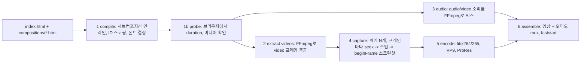
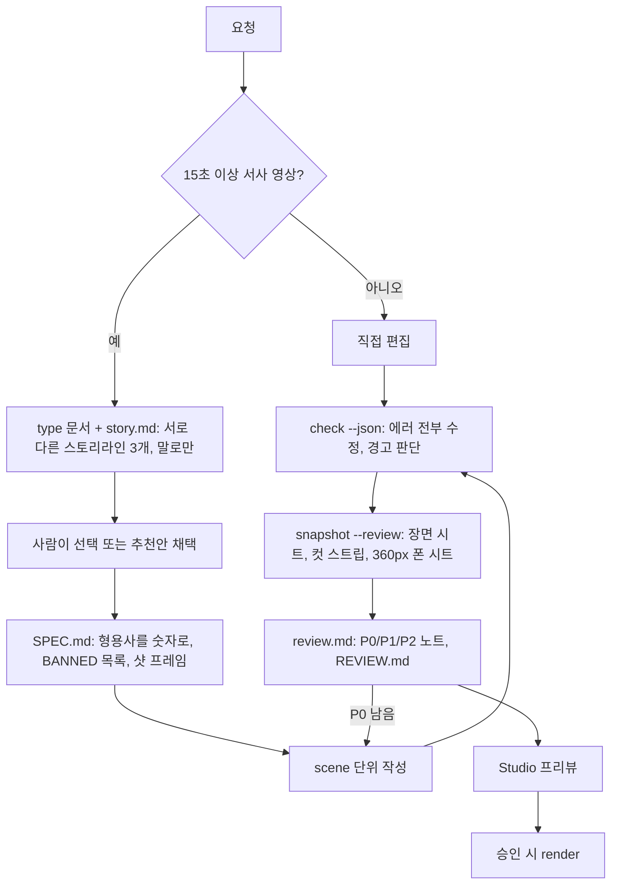

# HyperFrames: 핵심 원리 정리

> 원본: [heygen-com/hyperframes](https://github.com/heygen-com/hyperframes) (Apache-2.0) | 정리일: 2026-11-18 | 분석 기준: commit c569417 (CLI 0.9.65)

이 문서는 설치나 사용법이 아니라 HyperFrames가 "왜, 어떻게" 동작하는지를 정리한다. 근거는 packages/engine, packages/producer, packages/core(runtime, adapters), packages/lint 소스와 skills/hyperframes의 SKILL.md, references/*.md 이다. 소스에서 직접 확인하지 못한 내용은 [미확인]으로 표시한다.

## 1. 해결하려는 문제

- 영상 제작을 "웹 페이지 작성"으로 바꾼다. HTML, CSS, 미디어, 시크 가능한(seekable) 애니메이션을 쓰면 결정론적(deterministic) MP4가 나온다. README의 슬로건은 "Write HTML. Render video. Built for agents." 이다.
- 대상은 사람과 코딩 에이전트 둘 다다. 빌드 단계 없이 index.html이 그대로 재생되므로 LLM이 가장 잘 쓰는 언어(HTML/CSS/JS)로 영상을 만들 수 있다.
- 핵심 난제는 브라우저가 본질적으로 "실시간" 시스템이라는 점이다. 애니메이션은 벽시계(wall clock)를 따라 흐르고, 프레임은 렌더링 부하에 따라 빠진다. HyperFrames는 이 실시간 브라우저를 "시간 t를 입력받아 정확히 한 장을 그리는 함수"로 바꾸는 장치다.
- 두 번째 난제는 에이전트가 만든 영상의 "기본값 냄새"다. 그래서 렌더러 외에 계약(contract), lint, 스토리/SPEC/리뷰 루프, 모션 수치까지 skill 문서로 패키징한다.

## 2. 코드 기반 영상 vs AI 생성 영상

| 구분 | 코드 기반 (HyperFrames, Remotion, Manim) | AI 생성 모델 (Sora, Veo 류) |
|---|---|---|
| 원리 | 장면을 코드로 기술하고, 렌더러가 시간 t마다 그 상태를 계산해 래스터화한다 | 노이즈에서 픽셀(또는 latent)을 확률적으로 샘플링한다 |
| 결정성 | 같은 입력이면 같은 프레임 (재현 가능) | 같은 프롬프트라도 매번 다름 (seed로 부분 제어) |
| 편집 | 텍스트 한 글자, 타이밍 0.1초를 정확히 수정 가능 | 부분 수정이 어렵고 재생성 위주 |
| 강점 | 타이포, UI, 차트, 브랜드 정확도, 자막 싱크 | 실사, 사람, 자연 현상 같은 "그릴 수 없는" 장면 |
| LLM의 역할 | 코드(장면 기술)를 쓰는 작가 | 프롬프트를 쓰는 의뢰인 |

HyperFrames는 두 세계를 섞는다. 실사 소스(아바타, 푸티지, 음성, 음악)는 HeyGen 모델이나 외부 미디어로 받고, 그 위의 그래픽, 자막, 전환, 타이밍은 코드로 결정론적으로 합성한다. skill은 "실제 사물은 소스에서 보여주고, 소스가 없는 것만 그린다"고 규정한다.

## 3. 핵심 아이디어

1. **영상 = paused 타임라인 + 시크**. 각 컴포지션은 멈춘(paused) 타임라인 하나를 만들고 window.__timelines["`<id>`"]에 등록한다. 렌더러는 재생하지 않고 프레임마다 시간을 "세팅"한다. "보이는 모든 것은 타임라인 시간의 함수"가 계약 4번이다.
2. **시간을 가상화한다**. 렌더 중 Date.now, performance.now, requestAnimationFrame, setTimeout/setInterval, Math.random, crypto.getRandomValues를 모두 가짜로 바꿔 "시크한 시각"에 고정한다.
3. **프레임 어댑터**. GSAP, CSS @keyframes, WAAPI, Lottie, anime.js, Three.js/WebGPU/canvas처럼 각자 시계를 가진 라이브러리를 공통 인터페이스 seek(time)로 통일한다.
4. **Chrome의 컴포지터까지 수동 구동**. HeadlessExperimental.beginFrame으로 "레이아웃-페인트-합성-스크린샷"을 한 번의 원자적 호출로 실행한다.
5. **HTML 데이터 속성이 곧 데이터 모델**. class="clip", data-start, data-duration 등 속성만으로 트랙/클립 구조를 기술하므로 사람(Studio)과 에이전트가 같은 파일을 편집한다.
6. **에이전트용 품질 장치**. lint 80여 개 규칙, motion.json 단언(assertion), snapshot 시트, 금지 목록(BANNED)으로 "생성된 티"를 제거한다.

## 4. 렌더링 파이프라인 알고리즘

producer의 renderOrchestrator.ts는 6단계로 구성된다 (compile, probe, extract videos, audio, capture, encode, assemble).



### 4.1 단계별 알고리즘

1. **compile**: 루트의 data-composition-src 호스트마다 scene 파일의 `<template>` 내용을 인라인한다. ID 충돌 방지(SVG id 네임스페이싱 등), 자산 경로 재작성, 폰트 해석(번들 폰트, Google Fonts 캐시)을 한다. 페이지 head에 두 스크립트를 가장 먼저 주입한다.
   - VIRTUAL_TIME_SHIM (producer/src/services/fileServer.ts): 시간과 난수 가상화.
   - hf-early-stub: window.gsap setter를 가로채 gsap.timeline()을 프록시로 감싼다. to/from/fromTo/set 호출을 큐에 쌓아 rAF 단위(100개씩)로 실제 타임라인에 반영하고, 모든 트윈 대상(__hfAllTweenTargets)과 3D 트윈 대상을 수집한다.
2. **probe**: 헤드리스 Chrome에서 페이지를 열고 window.__hf = { duration, seek } 가 준비될 때까지 기다린다. 준비 판정은 window.__renderReady로, 폰트, 이미지, Three.js LoadingManager, window.__hf.buildReady[key] 프로미스가 모두 settle해야 true가 된다. root/host의 timeline이 없으면 45초 대기 후 정적 프레임이 되므로 lint(missing_data_no_timeline)가 이를 막는다.
3. **extract videos**: `<video>`는 브라우저에서 디코딩하면 시크 정확도가 보장되지 않는다. 그래서 FFmpeg로 필요한 프레임을 미리 이미지로 뽑고, 캡처 직전 훅(videoFrameInjector)이 `<video>`를 해당 시각의 ``로 교체한다. GPU 컴포지션은 주입 후 같은 t로 hf-seek를 강제 재발행(forceDispatchSeekEvent)해 텍스처를 다시 올린다.
4. **audio**: 3장 참고. 영상 캡처와 병렬로 실행된다.
5. **capture**: 프레임 i마다 다음을 수행한다.
   - t = i / fps 를 quantizeSeekTime으로 프레임 격자에 스냅한다: frameIndex = floor(t * fps + 1e-9), t = frameIndex / fps. 모션 블러용 서브프레임은 fps * divisions 격자에서 round한다.
   - page.evaluate로 window.__hf.seek(t) 호출. 내부적으로 player.renderSeek가 실행되어 (a) 가상 시계를 t로 이동(타이머 발화, rAF 큐 flush, RNG 재시드), (b) 루트 GSAP 타임라인 seek, (c) 나머지 어댑터 seek, (d) 미디어 동기화, (e) 컬러 그레이딩, VFX, 모션 블러 페인트 순서로 진행된다.
   - waitForSeekCompletion: hf-seek 리스너가 e.detail.waitUntil(promise)로 등록한 비동기 작업(GPU submit, 이미지 디코드, 비디오 프레임, 모션 블러)이 모두 끝날 때까지 기다리는 배리어다. 시간 초과 시 무엇을 기다렸는지 이름을 붙여 실패한다.
   - 비디오 프레임 주입, CSS 배경 이미지 디코드 대기.
   - HeadlessExperimental.beginFrame({ frameTimeTicks, interval, screenshot }) 호출. 직전 버퍼가 있으면 먼저 스크린샷 없는 beginFrame으로 "변화(damage)가 있었는가"를 탐지하고, 없으면 직전 버퍼를 재사용한다(정지 구간 가속).
   - 버퍼를 frame_NNNNNN.jpg/png로 쓰거나 FFmpeg stdin으로 스트리밍한다.
6. **encode**: 품질 프리셋은 draft(ultrafast, CRF 28), standard(medium, CRF 18), high(fast, CRF 15), 기본 H.264 yuv420p다. 홀수 해상도는 짝수로 패딩한다. webm은 VP9 yuva420p(진짜 알파), mov는 ProRes 4444 yuva444p10le, png-sequence, HLS, GIF도 지원한다. 텍스트/UI 마스터용 4:4:4 옵션이 있다.
7. **assemble**: 영상과 AAC 192k 오디오를 mux하고 +faststart를 붙인다.

### 4.2 결정성 보장 장치

| 위협 | 대응 (소스 근거) |
|---|---|
| 벽시계 기반 애니메이션 | Date, performance.now, rAF를 virtualNowMs로 고정. rAF 콜백은 시크 때만 flush된다 |
| setTimeout/setInterval | 렌더 시작 후 타이머는 "필름 시간" 큐로 들어가고, 시크 시 due 순서대로 발화한다. 발화 중 생긴 0ms 타이머는 최소 1ms로 밀어 무한 체인을 막는다 |
| Math.random | mulberry32 PRNG를 시크 시각(ms)으로 재시드(Knuth 곱셈 해시 + 황금비 오프셋). 같은 프레임은 같은 난수열 |
| 병렬 워커 간 차이 | 첫 프레임이 0이 아닌 워커는 먼저 seekToTime(0)을 실행해 단일 워커와 같은 타이머 스케줄을 재현한다 |
| 부동소수 시각 오차 | floor(t*fps + 1e-9) 격자 스냅, 클립 경계는 1e-3 이내면 프레임 경계로 스냅(exportClipWindow) |
| 컴포지터 비동기 | --deterministic-mode, --enable-begin-frame-control, --run-all-compositor-stages-before-draw, threaded animation/scrolling 비활성화 플래그 |
| 비디오 디코딩 | 브라우저 재생 대신 FFmpeg 추출 프레임 주입 |
| 런타임 버전 차이 | 런타임 IIFE를 sha256 manifest로 고정하고 렌더 전 체크섬 검증 |
| 작성자 코드 | lint의 non_deterministic_code, gsap_infinite_repeat, requestanimationframe_in_composition 등 |

beginFrame 모드 제약: Linux에서 알파가 필요하면 BeginFrame 컴포지터가 알파를 보존하지 않으므로 Page.captureScreenshot로 폴백한다. macOS/Windows는 기본이 스크린샷 모드다. 스크린샷 모드에서도 가상 시간 shim은 동일하게 적용된다.

### 4.3 병렬화

- parallelCoordinator가 프레임 범위를 워커(각자 Chrome 세션)에 나눈다. 연속 구간 분할이 기본이고, 스트리밍 인코딩 시에는 stride 방식(인터리브)으로 재정렬 버퍼를 O(워커 수)로 줄인다.
- 워커 수는 min(CPU 기반 = cpu-2 (cgroup 쿼터 반영), 메모리 기반 = floor(총메모리 * 0.5 / 1536MB), 프레임 기반 = 총프레임 / 최소프레임, 힙 기반)으로 정한다. 자동 상한은 max(6, min(16, floor(cpu/8)))다.
- 분산 렌더(AWS Lambda, Cloud Run)는 plan, chunk 렌더, mp4 stitch, 오디오 사이드카 구조이며 결정성 덕분에 청크 경계가 이음매 없이 맞는다.

## 5. 컴포지션 데이터 모델

### 5.1 구조

- **root (index.html)**: data-composition-id, data-start="0", data-duration(= 영상 길이), data-width, data-height. 변수 선언(data-composition-variables)과 scene 호스트, 미디어, 오디오만 둔다.
- **scene (compositions/*.html)**: 모든 style, markup, script를 `<template>` 안에 두고 루트를 #root로 스타일링한다. 자체 paused 타임라인을 만들어 같은 id 키로 등록한다.
- **host**: 루트 안의 빈 div로 data-composition-src를 가리킨다. host id, scene 루트 id, 타임라인 키는 같아야 한다(다르면 scene당 45초 대기 후 정적 프레임).
- 런타임이 각 scene 타임라인을 직접 구동한다. 루트 타임라인에 add()하면 두 번 시크되므로 금지다.

### 5.2 주요 속성

| 속성 | 의미 |
|---|---|
| class="clip" | 시간 제어 대상 표식 |
| data-start, data-duration | 초 단위, 선언한 파일 기준 로컬. 구간은 [start, start+duration) 반열린 구간 |
| data-start="intro + 0.5" | 다른 클립 종료 기준 상대 시작(오타/순환은 조용히 0) |
| data-track-index | Studio 레인 표시용일 뿐 렌더에 영향 없음. 페인트 순서는 z-index |
| data-track-kind | graphics 또는 captions (호스트에) |
| data-composition-src, data-variable-values | scene 마운트와 마운트별 변수 값 |
| data-media-start, data-playback-rate (0.1-10) | 소스 트림, 상수 속도 |
| data-automation | rate, volume 등 레인(t는 클립 초) |
| data-has-audio="true" / muted | video의 소리 유지 여부(둘 다 없으면 lint 에러) |
| data-volume (1 = 0dB, 최대 3.98 = +12dB), data-fade-in/out | 게인과 페이드 |
| data-link, data-sync-origin | video와 분리된 audio를 한 덩어리로 편집 |
| data-hidden, data-no-timeline | 숨김, 정지 컴포지션 |
| data-var-text, data-var-src, var(--id) | 변수 바인딩 |
| data-motion-blur(-shutter, -tier) | 렌더 시점 모션 블러 |
| data-layout-allow-overflow/overlap/occlusion, data-layout-ignore | 레이아웃 감사 예외 |

### 5.3 시간 규칙

- scene의 시계는 host의 data-start에서 0이 된다. 중첩 클립의 data-start는 부모 요소가 아니라 컴포지션 기준이며, 부모가 보일 때만 보인다(창이 안 겹치면 nested_clip_never_visible).
- host의 data-duration은 슬롯이다. scene 타임라인이 짧으면 마지막 프레임을 유지하고, 슬롯이 짧으면 끝난 뒤 공백이다.
- 루트 duration을 넘는 클립은 잘리고, 일찍 끝나면 마지막 프레임을 유지한다. 길이 미지정 시 video/audio는 소스 전체, img는 3초.
- 트랙(레인) 규칙: 시간이 겹치지 않으면 같은 레인을 공유한다. scene 연속은 한 레인, 오버레이는 다음 레인, 효과음 한 레인, 음악 한 레인, 보이스 한 레인.

### 5.4 런타임 전역 계약

window.__player, __playerReady, __renderReady, __timelines, __clipManifest, __hf(seek, duration, buildReady), __hfLottie, __hfAnime. 부모(Studio)와는 postMessage(source "hf-parent"/"hf-preview")로 play, pause, seek, state, assets-ready를 주고받는다.

## 6. 애니메이션 어댑터와 seek 원리

모든 어댑터는 RuntimeDeterministicAdapter = { name, discover(), seek({time}), pause(), play?, revert?, getReadyPromise? } 인터페이스를 구현한다.

| 어댑터 | seek 방식 |
|---|---|
| GSAP | timeline.pause() 후 totalTime(t, suppressEvents). 이어서 rerenderGsapTimelineAt로 t 바로 아래(t - step)에서 t로 다시 렌더해, 같은 시각에 놓인 set/트윈 단계를 "작성 순서"대로 재적용하고 from 값 누락을 복구한다 |
| CSS @keyframes | document.getAnimations()에서 CSSAnimation을 찾고 pause 후 currentTime = (t - 클립 시작) ms 로 고정(holdAnimationAt). 반드시 pause 먼저, 그다음 currentTime |
| WAAPI | Element.animate 후킹으로 생성된 애니메이션을 추적하고 기준점(baseline)에서 경과 시간을 계산해 currentTime 고정 |
| Lottie | lottie-web은 goToAndStop(frame, true). 루프면 frame을 totalFrames로 wrap, 끝났으면 마지막 프레임 유지. 부동소수 누적 오차를 피하려고 프레임 번호로 시크 |
| anime.js | autoplay: false, window.__hfAnime에 등록, createSeededRandom [세부 seek 코드는 미확인] |
| Three.js / WebGPU / canvas | window.__hfThreeTime = t 설정 후 "hf-seek" CustomEvent 발행. 작성자는 renderAt(e.detail.time)을 구현한다. 비동기 작업은 리스너 안에서 동기적으로 waitUntil(promise) 호출 |

핵심은 "직전 프레임에 의존하지 않는다"이다. 워커가 프레임 900부터 시작해도, 사용자가 Studio에서 뒤로 스크럽해도 같은 그림이 나와야 한다. 그래서:

- from() 대신 fromTo(): from은 시작 상태를 한 번만 기록하므로 역방향 시크 시 표류한다.
- onUpdate 안에서 레이아웃 측정 금지: 프레임마다 측정 결과가 달라진다.
- repeat: -1 금지, 유한 반복 repeat = max(0, floor(duration / cycle) - 1).
- 두 타임라인이 한 요소의 같은 속성을 쓰면 안 된다(overlapping_gsap_tweens).
- .clip 자체의 display/visibility/autoAlpha 트윈 금지. 런타임이 클립 가시성을 관리하므로 자식을 애니메이션한다.
- hf-seek 디스패치는 같은 시각이면 중복 제거된다(Three와 TypeGPU 어댑터가 동시에 있어도 한 번).

## 7. 오디오, 자막 처리

### 7.1 오디오 믹스 (engine/services/audioMixer.ts)

- HTML을 파싱해 `<audio id>`와 data-has-audio 비디오를 트랙으로 만든다. id 없는 audio는 믹스에서 빠진다.
- 트랙마다 FFmpeg 필터 체인: atrim(길이) -> volume(또는 automation 엔벨로프) -> afade -> adelay(시작 ms). 이후 amix=inputs=N:duration=longest:normalize=0 로 합치고 apad/atrim으로 총 길이를 맞춘다. normalize=0이 없는 구버전은 N배 게인으로 보정한다.
- 재생 속도(rate)는 피치 보존, 오디오 FX 체인(EQ, 레벨러 등)과 true peak, 트랙 수가 많으면 filter_complex_script 파일로 전달.
- 미디어 요소를 작성자가 play/pause/seek하면 안 된다(계약 7). 런타임이 시계에 맞춰 동기화한다.

### 7.2 사운드 설계 규칙 (sound.md)

- 15초 넘는 서사 영상은 음악 베드와 화면 행동에 맞는 효과음을 기본으로 둔다.
- 효과음은 원인이 화면에 있을 때만: click은 실제 커서 클릭, whoosh는 컷이나 큰 이동, pop은 배지/숫자 착지, riser는 영화에서 한 번.
- 소리의 피크는 그림보다 1프레임 뒤(빛이 소리보다 먼저 도착). 효과음은 베드보다 3-6dB 위. 보이스 아래 음악 볼륨 약 0.14. true peak -1 dBTP 이하, 소셜용 -16 ~ -14 LUFS.
- 반복 효과음은 2-3개 테이크를 돌려 쓴다(같은 whoosh 반복은 템플릿 티).

### 7.3 자막 (captions.md)

- 단어별 start/end JSON을 기반으로 한다. 한 엔트리에 두 단어 금지, 전사 단어와 자막 단어는 텍스트가 아닌 위치로 매칭한다.
- 그룹 크기: 고에너지 2-3단어, 대화 3-5, 차분 4-6. 문장 끝, 150ms 이상 쉼, 단어 한도에서 끊는다. 한 번에 한 그룹만 보인다. 0초 시작은 미리 있던 것처럼 보이므로 0.1-0.3초에 시작한다.
- 각 그룹은 퇴장 후 tl.set(group, {opacity:0, visibility:"hidden"}, end)로 강제 종료한다(시크 시 잔상 방지).
- fitTextFontSize(maxWidth 가로 1600, 세로 900, 기본 78, 최소 42, step 2). 가로 영상은 하단 80-120px, 세로는 하단 600-700px.
- 배경 밝기에 따른 블렌드: 60 미만 screen, 60-180 overlay, 180 초과 normal + 불투명. 사람 뒤 자막은 30-55% 가려질 때 가장 잘 읽힌다.

## 8. 계약(contract)과 lint 규칙

SKILL.md의 12개 계약을 요약하면: (1) 타임드 요소는 clip + start + duration, (2) 영상 길이 = 루트 duration, (3) 컴포지션당 paused 타임라인 하나를 트윈 작성 후 등록, (4) 비결정 코드 금지, (5) .clip의 display/visibility 트윈 금지, (6) GSAP가 transform하는 요소에 CSS transform 금지, left/top 대신 transform, (7) 미디어 직접 제어 금지, (8) audio는 id 필수, crossorigin 금지, (9) 번들 외 폰트는 @font-face, (10) 경로는 assets/..., (11) 푸티지 그레이드는 CSS filter가 아니라 media-treatment, (12) scene은 `<template>` + #root.

packages/lint/src/rules는 구조, 컴포지션, GSAP, 미디어, 폰트, 자막, 셰이더 등으로 나뉘며 코드 기준 80여 개 규칙 코드가 있다. 대표 예:

| 범주 | 규칙 코드 | 잡는 것 |
|---|---|---|
| 결정성 | non_deterministic_code, gsap_infinite_repeat, requestanimationframe_in_composition, css_transition_used | Math.random/Date.now, 무한 반복, rAF 시계, CSS transition |
| 타임라인 등록 | gsap_timeline_not_registered, gsap_timeline_registered_before_async_build, timeline_id_mismatch, missing_data_no_timeline | 빈 화면, 45초 대기 |
| GSAP 충돌 | overlapping_gsap_tweens, gsap_css_transform_conflict, gsap_animates_clip_element, gsap_callback_dom_measurement, gsap_from_opacity_noop | 시크 시 표류, 프레임 간 불일치 |
| 구조 | timed_element_missing_clip_class, root_missing_dimensions, duplicate_composition_id, subcomposition_style_outside_template, nested_clip_never_visible, clip_ends_past_root_duration | 조용히 안 보이는 클립 |
| 미디어 | video_missing_muted, media_missing_id, media_crossorigin_breaks_preview, video_nested_in_timed_element | 소리 누락, 프리뷰 깨짐 |
| 폰트 | font_family_without_font_face, font_face_local_only | 클라우드 렌더 시 폰트 치환 |

추가로 check는 시크된 타임라인에서 레이아웃과 공예(craft) 경고를 측정한다: line_unread(읽기에 짧은 노출), dead_stretch(3초 이상 변화 없음), text_below_floor(짧은 변의 2.6% 미만 텍스트), first_frame_empty(썸네일), film_silent(15초 초과 무음), text_occluded. `<name>`.motion.json에 appearsBy, before, staysInFrame, keepsMoving 단언을 쓰면 motion_appears_late 같은 에러로 검증된다. 렌더 차단은 shouldBlockRender(strictErrors, strictAll)로 결정한다.

## 9. 에이전트 작업 루프



- **plan(story.md)**: "하나의 것"(한 줄 정의, 시청자가 기억할 한 가지, 한 사람이 한 실제 작업을 하는 척추)을 정한다. 장치(device) x 형식(form) 아이디어를 5개 이상 스케치하고 가장 다른 3개를 남긴다. 각 스토리라인은 첫 2초, 비트 한 줄, LOOK 한 줄, 사운드 한 줄을 포함한다.
- **비트 비율(약 35초 런치)**: Hook 8%, Tension 12%, Reveal 8%(20-30% 지점), Proof 40%(3-6개 동사), Payoff 20%(60-80% 지점), Claim 8%, End card 8%(2-3초 유지).
- **SPEC.md 템플릿**: GOAL, OUTPUT, TIME(초 x fps = 프레임, BPM과 비트당 프레임), LOOK, OBJECTS, MOTION, SHOTS, BANNED, QA. "premium"은 "2% 그레인의 새틴 종이, 0.55 접지 그림자"처럼, "playful"은 "damping 0.45-0.6 스프링"처럼 숫자로 바꾼다.
- **BANNED 기본값**: 어두운 네이비 공허에 작은 요소, 글로우/네온/파티클, 보라/파랑 그라디언트와 글래스 카드, 크림 종이 + 세리프 + 이탤릭 + 01/02 라벨 룩, 전부 중앙 정렬, 전부 페이드+슬라이드업, 읽는 중 움직이는 텍스트, 카드 3개 나열, 코너 로고. 렌더 후 발견한 기본값은 목록에 추가해 계속 늘린다.
- **snapshot review(review.md)**: 숫자가 눈보다 우선한다. 비트 프레임을 낯선 사람처럼 한 문장으로 묘사하고, 설명이 필요한 물체는 P0다. 노트 형식은 "t=4.2s · 위치 · 문제 -> 정확한 변경 · 유지할 것". 10점 만점 점수 매기기는 금지(고칠 것을 찾지 못함). 가능하면 STORYBOARD.md와 시트만 준 서브에이전트에게 교차 리뷰를 맡긴다.
- **render**: 사람이 프리뷰를 승인했거나, 파일을 요청했거나, 무중단 모드일 때만. 그 외에는 프리뷰에서 멈춘다.

## 10. 모션 디자인 원칙과 수치 (motion.md, spec.md, film.md)

| 항목 | 규칙 |
|---|---|
| 빠른 이동 | 0.3-0.6초, 한 이동 = 한 트윈. 최고속 프레임에서 모션 블러 피크: 텍스트 크기 6-12px, 전체 화면 15-20px |
| ease by role | 등장: expo.out, power4.out (긴 꼬리). 카메라 이동/색 범람: power2.inOut. 줌 스루/퇴장: power3.in. linear는 회전, 진행률, 등속일 때만. 모든 곳에 power2.out 0.5초는 "생성된 느낌" |
| 퇴장 | 등장보다 40-50% 짧게, 하나의 매끄러운 동작 |
| overlap | 다음 요소는 이전 요소가 30-50% 진행됐을 때 시작 |
| stagger | 글자 1프레임, 단어 60-120ms, 리스트 항목 40-80ms |
| spring | damping ratio 1.0 무바운스, 0.7-0.85 프리미엄, 0.4-0.6 장난스러움, 0.3 미만 만화. 위치/크기만 튀고 opacity/색은 절대 튀지 않는다. 근사: elastic.out(1, 0.5), back.out(1.4) |
| 보조 이동 | 샷당 히어로 이동 1개. 보조는 50-70% 거리, 100-200ms 늦게 |
| 타이틀 크기 | 프레임 높이의 4-9%, 1-2줄. 조용한 줄 2.5-4%. 강조 단어 1개만 액센트 색 |
| 홀드 | 0.5초 + 단어당 0.3초, 마지막 줄 최소 2초, 1-2단어 챕터 라인 0.4초. 퇴장은 0.13-0.25초 블러아웃 |
| 타이틀 등장 예 | 단어별 blur(6px)->0, opacity 0->1, 0.13초, 0.067초 간격, 이동 없음 |
| 리듬 | 몽타주 컷 0.13-0.8초, 데모 한 프레이밍 7-10초, 평균 샷 1.8-3초, 페이오프 전 0.3-0.75초 홀드. 2-4초마다 새로운 것 |
| 컷 | 이동의 최고속 프레임에서, 양쪽 방향/속도 일치. 이음매에서 ease 거울상(power3.in 아웃, power3.out 인) |
| 전환 | 영화당 3-5종, 각각 화면상의 원인. 하드컷은 비트 사이 이음매의 1/3 이하 |
| 텍스트 최소 | 1080 기준 28px(짧은 변의 2.6%). 넘치면 글자를 줄이지 말고 단어를 줄인다 |
| 히어로 크기 | 프레임 높이나 너비의 40% 이상 |
| safe zone | 콘텐츠는 90% action-safe, 캡션과 핵심 텍스트는 80% title-safe(가장자리당 5%, 10%). 소셜 세로 가이드: Shorts 1080x1920에서 [288-1248, 48-888] 등 |
| 음악 싱크 | 히트에 착지할 이동은 40-190ms 일찍 시작, 반응은 0-45ms 뒤. 히트 자체는 0ms tl.set(이징하면 죽는다) |
| 처리 수명 | 단일 처리는 약 6초 지나면 식상하다. 섹션을 늘릴 때는 트윈을 늦추지 말고 홀드나 새 처리 |
| TTS 페이싱 | 초당 약 2.2단어, scene당 약 19단어(9초) |

**Beat grid 공식**: framesPerBeat = fps x 60 / BPM. 각 비트 프레임은 인덱스로 계산해 반올림한다: beatFrame(n) = round(n x fps x 60 / BPM). 반올림한 간격을 반복 더하면 누적 오차가 생긴다(128 BPM, 30fps에서 32비트 후 2프레임 드리프트). 컷은 비트에, 레이아웃 변경은 마디(4비트)에.

**Studio 스프링 ease 수식** (core/parsers/springEase.ts): bounce b in [0,1], decay = 12 - 6b, w = 2pi(1 + 1.5b), f(p) = (1 - e^(-decay*p) cos(w p)) / (1 - e^(-decay) cos(w)). 끝점 정규화된 감쇠 코사인으로, 시간의 닫힌 형식이므로 어느 프레임이든 독립적으로 계산 가능하다(시크 친화적).

## 11. frame.md 포맷

- frame.md는 웹용 DESIGN.md를 "카메라용으로 뒤집은" 상위 집합이다. 원칙: "atoms are sacred · composition is free · numbers come from the script".
- 우선순위: 프로젝트 루트의 frame.md, design.md, DESIGN.md 중 처음 존재하는 하나만 읽는다.
- **YAML frontmatter는 규범(normative)**: colors(hex), typography(역할별 fontFamily, weight, 크기를 cqw 또는 px로, lineHeight, tracking), spacing(edge 4cqw 등), components(그리드, 헤어라인, 시그니처 장식의 규칙과 배치). 값은 그대로 인용하고 반올림하거나 발명하지 않는다.
- **본문 prose는 의도**: Overview, The Frame(Frame Craft Bar), Colors, Typography, Depth & Surface, Shapes, Components, Frame Treatments(Hero Cover, Index Ledger, Chapter Opener, Data Frame, Quote, Colophon 같은 프레임 유형별 "move"), Composition Rules(Do/Don't), Aspect-Ratio Behavior, Approved Entities, Numerals & Claims(hard rule), Pre-Render Self-Audit, Known Gaps.
- 브랜드(hex, 폰트, 굵기 관계, Do/Don't)는 엄격, 레이아웃(크기, 간격, 테두리 두께)은 영상용으로 스케일 자유. 웹의 1px 테두리, 6% 그림자는 화면에서 사라진다.
- 크기 단위로 cqw(컨테이너 너비 비율)를 써서 16:9, 9:16, 1:1에 같은 비율을 적용한다.
- 13개 프리셋(biennale-yellow, cobalt-grid 등)은 슬라이드/덱 룩이며 브랜드 없는 영화의 기본값으로 쓰지 않는다.
- 영상 고유 사실: 어두운 바탕 전체 선형 그라디언트는 H.264에서 밴딩이 생기므로 radial이나 단색 + 국소 글로우. 5% 불투명 액센트는 압축에서 사라지므로 분위기용 15-25%.

**레지스트리**: registry/registry.json에 456개 항목(example 8, block 210, component 238). 아이템 타입은 hyperframes:example/block/component, 파일 타입은 composition/asset/snippet/style/timeline. block은 완성 scene, component는 효과, 전환, 자막 스타일 같은 조각이다. 손으로 효과를 짜기 전에 카탈로그를 먼저 검색하는 것이 skill 규칙이다.

## 12. Remotion과의 구조적 차이

| 축 | HyperFrames | Remotion |
|---|---|---|
| 작성 단위 | HTML 파일 + data 속성 + 아무 애니메이션 라이브러리 | React 컴포넌트 |
| 시간 전달 | 렌더러가 페이지 전역 시계를 t로 "세팅"(push). 라이브러리는 자기 시계를 쓰고 어댑터가 seek | 컴포넌트가 useCurrentFrame()으로 프레임 번호를 "읽어"(pull) 값을 계산 |
| 서드파티 애니메이션 | GSAP, Lottie, WAAPI, CSS, Three를 어댑터와 가상 시간으로 그대로 사용 | 벽시계 기반 라이브러리는 주의 필요(README 표현) |
| 빌드 | 없음, index.html이 그대로 재생 | 번들러 필요 |
| 캡처 | BeginFrame 원자적 캡처, 가상 시간 shim, 정지 프레임 damage 재사용 | headless Chrome 스크린샷 [Remotion 내부 세부는 이 문서 범위 밖, ../remotion/remotion-video.md 참고] |
| 타임라인 표현 | DOM 속성(clip, start, duration, track) = Studio가 직접 편집 | JSX의 Sequence/Series |
| 에이전트 친화 | 평문 HTML, lint의 Fix 힌트, skill 문서 | JSX 프로젝트 |
| 라이선스 | Apache 2.0 | Source-available Remotion License |

본질적 차이는 "시간의 방향"이다. Remotion은 프레임을 입력으로 받는 순수 함수를 사람이 쓰게 하고, HyperFrames는 사람이 평범한 웹 애니메이션을 쓰게 한 뒤 브라우저 쪽 시간을 하이재킹해서 순수 함수로 만든다.

## 13. 설계 판단과 이유

1. **paused 타임라인 + seek, 재생 녹화가 아님**: 화면 녹화는 프레임 드롭과 타이밍 흔들림이 생긴다. seek는 프레임 독립성을 주고, 그 결과 병렬, 분산, 부분 범위 렌더, 역방향 스크럽이 모두 가능해진다.
2. **시간 shim을 페이지 맨 앞에 주입**: 작성자 코드를 고치지 않고도 대부분의 시간 의존성을 흡수한다. 단 렌더 준비 전에는 타이머를 벽시계로 두어 초기화 코드(폰트 대기 등)가 멈추지 않게 했다.
3. **lint가 shim을 보완**: shim이 있어도 "첫 렌더 시 결정되는 값"은 워커가 어느 프레임부터 시작했는지에 따라 달라질 수 있다(소스 주석 명시). 그래서 Math.random 등을 코드 단계에서도 금지한다.
4. **비디오는 브라우저가 아닌 FFmpeg가 디코딩**: HTMLVideoElement 시크는 비동기이고 키프레임 근처로 스냅된다. 미리 추출한 프레임 이미지가 정확하다.
5. **data-track-index는 렌더와 무관**: 편집 UI의 레인과 페인트 순서(z-index)를 분리해, 레인 정리가 그림을 바꾸지 않게 했다.
6. **[start, start+duration) 반열린 구간**: 연속 클립 경계에서 두 클립이 동시에 보이는 프레임을 없앤다. 대신 끝 상태는 끝 직전에 착지해야 한다.
7. **fromTo 강제, from 금지**: from의 시작값 캐싱이 시크 순서에 따라 결과를 바꾸기 때문이다.
8. **GSAP early stub(프록시 + 배치)**: 대량 트윈 생성을 rAF 단위로 나눠 메인 스레드 정지를 막고, 트윈 대상 목록을 얻어 모션 블러와 3D 투영 등에 쓴다.
9. **damage 탐지 후 버퍼 재사용**: 정지 구간이 많은 영상(타이틀 홀드)에서 스크린샷 인코딩 비용을 아낀다.
10. **런타임 체크섬 고정**: 프리뷰(Studio)와 렌더(producer)가 같은 런타임을 쓰도록 parity 계약을 둔다. "프리뷰에서 본 것이 렌더된다".
11. **skill에 수치를 박음**: LLM은 형용사를 받으면 매번 같은 기본값으로 수렴한다. 형용사를 숫자로, 기본값을 금지 목록으로 바꿔 분포를 밀어낸다.
12. **점수 대신 P0/P1 노트**: 점수는 개선 행동을 만들지 않는다. 시각, 위치, 정확한 변경을 쓰게 해 다음 수정이 바로 실행 가능하다.

## 14. 내 작업에 가져올 점

- 어떤 렌더러를 쓰든 "보이는 것 = f(t)" 원칙과 fromTo, 유한 repeat, 시드 PRNG, 레이아웃 1회 측정 규칙은 그대로 통한다.
- 프레임 독립성이 확보되면 병렬화와 부분 재렌더는 공짜로 따라온다.
- SPEC의 "형용사 -> 숫자" 표와 BANNED 목록은 영상 외 디자인 프롬프트에도 재사용 가능하다.
- 리뷰를 "숫자 측정(check) -> 시트 관찰(snapshot) -> P0/P1 노트" 3단으로 분리하는 구조.

아래는 HTML/GSAP 모션을 작성하는 임의의 LLM에 붙일 수 있는 재사용 프롬프트다.

```text
You write HTML + GSAP motion that will be rendered frame by frame by seeking a paused timeline.
Treat every frame as a pure function of time t. Follow these rules exactly.

DETERMINISM
- Build ONE gsap.timeline({ paused: true }) per composition and register it LAST:
  window.__timelines["<composition-id>"] = tl (after any async build such as document.fonts.ready).
- Place tweens at absolute seconds: tl.to(el, {...}, 2.4). Use fromTo, never from.
- No Date.now(), performance.now() as a clock, requestAnimationFrame loops, setTimeout/setInterval,
  network fetches, or unseeded Math.random(). Seed randomness with mulberry32.
- Finite repeats only: repeat = Math.max(0, Math.floor(duration / cycle) - 1). Never repeat: -1.
- Measure layout once before building tweens, never in onUpdate. Two tweens never write the same
  property of the same element at the same time.
- Canvas/WebGL/3D: draw from state derived from t alone inside an "hf-seek" listener (e.detail.time).

STRUCTURE
- Every timed element: class="clip", data-start, data-duration (seconds). It shows over
  [start, start+duration); land its end state just before the end.
- Never tween display, visibility or autoAlpha on a .clip; animate a child. Do not combine CSS transform
  with GSAP transforms; animate x/y/scale, not left/top/width/height.
- Stable, readable ids on every timed element. Paint order is z-index.

MOTION NUMBERS
- Ease by role: arrivals expo.out or power4.out; camera moves and colour floods power2.inOut;
  exits and zoom-throughs power3.in; linear only for rotation, progress, constant speed.
- Fast moves 0.3-0.6 s. Exits 40-50% shorter than entrances. Next element starts when the previous is
  30-50% done. Stagger: letters 1 frame, words 60-120 ms, list items 40-80 ms.
- Springs by damping ratio: 0.7-0.85 premium, 0.4-0.6 playful; position/scale may overshoot,
  opacity/colour never.
- One hero move per shot; secondary moves travel 50-70% as far and start 100-200 ms later.
- Text holds 0.5 s + 0.3 s per word (last line >= 2 s); a landed title stays dead still.
- Titles 4-9% of frame height; readable text >= 2.6% of the short side; content inside the 90% box,
  key text inside the 80% box.
- Music: framesPerBeat = fps*60/BPM; beatFrame(n) = round(n*fps*60/BPM); cut on beats, change
  layout on bars. A hit is an instant tl.set at the beat.

AVOID (generated-look defaults)
- Dark void with small floating elements, glow/neon/particles, purple-blue gradients, glass cards,
  everything centred, everything fading and sliding up, three cards in a row, docked corner logo,
  breathing/floating loops on titles, the same power2.out 0.5 s on every tween.

BEFORE ANSWERING
- Write a SPEC: GOAL, OUTPUT (WxH, fps), TIME (s x fps = frames), LOOK (hex, faces, px),
  MOTION (eases by role, durations in frames), SHOTS (frame range, hero move, handoff), BANNED.
- After writing, list each beat frame as a stranger would describe it; fix anything that needs
  explaining, any default from AVOID, and any text shown shorter than its read time.
```
