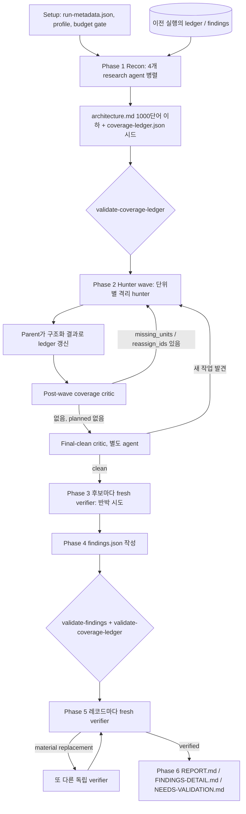

# Cloudflare Security Audit Skill: 핵심 원리 정리

> 원본: [cloudflare/security-audit-skill](https://github.com/cloudflare/security-audit-skill) (MIT) | 정리일: 2026-11-18 | 분석 기준: commit c1c8a8c1471069fb0e188eeaff69b8e8db6564a8 (2026-09-14)

코딩 에이전트용 agent skill이며, Cloudflare가 사내 취약점 탐지 하네스를 만들기 전 출발점으로 삼은 단일 저장소용 감사 절차이다. 이 문서는 설치나 사용법이 아니라 그 안에 담긴 방법론, 데이터 구조, 판정 규칙, 불변 조건을 정리한다. 일반적인 보안 점검 관점은 [security-audit.md](./security-audit.md)를 함께 보면 된다.

## 1. 해결하려는 문제

LLM에게 "보안 감사해 줘"라고 하면 대체로 세 가지 실패가 나온다.

1. **체크리스트 소음**: 쿠키 속성 누락, rate limit 부재 같은 "모범 사례와의 차이"를 취약점으로 보고한다. 실제로 경계를 넘는 피해가 있는지 추적하지 않는다.
2. **확신 과잉과 근거 부족**: crash를 RCE로, 같은 사용자의 자기 피해를 권한 상승으로 부풀린다. 배포 환경(프록시, IdP, 클라우드 정책)을 추측해서 결론을 낸다.
3. **커버리지 착시**: 한 번 훑고 "인증 부분은 검토함"이라고 쓰지만, 어떤 입력면과 경계를 실제로 봤는지 기록이 없다. 원본 README는 "a single run found roughly half of the vulnerabilities that repeated runs found in total"이라고 밝힌다. 즉 한 번의 실행은 본질적으로 불완전하다.

이 스킬은 이 세 문제를 (a) 경계와 결과를 요구하는 판정 기준, (b) 발견자와 검증자를 분리하는 적대적 검증, (c) 결정적(deterministic) coverage ledger와 기계 검증기로 해결한다.

## 2. 핵심 아이디어 요약

- 후보는 "낮은 신뢰 주체, 입력, 의도된 통제, 넘은 경계, 영향받는 주체/자원, 관측된 결과" 여섯 요소를 모두 갖춰야 한다. 하나라도 없으면 취약점이 아니다.
- 결과는 세 가지 verdict로만 남긴다: `confirmed`(완전한 소스 추적 + 로컬에서 관측한 최소 결과), `needs_validation`(정확히 무엇이 미확인인지 명시, severity 없음), `rejected`(반박됨, 재보고 방지용 보존).
- 찾은 에이전트는 절대 스스로 검증하지 않는다. 매 후보마다 새 verifier가 "반박하려고" 다시 읽는다.
- 커버리지는 surface x boundary x subsystem x attack class 단위의 ledger로 셈하고, coverage critic이 빈틈을 찾을 때까지 hunter wave를 반복한다.
- 모든 산출물은 JSON 스키마와 zero-dependency 검증기로 형식과 상태 불변식을 강제한다. 산문 보고서는 검증된 JSON에서 파생될 뿐 판정을 바꾸지 못한다.
- 반복 실행은 누적된다. 이전 ledger와 findings는 우선순위 입력일 뿐 "이미 봤으니 생략"의 근거가 되지 않는다.

## 3. 전체 구조

### 3.1 두 가지 모드

- **Guidance mode(기본)**: 보안 질문, 특정 코드 리뷰, 특정 finding 조사. 필요한 부분만 쓰고 파일을 만들지 않는다.
- **Full audit mode**: 사용자가 명시적으로 코드베이스 감사/펜테스트, "full/comprehensive/end-to-end" 리뷰, 보고서 산출물을 요청할 때만. 6단계 전부 실행. 애매하면 파일을 만들기 전에 질문 하나를 한다.

### 3.2 역할

| 역할 | 성격 | 쓰기 권한 |
|---|---|---|
| Parent | 조율자, 공유 상태의 유일한 writer | `run-metadata.json`, `architecture.md`, `coverage-ledger.json`, `findings.json`, 보고서 3종 |
| `research` agent | 소스 탐색, 사실 검증 (recon, critic, Phase 5 verifier) | 없음, 구조화된 결과만 반환 |
| `general` agent | 폭넓은 조사와 제한된 로컬 실행 (hunter, Phase 3 verifier) | 자기 `agents/<id>/scratch/`만 |

### 3.3 흐름



종료 상태는 정확히 두 가지이다: (a) Phase 6 산출물이 모두 쓰이고 두 검증기가 통과, 또는 (b) `run_status: "incomplete"`와 정확한 사유를 기록하고 보고서에 공백을 공개. "Never stop mid-phase."

## 4. 단계별 알고리즘

### 4.0 Setup과 예산 게이트

- 출력 디렉터리는 대상 저장소 밖(기본 `~/security-audit-skill/<repo-name>/run-<N>`). 저장소 안은 사용자가 지정하고 VCS가 무시하는 경우에만 허용.
- `run-metadata.json` 최소 필드: `run_id`, `repo`, `target`, `source_ref`(커밋 + dirty 여부), `profile`, `scope_paths`, `budget`, `execution_policy: "sandboxed-source-and-local-only"`, 선택한 companion 파일, 이전 실행 경로, 공유 파일 소유자, `run_status: "in_progress"`.
- **예산 = 전 단계 agent 호출 총수.** recon 시작 전에 최소분을 예약할 수 있어야 한다: recon 기본 4회 + critic(quick은 1회, standard/deep은 post-wave 1회 + final-clean 1회) + verifier 최소 1회. 안 되면 agent를 하나도 띄우지 않고 `incomplete_reason: "budget_cannot_fund_reconnaissance_and_reserves"`.
- 소비 순서: critic과 검증 예약을 먼저 떼어놓고(후보당 verifier 1~2개, 불확실하면 critic 예약 후 잔액의 30%), 남은 것으로 hunter를 우선순위대로 배정한다. hunter는 예약분을 절대 침범하지 않는다.
- 다음 wave 전에 post-wave critic을 다시 예약할 수 없으면 그 wave의 planned 단위는 `deferred`(사유 `budget_cannot_reserve_critics_and_validation`). final critic 예약까지 소진되면 `critic_budget_exhausted`. 후보 검증 예산이 모자라면 hunting을 중단하고 fingerprint 순으로 검증, 나머지는 ledger에만 `candidate`로 남기고 `validation_budget_exhausted`. 미검증 후보는 `findings.json`에 어떤 verdict로도 넣지 않는다.

### 4.1 Run profile

| Profile | Ledger 단위 세분도 | Hunter wave | Critic | Verifier |
|---|---|---|---|---|
| `quick` | surface x boundary x attack class로 거칠게. subsystem은 고정값 `profile/quick/all-in-scope-subsystems` | 정확히 1회 | 정확히 1회(최종). 받아들인 신규/재배정은 `deferred`(사유 `quick_profile_final_critic`) | 후보당 1명이 Phase 3과 5를 겸함 |
| `standard`(기본) | 문서 그대로 | clean이 될 때까지 | post-wave + 별도 final-clean | Phase 3, Phase 5 분리 |
| `deep` | subsystem별, lifecycle mode별로 분할 | clean이 될 때까지 | 동일 | 분리 유지 + `prior_covered_same_source` 단위도 독립 2차 패스 |

Scoped run(특정 경로, 서브시스템, companion 영역, 두 ref 간 diff)은 범위 밖을 `out_of_scope`로 기록하며 절대 `covered`로 쓰지 않는다. 핵심 원칙: "Profiles change breadth and redundancy, never the evidence bar." 후보 게이트, 실행 경계, `needs_validation` 규율, 스키마 검증, confirmed의 독립 검증은 어떤 profile에서도 줄이지 않는다.

### 4.2 Phase 1: Reconnaissance

입력: 대상 소스와 로컬 빌드/설정 상태만. 배포 엔드포인트, IdP, 레지스트리, 클라우드 API 접촉 금지. 결과: `architecture.md`, 초기 `coverage-ledger.json`.

병렬 `research` agent 4개(파일을 쓰지 않고 file:line 근거가 붙은 사실만 반환):

| Agent | 맡는 질문 |
|---|---|
| 1a 제품/스택/로컬 운용 | 제품 유형, 사용자/운영자, 언어/프레임워크, 진입점과 서브시스템 경계, 오프라인 실행 가능한 빌드/테스트 명령(실행은 안 함), 비교 대상 소프트웨어, 부족한 툴체인 |
| 1b 주체/권한/통제 | 낮은 신뢰 주체와 설계상 허용 행위, 진입면별 인증, 자원별 인가와 tenant 범위, 프로세스/CI/플러그인/모델-툴 권한, 권한 변화와 폐기/복구/fallback 경로, 소스로 보이는 통제와 배포 사실에 의존하는 통제 구분 |
| 1c 진입면/복사본/sink | HTTP, RPC/메시지, 파일/아카이브, CLI/env/config, 플러그인/CI, 클라우드 이벤트, 모델 컨텍스트/툴 인자, 딥링크/웹뷰, 로컬 IPC 등 모든 입력면과 변환, 파생 복사본, 보안 sink |
| 1d 로컬 실행/배포 가시성 | 샌드박스에서 돌릴 수 있는 작은 오프라인 테스트, 금지 명령(의존성 fetch, publish, 유료 API), 소스로 확인 불가한 배포 통제, 샌드박스와 artifact promotion 통제의 실제 가능 여부 |

예산이 허락하면 별도 배포 모드나 서브시스템용 focused recon을 추가하고, 못 하면 `deferred` 단위로 남겨 공개한다.

`architecture.md`는 약 1,000단어 상한이며 제품/주체/보호 자원, 비교 대상 baseline(심각도 보정용일 뿐 기각 근거 아님, 같은 결함 패턴을 공유하면 오히려 강화 근거), 스택, 진입면과 source-to-sink 경로, 경계별 가장 강한 통제, 시작 경로, 이전 실행 공백, companion 선택 요약을 담는다. 단위별 block 매핑은 ledger에 둔다(상한 유지 + 기계 검사 가능).

Companion 파일 선택 규칙: 언어나 의존성 이름이 보인다는 이유로 고르지 않는다. 그 파일의 "When to use this file"이 설명하는 신뢰 경계를 recon이 실제로 찾았을 때 고른다.

### 4.3 Coverage ledger 구성 알고리즘

1. 입력면, 신뢰 경계, 서브시스템, 적용 가능한 attack class(ordinary 또는 companion)의 의미 있는 조합마다 단위 하나를 만든다. deep은 lifecycle 차원을 추가한다.
2. 각 차원에는 사람용 label과 별도로 `canonical_refs`에 안정적 소스 기반 참조를 둔다. 예: `src/router.ts#POST /users/:id`, `src/authz.ts#requireOwner`, `packages/api`, `ATTACK-CLASSES.md#Access control`. Block 참조는 파일의 굵은 글씨나 제목 텍스트를 그대로 쓴다(HTML anchor나 slug 금지).
3. `coverage_id` 생성: 각 참조는 NFC, 제어/포맷/default-ignorable 문자 없음, 앞뒤 공백 없음. UTF-8 바이트를 RFC 3986 방식으로 percent-encoding(`A-Z a-z 0-9 - . _ ~`만 그대로, 나머지는 대문자 `%HH`). 인코딩된 surface, boundary, subsystem, attack_class를 `::`로 잇고 lifecycle이 있으면 덧붙인다. 즉 손실 없는 가역 ID이다.
4. wave 번호, agent, verdict, severity, 줄 번호는 ID에 절대 넣지 않는다(실행 간 안정성).
5. 배정 전마다 `coverage_id` 사전순 정렬. 중복 ID는 실패, 같은 ID에 다른 의미 필드면 "canonical identity collision"으로 실패하며 절대 병합하지 않는다. 같은 의미 튜플이 다른 참조로 표현돼도 실패한다.

### 4.4 Phase 2: Coverage-led hunting

**배정 우선순위**(예산이 hunter 수를 제한할 때): (1) 비인증/최저 신뢰 입력면 우선, (2) 가장 가치 있는 자원(자격증명, cross-tenant 데이터, 코드 실행, 릴리스 권한)을 지키는 경계, (3) 이전 실행 공백, 재검증 대상, 변경된 소스를 same-source 재검토보다 먼저, (4) 이 유형의 대상에서 역사적으로 confirmed가 나온 class. 동점은 `coverage_id` 사전순(결정성).

**Hunter prompt 구성(순서 고정)**: 2문장 역할 소개 → `architecture.md` 원문 → 배정된 coverage ID와 block map → 선택된 attack-class block 원문 복사(이름만 보내지 않음, companion이면 Core discipline + 해당 class + Universal moves + Validation rules) → 제외된 block과 사유 → 핵심 hunting 방법 + promotion 절차 → 후보 게이트 → 제외 목록(이월된 confirmed는 fingerprint/title/root cause만, 동료 소유 ID) → scratch 경로, agent ID, 결과 계약과 스키마 branch 원문.

**핵심 hunting 방법(요지)**:
- "READ THE CODE AT DEPTH": 입력을 파싱, 신원, 인가, 정규화, 상태, 파생 복사본, 최종 sink까지 따라간다. 형제 경로(legacy, batch, retry, cancel, migration, error)도 읽고, 통제가 "존재하는지"가 아니라 "동등한지"를 비교한다. 한 컴포넌트가 보장하는 것과 다음 컴포넌트가 가정하는 것을 비교한다.
- "WORK FROM A CONCRETE INVARIANT" 6단계: 낮은 신뢰 주체와 시작 능력 → 받아들여진 값/행위/상태 전이/자원 선택자 → 거부/바인딩/격리/제한/폐기해야 할 통제 위치 → 그 결정 이후의 정확한 소스 경로 → 가장 작은 영향(더미 레코드 하나, 잘못된 반환값 등)에서 멈춤 → 불변식을 강제하는 소스 수정과 회귀 케이스.
- "DEPTH BOUND": 배정된 경계에 닿거나 그 경계가 의존하는 경로만 추적하고, 불변식이 어느 쪽으로든 결론나면 즉시 멈추고 기록한다.
- Sad path: absent, empty, zero, negative, max, over-limit, duplicate, mixed encoding, stale, revoked, reordered, concurrent, partially migrated, failed dependency, rollback. 단, 인터페이스가 받아들이는 경우만.
- High/critical 후보가 재사용 가능한 root cause를 드러내면 자기 소유 단위 안에서 lexical/structural/logical 변형을 찾는다. 같은 root cause는 하나로 합치되 변형마다 조건과 영향은 독립적으로 확립한다. 소유 단위 밖이면 `uncovered`로 반환.
- 배포/브라우저/프로바이더/OS/프록시/신원 사실은 소스 밖이면 어느 쪽 증거도 아니다. 결정적이면 `needs_validation`.

**로컬 실행 경계**: 대상 코드 실행은 OS 강제 샌드박스에서만(외부 네트워크 차단, 빈 allowlist 환경, 대상/툴체인 읽기 전용, scratch만 쓰기, 낮은 CPU/메모리/프로세스/파일크기/디스크/시간 제한). 하나라도 없으면 실행하지 않고 그 부재 자체를 `needs_validation` blocker로 남긴다. 허용: 오프라인 빌드, 단위/통합 테스트, 작은 fixture, sanitizer, bounded fuzz, 결정적 동시성 테스트, 렌더링한 정책 평가, mock된 유료 호출. 금지: 라이브 트래픽, 실제 자격증명, 공유 큐/러너/레지스트리, publish, 스트레스 테스트, 최소 결과 이후의 모든 작업.

**Artifact promotion**: scratch 파일은 실행 후에도 "target-controlled"로 간주한다. 신뢰된 parent 측 코드만 사전 선언된 allowlist 파일을 하나씩 옮긴다: 경로 검증(절대경로, `..`, 심링크 거부) → 보관한 디렉터리 descriptor에서 no-follow 상대 탐색 → leaf를 no-follow, nonblocking으로 열기 → `fstat`로 regular file, link count 정확히 1, 파일별/누적 바이트 한도 확인 → 읽는 중에도 한도 재확인 → 복사 후 `fstat` 재확인(identity/type/link/size 변화 시 거부) → 목적지도 no-follow로 걷고 exclusive 생성. 재귀 복사, glob, 아카이브 해제, FIFO/소켓/디바이스/하드링크 파일은 금지. 실패하면 버리고, 결정적 증거였다면 `needs_validation`으로 남긴다.

**Hunter 결과 계약**: JSON 객체 하나, 산문 없음. `units`(배정된 ID마다 정확히 한 번, `disposition`은 `covered|candidate|blocked`), `candidates`(`verdict` 대신 `proposed_verdict`), `hardening`(비-finding 메모), `uncovered`(새 단위가 필요한 경계). 단위 결과의 각 check는 `agent_id`, `reviewed_paths`, `invariant`, `method: source|local`, `result`, `artifact`(source면 null)를 가진다.

**Parent 통합**: 결과를 정확히 하나의 배정 ID에 매핑해 그 단위만 갱신. 중복/누락 ID, 안전하지 않은 agent ID, artifact가 붙은 source check, parent가 승격하지 않은 artifact는 거부. 실패/형식 오류/근거 없는 결론은 단위를 `planned`로 되돌려 재배정. hardening 메모는 의미 필드 밖 bookkeeping 필드에 보관. 후보는 fingerprint, 그다음 root cause로 통합한다: 한 root cause가 여러 진입 경로를 가지면 가장 강한 완전 추적을 가진 후보 하나, 서로 독립인 통제 누락은 별개 fingerprint.

### 4.5 Coverage critic 루프와 종료 조건

각 wave 직후 새 `research` critic 하나가 `architecture.md`, 전체 ledger(block map 포함), 현재 후보 상태, 이전 공백 요약을 받아 소스를 읽는다. 반환 형식:

```json
{"missing_units": [...], "reassign_ids": [...], "resolved_prior_leads": [...], "stop": false}
```

Critic이 찾는 것: 매핑 안 된 진입점, 확인 안 된 평행 경로, 빠진 lifecycle mode, 선택했는데 단위가 없는 companion class, 근거 없는 제외, path/check 없이 닫힌 단위, 어떤 단위도 다루지 않는 이전 `needs_validation`이나 변경 소스 공백. "It proposes coverage, not findings."

종료 로직:
- `stop`은 critic 자신의 의견일 뿐, 루프 조건은 parent가 판단한다.
- 재배정(`reassign_ids`) 시 기존 terminal 상태(`blocked/covered/candidate`)를 `attempts`에 그대로 보관하고 `reassignment_reason`을 붙인다. `wave`를 증가시키고 새 owner에게 빈 증거로 `in_progress`를 준다. 이전 owner의 check와 artifact는 새 시도로 복사하지 않는다.
- standard/deep: post-wave critic이 받아들일 작업을 내지 않고 `planned`도 없으면, 별도 예약된 **다른** final-clean critic을 돌린다. 그것도 작업이 없을 때만 커버리지 완료. 작업을 찾으면 wave, post-wave critic, final-clean을 반복.
- quick: 1 wave + 1 critic으로 끝. critic 제안은 `deferred`로 기록만.
- 시간/자원 조기 종료 시 손대지 않은 단위는 모두 `deferred`, 보고서에 공개. "Never use a silent wave or agent cap as evidence of complete coverage."

### 4.6 Phase 3: 후보 검증(적대적)

모든 고유 후보(이월된 이전 confirmed 포함)를 그것을 사냥하지 않은 새 `general` verifier에게 준다. verifier가 받는 것: 후보, 연결된 단위의 check와 artifact, 필요한 아키텍처 사실, 관련 companion validation block, promotion 절차, 세 verdict 스키마 branch, 같은 fingerprint의 이전 레코드. **다른 verifier의 결론은 받지 않는다.**

프롬프트의 첫 문장: "You did not write this candidate. Try to refute it from repository source and bounded local evidence." 점검 항목: 모든 trace/evidence 파일과 줄 확인(첫 항목이 진짜 낮은 신뢰 진입점, 마지막이 주장된 sink인지) → 경로상 가장 강한 통제 재구성 → confirmed 후보는 최소 결과를 독립 재현 → likelihood/impact/confidence/수정안이 증거에 맞는지 → needs_validation 후보는 blocker가 정말 소스/로컬 밖인지, 소스가 반박하면 reject → fingerprint 유지.

결정 규칙: `needs_validation`에서 `confirmed`로 승격은 완전한 경로와 관측 결과를 독립 확립한 뒤에만. 특정 배포/런타임 사실이 모르는 상태면 confirmed를 `needs_validation`으로 강등. 소스, 로컬 동작, 보이는 통제, 의미 있는 영향 부재, 불가능한 전제 중 하나로 반박되면 `rejected`. 형식 오류나 산문으로 감싼 verifier 결과는 고치지 않고 버리며 예산이 되면 새 verifier로 재실행.

### 4.7 Phase 4: findings.json

fingerprint로 정렬해 세 verdict 레코드를 모두 쓴다. 쓰기 직전 `report-schema.json`을 다시 읽는다(`additionalProperties: false`이므로 hunter wrapper 필드를 들고 오면 실패). 두 검증기 실행 후 모든 오류 수정. "Validator success proves format and ledger consistency only."

### 4.8 Phase 5: 레코드 독립 재검증

최종 `confirmed`와 `needs_validation` 레코드마다 새 `research` verifier를 병렬로. hunter 산문이 아니라 구조화된 레코드를 검증한다. 반환: `{"decision":"verified","fingerprint":...}` 또는 `{"decision":"replace","reason":...,"record":{...}}`.

- confirmed 점검: 경로/줄/scope, 실제 진입 인터페이스와 입력 형태, 조건과 막는 층, 영향받는 주체와 입증된 영향, severity 분리(overall <= impact), 수정안이 신뢰를 옮기기만 하는지 아니면 불변식을 강제하는지.
- needs_validation 점검: 소스 경로가 `claimed_root_cause`만 지지하는지, blocker가 결정적이며 로컬로 이미 답할 수 없는지, 일반적 우려가 아닌 구체적 경계와 결과인지, 검증 계획이 정확한지, fingerprint 일치. "A misleading `needs_validation` handoff wastes owner time and can preserve a false premise."
- **Material replacement**(verdict 강화, root cause/trace/입력/관측 결과/영향/severity 변경)는 바로 적용하지 않는다. hunt, Phase 3, 해당 replacement 제안 어디에도 관여하지 않은 또 다른 verifier가 확인해야 적용한다. 또 material replacement가 나오면 반복. 독립성이나 예산이 없으면 레코드를 `findings.json`에서 빼고 ledger에 미해결 후보로 남기며 run은 incomplete. 단순 문구나 줄 번호 수정은 바로 적용 가능.
- 적용 후마다 두 검증기 재실행. 별개 root cause가 발견되면 새 fingerprint로 Phase 3부터 다시.

### 4.9 Phase 6: 보고서

검증된 레코드, ledger, hardening 메모에서만 파생한다. 산문은 verdict, severity, blocker, 영향을 바꿀 수 없다.

- `REPORT.md`: profile/scope/예산 사용량/source ref/실행 정책/이전 실행 활용, 부분 패스 여부를 명시 → 보안 상태 요약 → confirmed 표 → 각 confirmed 상세 → 별도 NEEDS VALIDATION 표(severity 없음) → hardening과 긍정적 패턴 → ledger 기반 커버리지 집계(covered/candidate/blocked/deferred 수, final critic 결과).
- `FINDINGS-DETAIL.md`: medium 이상 confirmed의 완전한 추적과 대상 고유 인터페이스 재현.
- `NEEDS-VALIDATION.md`: severity 없는 우선순위 리드.
- 대상 중립성: HTTP가 기본이 아니다. 라이브러리는 함수 호출, 파서는 fixture, CLI는 명령, 인프라는 렌더링한 정책으로 재현한다. "A clean run may have zero confirmed records." LOW finding을 지어내지 않는다.

## 5. 데이터 구조

### 5.1 coverage-ledger.json (최상위 JSON 배열, 단위 하나의 필드)

| 필드 | 의미 |
|---|---|
| `coverage_id` | canonical_refs에서 결정적으로 유도한 percent-encoded ID, `::` 구분 |
| `canonical_refs` | `surface`, `boundary`, `subsystem`, `attack_class`(+선택 `lifecycle`)의 안정적 소스 참조 |
| `surface`, `boundary`, `subsystem`, `attack_class`, (`lifecycle`) | 사람용 label. lifecycle과 `canonical_refs.lifecycle`은 함께 있거나 함께 없어야 함 |
| `starting_paths` | 저장소 상대 시작 경로 |
| `ordinary_attack_class_block` | `ATTACK-CLASSES.md#<class>` 또는 null |
| `selected_companion_blocks` | 선택한 companion class + 그 파일의 `Core discipline`, `Universal moves`, `Validation rules` |
| `excluded_blocks` | 검토했지만 제외한 block과 그 근거 소스 사실 |
| `prior_status` | `new`, `none`, `prior_confirmed_same_source`, `prior_confirmed_changed_source`, `prior_needs_validation`, `prior_deferred`, `prior_blocked`, `prior_out_of_scope`, `prior_covered_same_source`, `prior_covered_changed_source`, `prior_rejected_claim_changed` |
| `attempts` | critic이 재오픈한 이전 시도의 append-only 아카이브(wave, status, agent_id, 증거, `reassignment_reason`) |
| `wave` | 현재 시도의 wave 번호 |
| `status` | 아래 상태표 참조 |
| `agent_id` | 배정 owner, `^[a-z0-9][a-z0-9_-]{0,63}$`, Windows 장치명 금지 |
| `reviewed_paths` | 모든 check의 `reviewed_paths` 합집합과 정확히 일치해야 함 |
| `local_checks` | check 목록(각자 `agent_id`, `reviewed_paths`, `invariant`, `method`, `result`, `artifact`) |
| `result_fingerprints` | 연결된 후보 fingerprint |
| `unresolved` | 미해결 사실 또는 보류 사유 |

상태별 불변식:

| Status | `agent_id` | `reviewed_paths` / `local_checks` | `result_fingerprints` | `unresolved` |
|---|---|---|---|---|
| `planned` | null | 비어 있음 | 비어 있음 | 비어 있음 |
| `not_applicable`, `out_of_scope`, `deferred` | null | 비어 있음 | 비어 있음 | 사유 필수 |
| `in_progress` | owner | 비어 있음 | 비어 있음 | 비어 있음 |
| `blocked` | owner | 둘 다 있음(부분 증거) | 비어 있음 | blocker 필수 |
| `covered` | owner | 둘 다 있음 | 비어 있음 | 비어 있음 |
| `candidate` | owner | 둘 다 있음 | 필수 | 선택 |

설계 포인트: "deferred에 부분 증거를 숨기지 않는다", 증거 없이 "covered"가 될 수 없다, fingerprint를 달 수 있는 상태는 `candidate` 하나뿐이다. 단위 owner와 check owner가 분리되어 있어 hunter 증거와 verifier 증거가 한 단위에 공존한다.

### 5.2 findings.json (report-schema.json, 최상위 배열, 각 항목은 `oneOf` 세 branch 중 정확히 하나)

| 필드 | confirmed | needs_validation | rejected | 설명 |
|---|---|---|---|---|
| `verdict` | O | O | O | const 값 |
| `fingerprint` | O | O | O | `^[A-Za-z0-9][A-Za-z0-9._:/@+-]*$`, 소스 유래, 상태 간 불변 |
| `title`, `description` | O | O | O | 보이는 문자 필수(`visibleContent`) |
| `root_cause` | O | X | X | 확정된 근본 원인 |
| `claimed_root_cause` | X | O | O | 주장된(미확정/반박된) 근본 원인 |
| `intended_behavior` | O | X | X | 코드가 지켰어야 할 동작 |
| `trace[]` | O | O | O | `kind`(entrypoint/propagation/sink), `file`, `line`>=1, `scope`, `description` |
| `evidence[]` | O | O | O | `file`, `line`, `description` |
| `conditions[]` | O | X | X | `kind`: authentication_level, authorization_role, user_interaction, system_configuration, network_routing, environmental_dependency, data_state, timing_dependency, third_party_dependency |
| `execution` | O | X | X | `attacker_perspective`, `payloads`(최소 입력), `instructions`, `observed_result`(실제 로컬 출력) |
| `remediation` | O | X | X | `strategy` 필수, 선택 `code_changes[{file_name, fixed_code}]` |
| `severity` | O | X | X | `likelihood{score,reason}`, `impact{score,reason}`, `overall_severity`; 5단계 informational~critical |
| `confidence` | O | X | X | `score` low/medium/high + `reason` |
| `blockers[]` | X | O(1개 이상) | X | 정확히 무엇이 미확인인지 |
| `validation_plan` | X | O | X | `local` 또는 `deployment`(owner가 관찰), 최소 하나 |
| `reason` | X | X | O | 반박 이유 |

## 6. 판정 규칙

### 6.1 세 verdict의 기준

- **confirmed**: 저장소 상대 경로의 완전한 source trace, 가장 강한 소스상 통제까지 포함한 root cause 증거, 샌드박스 로컬에서 관측된 최소 결과, 명시된 경계를 넘는 의미 있는 영향, 완전한 조건, 막는 층이 보이지 않음. 독립 verifier 두 번(quick은 한 번)을 통과.
- **needs_validation**: 소스 근거가 있는 구체적 경계 가설이지만 결정적 사실 하나가 소스/로컬 관측 밖(배포 설정, 프록시, IdP, 브라우저 정책, 서명, 브로커 ACL 등)이거나 샌드박스/promotion 통제가 없어 실행할 수 없는 경우. 정확한 blocker와 해소 계획 필수, severity 없음. "`needs_validation` is never a parking place for a speculative idea." 소스가 반박하는 후보는 needs_validation이 아니라 rejected이다.
- **rejected**: 소스, 로컬 동작, 보이는 통제, 의미 있는 영향 부재, 불가능한 전제로 반박됨. 같은 근거로 반복 보고되지 않도록 보존한다.

### 6.2 Severity = likelihood x impact

- confirmed만 severity를 가진다. likelihood와 impact는 각각 점수와 이유를 갖고, **overall은 입증된 impact를 넘을 수 없다**(검증기가 rank 비교로 강제: informational 0 < low 1 < medium 2 < high 3 < critical 4).
- 기준점:
  - critical: 비인증 행위자가 코드 실행, 데이터 저장소 전체 접근, 임의 계정 탈취.
  - high: 명시적 보안 통제를 완전히 무력화하고 실제 결과가 있음(인증 우회, cross-tenant 읽기/쓰기, 다른 사용자에게 영향 주는 stored script, 인증된 코드 실행, 공유 서비스의 비인증 원격 중단).
  - medium: 피해 범위가 제한되거나 전제가 드물거나 좁은 자원에 국한된 실제 경계 위반.
  - low: 비밀이 아닌 내부 정보 노출, 또는 최소 이득에 지속적 노력이 필요한 효과.
  - informational: 확인됐지만 영향이 최소, 주로 더 큰 finding의 전제 조건.
- High/medium 판별 질문: "does the demonstrated result fully defeat an explicit control for an action with real consequences, or only weaken it?" 구체적 피해를 말할 수 없으면 "the severity is lower than it feels."

### 6.3 취약점이 아닌 것

- 체크리스트 편차, 모범 사례 누락(영향받는 주체/자원 없음) → hardening 메모.
- Defense-in-depth 공백: "If Layer A prevents the attack, the absence of Layer B is a hardening note."
- 같은 주체의 의도된 권한 사용, self-impact, 공격자 자신의 데이터 노출.
- 현실적 비신뢰 입력이 닿지 않는 parser crash나 panic. crash를 코드 실행으로, 평범한 작업을 공유 가용성 피해로 부풀리는 것.
- Prompt injection 그 자체("Prompt injection alone is not a finding"), 가드레일 프롬프트의 부재("A guardrail prompt is not a security boundary").
- 취약/가변 의존성 존재 그 자체, 시크릿 "참조" 그 자체, 레코드의 tenant 필드 존재 그 자체, 요청 자신의 프로세스 안에서 자기 제한되는 작업, rate limit 부재 그 자체, 헤더/쿠키 속성/MFA 프롬프트 누락 그 자체.
- 소스에 없는 배포 동작을 추측해 내린 결론(있다고도 없다고도 가정하지 않음).

### 6.4 안티패턴 10개(원문 요지)

체크리스트 편차를 취약점으로 / 도달 가능한 경계 위반 없는 심층 방어 조언 / 라이브 공유 환경 테스트 / 프로바이더, 프록시, 브라우저, 신원, 배포 동작 추측 / 동일 주체 권한이나 self-impact를 경계 위반으로 / 관측보다 강한 효과 보고 / 중복 제거, 검증 불가한 산문 결과 / 이월된 same-source confirmed 재보고 또는 그것을 예시로 써서 사냥을 고정(anchoring) / needs_validation에 severity / 독립 검증 전 보고서 작성 또는 산문과 JSON 불일치.

## 7. 공격 클래스별 핵심 체크 포인트

### 7.1 Ordinary classes (ATTACK-CLASSES.md)

| Class | 핵심 질문 |
|---|---|
| Injection | 직접 경로뿐 아니라 안전하게 저장된 뒤 다른 코드가 위험한 맥락에서 쓰는 indirect injection, 값이 아닌 필드명/키/헤더/메타데이터, 로그/캐시/검색 인덱스 같은 2차 시스템 |
| Access control | 같은 상태 변화에 더 약한 권한을 검사하는 다른 경로, 요청 본문 필드가 권한 의도를 덮어씀, 인증만 하고 인가를 잊은 엔드포인트, bulk/export/import의 항목별 권한 |
| Resource and file handling | symlink/인코딩/null byte를 통한 path traversal, redirect/DNS rebinding/URL 파서 차이를 통한 SSRF, 역직렬화, zip slip, 파일 TOCTOU |
| Cryptography and secrets | 약한 난수, 하드코딩/로그/URL 노출 시크릿, HMAC 누락, nonce 재사용, 타이밍 비교, ECB/정적 IV, 암호 실패 시 무암호화 fallback |
| Business logic | 상태 기계 건너뛰기/역행/재생, 부분 실패 롤백, check-then-act 경쟁(이중 지불), 음수/0/오버플로/정밀도, 시간 경계와 clock skew, 설정 누락/플래그 off/마이그레이션 중 기본값 |
| Feature abuse and data leakage | export/backup을 통한 유출, import/restore를 통한 주입, 검색/필터/정렬을 존재 oracle로, 오류/시간/크기 차이로 열거, preview 토큰 범위, webhook을 통한 SSRF |
| Chained vulnerabilities | 컴포넌트 A가 보장한 것과 B가 가정한 것의 차이(절단, 타입 변환, 정규화, tenant 범위), 2차 사용(slug가 파일 경로로), 위임/갱신/캐시 후 권한 확대, 롤백/복구 시 현재 권한 미적용 |
| Wildcard | 가장 이상한 코드, 반쯤 만든 기능, 프론트엔드가 절대 보내지 않는 API 호출, 숨겨진 엔드포인트/파라미터, 섞이도록 설계되지 않은 기능 조합, git 히스토리, 테스트가 다루지 않는 것. "If a function has a comment explaining why it is safe, verify the explanation." |
| Obvious things | 하드코딩 시크릿 grep, 보안 관련 TODO/FIXME, 디버그 모드 게이팅, seed 자격증명, 무방비 `/debug` `/admin` `/metrics` `/.env`, 커밋된 키 파일, `eval`/`exec` 동적 입력, CORS 와일드카드 + credentials, 쿠키 속성, open redirect, 스택 트레이스 노출. 단 "A flag is not a finding": 각 항목도 전체 경로와 영향을 추적해야 한다 |

### 7.2 Companion 파일 (각 파일은 When to use / Core discipline / class 묶음 / Universal moves / Validation rules 구조)

| 파일 | 대표 class | Core discipline의 핵심 문장 |
|---|---|---|
| MEMORY-SAFETY-AND-BINARY | OOB, 정수 overflow/절단/부호, 단위 혼동, 미초기화, UAF/double free, 타입 혼동, refcount 경쟁, FFI 길이/소유권 계약, 라이브러리 검색 순서, JIT 일관성, 커널 user-copy 이중 읽기 | 최악의 수용 입력 기준으로 bound와 lifetime 재유도. crash는 현실적 비신뢰 입력이 닿을 때만 결함. 사후 악용 기법 개발 금지. sanitizer가 계측하지 못하는 영역 식별 |
| AI-AND-LLM | 검색 콘텐츠를 통한 간접 주입, cross-session 컨텍스트 누출, 영속 메모리 오염, 툴 인자 주입, confused deputy, 행위 승인 바인딩, 툴 스키마와 dispatcher 불일치, 무한 위임 루프, MCP 신원 혼동, 출력 렌더링 | 모델 출력, 메모리, 툴 설명, MCP 응답은 비신뢰 입력. 인가와 action binding은 별개 통제: 유효한 권한 아래라도 주체가 의도/승인하지 않은 행위면 binding 실패. 메모리 주장은 공격자 쓰기와 이후 cross-principal 읽기 둘 다 인용 |
| WEB-PROTOCOL-AND-AUTH | request smuggling, 캐시 poisoning/deception, Host/Forwarded 신뢰, CSRF, 세션 고정, JWT/OAuth/SAML 바인딩, MFA 다운그레이드, 패스키, 계정 연결, 비밀번호 재설정, API key 범위, mTLS 신원 | framing/캐시 finding은 같은 요청에 대한 두 해석과 양쪽 정규화 값을 명시. 자격증명마다 서명 검증과 issuer, audience, origin, client, session, resource, expiry, one-time 상태 바인딩 확인 |
| CLIENT-SIDE | DOM XSS, DOM clobbering, prototype pollution 가젯, `postMessage` origin 신뢰, CSWSH, credentialed CORS, service worker 범위 탈취, 브라우저 저장소의 stale 인가, XS-Leaks, clickjacking | 제어 가능한 source와 실행/노출 sink를 모두 명시. 영향은 피해자 세션, 다른 origin, 공유 영속 상태에 닿아야 함. self-XSS 제외. 프레임워크 escaping, CSP, COOP 등은 실제 통제 |
| SUPPLY-CHAIN-AND-RELEASE | 의존성 네임스페이스 혼동, 고정되지 않은 빌드 입력, codegen 출처, 특권 워크플로의 비신뢰 코드, 워크플로 표현식 주입, 캐시/artifact 혼합, 빌드에서 promotion 사이 바꿔치기, 업데이트 롤백, 플러그인 신뢰 확장 | "CI configuration is authorization code." 어떤 이벤트가 누구의 코드를 어떤 시크릿으로 돌리는지. 같은 비신뢰 위치에서 받은 checksum은 독립 무결성이 아님 |
| CLOUD-AND-DEPLOYMENT | 워크로드 신원 과다 권한, cross-account role 혼동, 관리 평면 도달성, trusted proxy/mesh 우회, 메타데이터 서비스, 호스트 capability, admission 경로 불일치, 시크릿 노출, signed URL, 이벤트 소스 신원 | manifest만으로 라이브 노출을 추론하지 않음. 넓은 정책은 낮은 신뢰 입력이 비인가 행위에 닿을 때만 finding. 시크릿 참조는 노출이 아님 |
| PROTOCOLS-RPC-AND-MESSAGING | 메시지 경계/정규화 불일치, union/enum 기본값, envelope와 payload 신원 불일치, interceptor와 method 경로 불일치, 스트리밍 항목별 인가, topic 범위, DLQ 노출, 중복 전달/멱등성, ack/commit 순서 | "Internal is not authentication." 스키마 검증은 모양만 증명하지 출처, 권한, 순서는 아님. 파서 불일치는 두 구체적 소비자와 보안상 다른 값 하나가 필요 |
| RESOURCE-EXHAUSTION-AND-AVAILABILITY | 초선형 파싱/정규식, 압축 폭탄, 쿼리 증폭, 무한 버퍼링, 핸들 누수, 취소 후 남는 작업, 인증 전 작업 불균형, quota 범위, worker 고갈, retry storm, poison record | 입력에서 비용으로 가는 경로, 효과적 bound 부재, 타인/공유 서비스/운영자 비용 영향 세 가지 필요. 스트레스 테스트 금지, 점근 분석과 작은 경계 fixture로 증명 |
| DATA-ISOLATION-AND-LIFECYCLE | tenant/owner 강제 누락, 복합키 충돌, 정책과 쿼리 불일치, 검색/캐시 ACL drift, 로그/분석을 대체 reader로, export/backup 범위 확대, restore 권한 확대, soft-delete 우회, 삭제 후 파생 복사본 | "A tenant or owner field on a record is not isolation." 파생 복사본(검색, 캐시, export, 백업)을 추적. 개인정보 선호는 명시적 경계나 삭제 보장이 있을 때만 보안 문제 |
| DESKTOP-MOBILE-AND-LOCAL-IPC | 딥링크 모호성, 계정 handoff, 웹뷰에서 네이티브 브리지, 과도한 브리지 기능, IPC peer 인증, exported component, 특권 helper confused deputy, 설치/업데이트 경로, 로컬 파일 TOCTOU, 로그아웃/계정 전환 누출 | 현실적 공격자(다른 앱, 다른 OS 사용자, 원격 origin)부터 정한다. 경로, 프로세스 이름, bundle ID, 주장된 sender는 peer 인증이 아니다. OS peer credential이나 code identity만 인정 |

공통 Validation rules 패턴: 넘은 경계와 관측 결과를 이름 붙이고, 소스로 보이는 상위 bound나 통제가 막지 않음을 확인하며, 모르는 배포 통제는 `needs_validation`으로 돌린다. Universal moves 예(AI 파일): 실행 신원, 능력, 쓰기 가능한 컨텍스트/메모리, 출력 목적지 네 가지 지도를 먼저 그리고, 부수효과가 있는 툴에서 거꾸로 dispatcher, 스키마, 승인, 컨텍스트, 검색, 수집 순으로 추적하며, 가장 강한 게이트가 "after arguments are final and before every side effect"에 적용되는지 본다.

## 8. 검증기(validators)가 강제하는 불변 조건

두 검증기 모두 Node 내장 모듈만 쓰는 zero-dependency 스크립트이며, 파싱 전 preflight와 파싱 후 양쪽에서 크기 한도를 건다. 오류 출력은 최대 100개, 진단 문자열의 제어 문자는 escape한다(검증기 출력 자체가 프롬프트 주입 경로가 되지 않게 하려는 것으로 보인다 [미확인: 의도는 코드 주석으로 확인하지 않음]).

### 8.1 validate-findings.cjs

- 한도: 입력 5 MiB, 최상위 finding 1,000개(배열 항목 한도), 중첩 64단계, canonical key 1 MiB, 유일성 집합 5 MiB. 반복/순환 객체 참조 거부.
- `report-schema.json`을 직접 해석하는 자체 미니 JSON Schema 엔진(`oneOf` 정확히 하나 매칭, `const`, `enum`, `minItems`, `uniqueItems`, `minLength`(code point 기준), `pattern`, `minimum`, `additionalProperties`, 커스텀 키워드 `visibleContent`).
- `visibleContent`: 공백, 제어, 포맷, default-ignorable 문자만으로 된 문자열 거부. 유효하지 않은 Unicode scalar(고립 surrogate) 거부.
- 의미 검사: fingerprint 중복 금지, 사전순 정렬 강제 / trace와 evidence의 `line`은 양의 정수, `file`은 안전한 저장소 상대 경로(절대경로, 드라이브 문자, `~`, `\`, `:`, `.`/`..`, 끝 공백이나 점, Windows 예약 이름 `con`, `nul`, `com1` 등 거부) / trace 1개면 entrypoint 또는 sink, 여러 개면 처음 entrypoint, 끝 sink, 중간은 propagation / confirmed는 금지 필드(`claimed_root_cause`, `blockers`, `validation_plan`, `reason`) 없음, 보이는 `observed_result`와 remediation 필수, `overall_severity` rank가 impact rank 이하 / needs_validation은 severity 등 금지 필드 없음, 보이는 `local` 또는 `deployment` 계획 최소 하나 / rejected도 금지 필드 검사.

### 8.2 validate-coverage-ledger.cjs

- 한도: 입력 5 MiB, 단위 10,000개, 중첩 컬렉션 1,000 항목, 객체 필드 1,000개, 중첩 64단계, 총 순회 값 500,000개, 텍스트 4,096자. 문서 설명상 5 MiB가 실제로는 2,000~5,000 단위에서 먼저 걸린다.
- 필수 필드 존재, `status`와 `prior_status` 열거값.
- `canonical_refs`의 각 참조가 정규형이며, `coverage_id`가 그것으로부터 다시 계산한 값과 정확히 일치("expected canonical ...").
- 중복 ID("duplicate coverage ID"), 같은 ID에 다른 의미("canonical identity collision with different semantic fields"), 같은 의미 튜플에 다른 ID("semantic tuple already uses coverage ID"), 사전순 정렬.
- 상태표(5.1) 강제: 상태별 배열 비어 있음/필수, owner 유무.
- check 검증: source check는 `artifact: null`, local check는 `agents/<check.agent_id>/artifacts/` 아래 경로여야 함(다른 owner의 artifact 금지), 단위 `reviewed_paths`는 check 경로의 합집합.
- `attempts` 검증: 상태는 `covered|candidate|blocked`만, wave는 엄격 증가하며 현재 wave보다 작음, 시도마다 owner가 새로워야 함("assignment owner must be fresh for each attempt"), 이전 owner의 check가 현재 시도에 섞이면 거부("prior assignment owner evidence must remain in its archived attempt"), 이전 시도의 artifact 재사용 금지.
- agent ID는 소문자 정규식 + Windows 장치명 금지(대소문자 접기 충돌 방지).

요약하면 검증기는 "형식"뿐 아니라 "증거 소유권과 시도 이력의 위조 불가능성"까지 기계적으로 강제한다. 다만 원문 표현대로 통과는 형식과 일관성만 증명하며 판정의 진실성은 증명하지 않는다.

## 9. 반복 실행 시 누적 로직

이전 실행의 `coverage-ledger.json`과 `findings.json`을 모두 읽은 뒤 계획한다. 핵심은 "prior source ref alone is not evidence that a path is unchanged"이다. 커밋이 같다는 것이 아니라 관련 소스를 실제로 비교해야 한다.

| 이전 상태 | 이번 실행에서의 처리 |
|---|---|
| confirmed, 관련 소스와 조건 불변 | 같은 fingerprint로 후보 집합에 이월, `planned` 단위(`prior_confirmed_same_source`)에 연결, 그 root cause만 hunter 제외 목록에. Phase 3 verifier가 그 단위의 owner가 되어 재확인하고 `candidate`로 전환. 최종 검증도 다시 통과해야 함 |
| confirmed, 소스 변경 | `prior_confirmed_changed_source` 재검증 단위 생성. 제외 목록에 넣지 않음. 현재 독립 검증이 재확립할 때만 confirmed 유지 |
| needs_validation, 여전히 외부 사실 대기 | 현재 소스 추적을 확인한 뒤에만 같은 fingerprint로 이월(`prior_needs_validation`), blocker 유지, 최종 검증 포함 |
| deferred, blocked, out_of_scope, 변경 소스 단위 | 범위 안이면 현재 `planned` 작업. 중복 제거나 억제 키로 절대 쓰지 않음 |
| same-source covered | ledger에 계속 보이며 우선순위 정보로만 사용. 재검토 여부는 critic이 판단(deep은 독립 2차 패스) |
| rejected | 변경되지 않은 그 주장만 억제, 단위 커버리지는 억제하지 않음. 증거가 바뀌면 `prior_rejected_claim_changed` |
| 이전 quick 또는 scoped 실행 | 기록된 증거와 공백만 기여, "나머지는 괜찮다"는 함의 없음 |
| 호환되지 않거나 없는 ledger | 빈 커버리지로 취급하지 않고 그 사실을 기록, 최종 커버리지 문장에 명시 |

이월된 confirmed를 hunter에게 예시로 주지 않는 이유는 anchoring 때문이다(안티패턴 8). hunter는 fingerprint, title, root cause만 받아 같은 것을 다시 찾지 않을 뿐이다.

## 10. 설계 판단과 이유

| 판단 | 이유 |
|---|---|
| 발견자와 검증자 분리, verifier끼리도 결론 비공유 | 자기 확증 편향과 집단 동조를 끊는다. 검증 프롬프트가 "반박하라"로 시작해 기본 자세를 회의로 둔다 |
| Phase 3과 Phase 5 이중 검증 | Phase 3은 "후보가 진짜인가", Phase 5는 "최종 레코드가 정확히 기술됐는가"를 본다. 레코드 작성 과정에서 생기는 과장과 오기를 잡는다 |
| Material replacement는 또 다른 독립 verifier | 검증자가 스스로 판정을 강화하면 그것도 검증되지 않은 주장이 되기 때문이다 |
| `needs_validation`을 별도 verdict로, severity 없음 | 불확실성과 우선순위를 섞지 않는다. "low confidence confirmed"라는 중간 상태를 없애 owner의 시간을 정확한 질문 하나에 쓰게 한다 |
| `rejected` 보존 | 다음 실행이 같은 근거 없는 주장을 반복하지 않게 하는 음성 기억 |
| 결정적 coverage ID와 정렬 | 실행 간 비교, 중복 제거, 기계 검증을 가능하게 한다. label이 바뀌어도 ID가 유지된다 |
| Critic은 커버리지만 제안, finding 금지 | 역할 오염 방지. 빈틈 찾기와 취약점 찾기를 섞으면 둘 다 약해진다 |
| post-wave critic과 다른 final-clean critic | 한 critic의 "이제 없다"를 그대로 믿지 않는 이중 확인 |
| 예산에서 critic과 검증을 먼저 예약 | 예산이 모자랄 때 가장 먼저 희생되는 것이 검증이 되는 것을 구조적으로 막는다. 검증 안 된 finding보다 deferred 단위가 낫다 |
| Profile은 폭만 바꾸고 증거 기준은 불변 | 빠른 실행이 "덜 엄격한 실행"으로 변질되는 것을 막는다 |
| 산문 보고서는 JSON에서 파생 | 보고서 작성 단계의 과장이 판정을 바꾸지 못한다 |
| 구조화 결과만 허용, 산문은 버림(수리 금지) | parent가 형식을 고치며 내용을 지어내는 것을 막는다 |
| 소스 밖 배포 사실은 어느 쪽 증거도 아님 | LLM이 가장 쉽게 환각하는 영역(프록시, IdP, 클라우드 정책)을 판정에서 배제 |
| 최소 결과에서 정지, 라이브 금지 | 방어 목적 유지, 공유 환경 피해 방지, 악용 코드 생성 회피 |
| scratch는 target-controlled로 간주 | 감사 대상 코드가 symlink, FIFO, 하드링크로 감사자 호스트를 공격하는 경로 차단 |
| 비교 대상 baseline은 보정용 | "비슷한 제품도 이렇다"는 논리로 실제 finding을 기각하는 것 방지 |
| Companion block 원문을 프롬프트에 복사 | 이름만 주면 모델이 자기 기억으로 내용을 채운다 |

## 11. 내 작업에 가져올 점

- 어떤 LLM 리뷰(보안이 아니어도)에도 "verdict 3분할 + 미확인 사실 명시 + 독립 반박 검증" 구조를 그대로 쓸 수 있다. 특히 `needs_validation`처럼 "무엇을 확인하면 결론이 나는가"를 강제하는 상태가 유용하다.
- 커버리지를 산문이 아니라 ledger로 셈하고, 상태별 불변식(증거 없는 covered 금지)을 작은 스크립트로 검증한다.
- 우선순위와 확실성을 분리하고, severity 상한을 입증된 impact로 묶는다.
- 반복 실행 시 이전 결과는 "우선순위 입력"이지 "생략 근거"가 아니다.

재사용 가능한 프롬프트(단일 LLM 또는 다중 에이전트 어디에나):

```text
You are auditing <target> for security invariant failures. Work source-first and defensively.

PHASE A - MAP. Before hunting, list: principals and their designed authority; entry
surfaces (HTTP, RPC, files, CLI/env, CI, plugins, model context, IPC); trust boundaries
and the strongest source-visible control on each; source-to-sink paths. Cite file:line.
Mark every control that depends on a deployment fact not in source as UNKNOWN.

PHASE B - LEDGER. Build a list of coverage units = surface x boundary x subsystem x
attack class, each with a stable ID derived from source references (no line numbers).
Each unit has status: planned | covered | candidate | blocked | deferred | out_of_scope.
"covered" requires the paths you read and the specific invariant you checked.
"deferred" requires a reason. Never claim coverage you did not record.

PHASE C - HUNT each unit from a concrete invariant:
1. lower-trust principal and starting capability;
2. accepted value / action / state transition / resource selector;
3. the control that should reject, bind, isolate, limit, or revoke it;
4. the exact source path after that decision (include sibling, legacy, batch, retry,
   error, migration paths; compare controls for equivalence, not presence);
5. the smallest concrete effect on another principal or shared resource;
6. the narrowest source fix at the last trusted decision point plus a regression test.
Stop as soon as the invariant is settled either way.

PHASE D - CRITIC. Re-read the ledger and source. List missing units (unmapped entry
points, parallel paths, lifecycle modes, unjustified exclusions, units closed without
evidence). Propose coverage only, not findings. Repeat C and D until a fresh critic
pass finds nothing.

PHASE E - REFUTE. For every candidate, switch stance: "I did not write this. Try to
disprove it." Re-read every cited line, reconstruct the strongest control on the path,
and decide:
- confirmed: complete trace + observed minimal result + real cross-boundary impact +
  no visible preventing layer. Give likelihood, impact, overall (overall <= impact).
- needs_validation: source-grounded but one decisive fact is outside source or cannot be
  observed safely. State the exact blocker and a concrete local or owner-observed check.
  No severity.
- rejected: disproved by source, a visible control, missing impact, or impossible
  prerequisite. Keep it with the reason so it is not re-reported.

NOT FINDINGS: checklist deviations, missing best practice with no affected principal,
defense-in-depth gaps when another layer already prevents the attack, self-impact or
intended same-principal authority, crashes not reachable by realistic untrusted input,
claims that rely on guessed deployment behavior. Never inflate a crash to RCE or a
same-user action to privilege escalation.

SEVERITY anchors: critical = unauthenticated code exec / full data store / arbitrary
account takeover; high = fully defeats an explicit control with real consequences;
medium = real violation with limited blast radius or uncommon preconditions; low =
non-secret disclosure or minimal gain; informational = prerequisite only. If you cannot
state the concrete damage, the severity is lower than it feels.

OUTPUT: one JSON array of records {verdict, fingerprint (stable, source-derived),
title, root_cause|claimed_root_cause, trace[{kind: entrypoint|propagation|sink, file,
line, description}], evidence, conditions, observed_result, remediation, severity,
blockers, validation_plan, reason} using only the fields valid for each verdict,
then a coverage summary (covered / candidate / blocked / deferred counts) that states
plainly what was not reviewed. Zero confirmed findings is a valid result.
```
