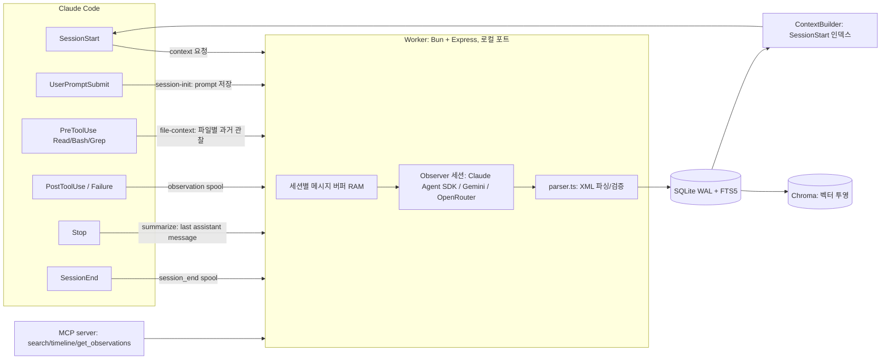

# claude-mem: 핵심 원리 정리

> 원본: [thedotmack/claude-mem](https://github.com/thedotmack/claude-mem) (Apache-2.0) | 정리일: 2026-11-18 | 분석 기준: v16.0.0 / commit cc4dbf5 (HEAD, 2026-11-18)

이 문서는 설치나 사용법이 아니라 설계 원리를 정리한다. 근거는 `src/` 소스(hook handler, `sdk/prompts.ts`, `sdk/parser.ts`, `services/context/*`, `services/worker/search/*`, `services/sqlite/*`, `services/sync/ChromaSync.ts`, `utils/tag-stripping.ts`), `plugin/modes/*.json`, `plugin/hooks/hooks.json`, `plugin/skills/mem-search/SKILL.md`, `docs/` 이다. 코드에서 직접 확인하지 못한 항목은 [미확인]으로 표시한다.

## 1. 해결하려는 문제

- LLM 코딩 에이전트는 세션이 끝나면 모든 맥락을 잃는다. 어제 고친 버그, 내린 결정, 발견한 함정을 다음 세션에서 다시 발견하는 데 토큰과 시간이 든다.
- 원시 도구 호출 로그(Read 결과, Bash 출력)는 한 건이 수천 토큰이라 그대로 저장해서 다시 주입할 수 없다. 한 세션에 PostToolUse가 100회 이상 발생한다.
- "항상 전부 주입"은 컨텍스트를 낭비하고, "필요할 때 RAG로 20건 가져오기"는 관련도가 낮은 청크를 대량으로 끌어온다.
- 에이전트 본인에게 "기억할 것을 스스로 적어라"라고 시키면 작업 흐름이 끊기고 본 작업의 토큰을 쓴다.

풀려는 문제는 세 가지다. 무엇을 기억할지 고르는 일(압축), 다음 세션 시작 때 얼마나 보여줄지 정하는 일(주입), 더 필요할 때 어떻게 싸게 찾을지(검색)이다.

## 2. 핵심 아이디어

1. 관찰자 분리(observer): 작업하는 Claude 세션과 별개로, 도구 호출만 지켜보는 두 번째 LLM 세션(기본 모델 `haiku`)이 백그라운드에서 돈다. 본 세션은 관찰당하는 줄 모른다. 관찰자는 도구 없이 입력된 `<observed_from_primary_session>` 메시지만 보고 XML을 출력한다.
2. 도구 호출을 의미 단위로 압축: 원시 tool I/O는 `<observation>`(type, title, subtitle, facts, narrative, concepts, files)으로 바뀌고, 턴이 끝나면 `<summary>`(request, investigated, learned, completed, next_steps, notes)가 만들어진다.
3. 점진적 공개(progressive disclosure): 시작 시에는 제목만 있는 인덱스(한 줄 약 50~100 토큰)를 주입하고, 필요하면 search, timeline, get_observations 3단계로 세부(약 500~1000 토큰)를 당겨온다. 원시 tool I/O는 4번째 예외 계층(`get_tool_uses`)이다.
4. 길이로 맞추지 않고 측정으로 맞춘다: 주입 블록은 항목 수가 아니라 렌더링 후 문자 수(10,000자 한도)를 재서, 비싼 것부터 버리며 다시 렌더링한다.
5. 훅은 얇게, 일은 worker가: 훅은 stdin 이벤트를 spool/HTTP로 넘기고 즉시 종료한다. 무거운 처리(LLM 호출, SQLite, Chroma)는 상주 worker가 한다.

## 3. 아키텍처



- Plugin hooks: `hooks.json`에 SessionStart(`startup|resume|clear|compact`), UserPromptSubmit, PreToolUse, PostToolUse, PostToolUseFailure, Stop, SubagentStop, SessionEnd, Setup이 등록된다. 각 훅은 `claude-mem hook claude-code <event>` 형태의 shell-free 명령이다.
- Worker: Express HTTP(사용자별 포트) + SSE. 세션별 RAM 버퍼에서 메시지를 꺼내 observer 모델에 보낸다. 제공자는 Claude Agent SDK(기본), Gemini, OpenRouter, Codex 등으로 교체된다.
- 저장: SQLite(`~/.claude-mem/claude-mem.db`, WAL) + FTS5 가상 테이블. 선택적으로 Chroma가 의미 검색용 투영(projection)을 가진다. SQLite가 진실의 원천이고 Chroma는 그 검색 투영이다.
- MCP server: worker HTTP API를 감싸는 얇은 래퍼. 도구는 `search`, `timeline`, `get_observations`, `important_workflow` 4개로, 과거 9개 도구(약 2,500 토큰 정의)를 줄인 결과다.
- 부가: 뷰어 UI, knowledge agent(관찰을 코퍼스로 묶어 질의), 폴더별 CLAUDE.md 생성, 클라우드 동기화, work_state(할 일 목록).

데이터 흐름: `Hook stdin -> worker 버퍼 -> observer LLM -> XML 파싱 -> SQLite(+Chroma) -> 다음 SessionStart 훅이 읽음`.

## 4. 캡처 단계 (hook별 데이터)

| 훅 | 핸들러 | 보내는 데이터 | 동작 특성 |
|---|---|---|---|
| SessionStart | `context` | `session_id`, `cwd`, `source`(startup/resume/clear/compact), `transcript_path` | 동기. `additionalContext`(모델용)와 `systemMessage`(사용자용 배너)를 stdout JSON으로 반환 |
| UserPromptSubmit | `session-init` | 사용자 프롬프트(태그 제거 후), 프로젝트 해석 결과 | 동기, 15초 예산. 세션 row 생성, 프롬프트 번호 증가, raw prompt 저장. 서버 의미 기반 컨텍스트 주입 경로도 있음(`semantic-context`) |
| PreToolUse (Read, Bash, Grep, Glob 등) | `file-context` | 대상 파일 경로 | 해당 파일의 과거 관찰 타임라인을 컨텍스트로 주입. 조건 충족 시 전체 파일 Read를 deny하고 `smart_outline`/`smart_unfold`로 유도(File Read Gate) |
| PostToolUse, PostToolUseFailure | `observation` | `toolName`, `toolInput`, `toolResponse`, `cwd`, `agentId`, `agentType`, `toolUseId`, 훅 시각 | 비동기. 로컬 spool에 쓰고 종료 |
| Stop | `summarize` | `last_assistant_message`(비면 transcript에서 마지막 assistant 턴 추출) | 비동기. 요약 요청을 spool |
| SubagentStop | `subagent-stop` | 서브에이전트 종료 메타 | 메타데이터 이벤트 |
| SessionEnd | `session-end` | (session, platform)만 | Claude Code가 주는 1.5초 예산 안에서 spool만 하고 끝 |

캡처 단계의 방어 규칙은 다음과 같다.

- 훅 핸들러는 순수 함수다. `stdout/stderr/console/process.exit`를 직접 쓰지 않고 `HookResult`만 반환한다. 예외는 호출 측이 잡아 no-op로 응답하며 exit 2를 내지 않는다. 메모리 시스템의 실패가 본 작업을 막지 않는다(fail-open).
- 캡처 제외 규칙: `shouldTrackProject(cwd)`(제외 프로젝트 glob), `CLAUDE_MEM_SKIP_TOOLS`(기본 `ListMcpResourcesTool,SlashCommand,Skill,TodoWrite,AskUserQuestion`), `CLAUDE_MEM_SKIP_BASH_PATTERNS`(정규식), 서브에이전트 관찰 스킵(`SKIP_SUBAGENT_OBSERVATIONS`, `SKIP_AGENT_TYPES`).
- 재귀 방지: `isRecursiveMemoryTool`로 claude-mem 자신의 검색 도구 호출은 관찰하지 않는다. 명시적 저장(`save_memory`)은 receipt만 남기고 두 번째 관찰을 만들지 않는다.
- Stop 재진입 방지: `stop_hook_active`가 true인 Codex 이벤트와 서브에이전트(`agentId` 있음) 컨텍스트에서는 요약하지 않는다.
- 전달 계약: observer 입력은 "라이브 전용, 한 번의 bounded handoff"다. worker가 없으면 이벤트를 건너뛰고(전송 마감 기본 250ms), 쿼터/인증 실패 시 대기 입력을 버린다. RAM 버퍼는 세션당 128건, worker 전체 1,024건, 미전송 입력은 5분 후 만료한다. 문맥 없이 떨어져 나온 입력을 나중에 재생하면 의미와 순서가 어긋나고 사용자가 떠난 뒤 비용만 쓰기 때문이다(`docs/architecture/observer-lifecycle.md`). 이 정책은 2025-12 SQLite 큐, 2026-05 RAM 버퍼, 이후 여러 번의 번복을 거쳐 현재 형태가 됐다.
- 이미지 제거: 관찰자에게 보내기 전에 base64 이미지 블록(Anthropic, MCP, OpenAI 형태, `data:image` URL)을 모양으로 감지해 `{elided, bytes}`로 바꾼다. 도구 이름을 열거하지 않고 블록 모양으로 처리한다.
- 길이 절단: tool input/output 각 필드는 16,000자를 넘으면 앞 60%, 뒤 30%만 남기고 `<elided chars=... />` 마커를 넣는다. 마커가 있으면 "보이는 부분만 설명하고 생략 구간을 추정하지 말라"는 문장을 프롬프트에 붙인다.

## 5. 압축 단계: observer 프롬프트의 핵심 지시와 observation 스키마

### 5.1 프롬프트 조립 순서

`buildInitPrompt`/`buildContinuationPrompt`는 모드에만 의존하는 고정 접두부를 맨 앞에 둔다. 제공자 프롬프트 캐시는 바이트가 동일한 접두부에만 적중하기 때문이다.

1. `system_identity`: 미래 세션을 위한 검색 가능한 메모리를 만드는 관찰 도구. 도구 접근 없음.
2. `observer_role`: 다른 Claude Code 세션을 지금 지켜보는 기록자. 조용히(SILENT BY DESIGN), 접촉 금지(NO CONTACT), 서브에이전트 생성 금지, 일방향 기록자.
3. `spatial_awareness`: 작업 디렉터리로 어느 저장소/경로인지 파악.
4. `recording_focus`, `skip_guidance`
5. XML 출력 골격(`observationSkeleton`)과 `footer`
6. 프롬프트별 가변부: `<session_start_context>`(이어받는 생성일 때 이미 기록한 내용), 사용자 요청 블록(길이 제한), 날짜

### 5.2 지시의 핵심

- 관찰자 자신이 아니라 대상 세션에서 무엇이 배워지고/만들어지고/고쳐지고/배포되고/설정됐는지를 쓴다. "Analyzed ...", "Tracked ..." 같은 관찰 과정 서술은 나쁜 예로 명시한다. 좋은 예는 "Authentication now supports OAuth2 with PKCE flow"처럼 시스템이 이제 무엇을 하는지를 말한다.
- 기록 대상: 시스템이 이제 다르게 하는 것, 사용자/프로덕션에 나간 것, 기술 도메인의 변화, 로그/큐 상태/DB row/코드 경로 점검에서 나온 구체적 디버깅 발견.
- 동사 목록을 준다: implemented, fixed, deployed, configured, migrated, optimized, added, refactored, discovered, confirmed, traced.
- 중복 금지: 이미 이 대화에서 기록한 사실/결정/수정은 표현이 달라도 다시 쓰지 않는다. PR 리뷰 라운드, 재시도, 폴링처럼 같은 결과를 반복 확인하는 루프는 처음 한 번만 기록한다.
- 스킵 대상: 빈 상태 확인, 오류 없는 패키지 설치, 후속 발견 없는 파일 목록, 빈 결과로 끝난 파일 조사. 스킵은 정확히 `<skip_summary reason="noise" />` 한 줄이고, 빈 응답이나 산문 설명은 금지다. 산문 응답은 한 번 재요청한 뒤 버려진다.
- 출력 규율: XML 밖의 모든 출력은 무시된다. 자기 자신이나 자기 행동을 언급하지 않는다. 토큰을 아껴 쓴다.
- 요약(`buildSummaryPrompt`)은 `MODE SWITCH: PROGRESS SUMMARY` 마커로 모드를 바꾼다. 루트 태그는 `<summary>`만 허용하고 `<observation>`이 오면 폐기된다. `next_steps`는 "세션 종료 후 할 일"이 아니라 "지금 진행 중인 궤적"으로 쓰게 한다. 진행 내용이 없으면 `<skip_summary reason="nothing durable" />`.

### 5.3 observation 스키마

```
<observation>
  <type>  bugfix | feature | refactor | change | discovery | decision
          | security_alert | security_note | sensitive   (code 모드 9종, 정확히 하나)
  <title>        핵심 행동/주제의 짧은 제목
  <subtitle>     한 문장 설명 (최대 24단어)
  <facts>        <fact> 여러 개: 대명사 없이 단독으로 읽히는 한 가지 정보, 파일명/함수/값 포함
  <narrative>    전체 맥락: 무엇을, 어떻게 동작, 왜 중요한지
  <concepts>     2~5개, 아래 7개 키워드만(설명/콜론 금지)
                 how-it-works | why-it-exists | what-changed | problem-solution
                 | gotcha | pattern | trade-off
  <files_read> / <files_modified>   프로젝트 루트 기준 전체 경로
</observation>
```

- type과 concept은 서로 다른 축이다. type 값을 concept에 넣지 말라고 명시한다.
- `sensitive`는 비공개는 아니지만 잘못된 맥락에서 이후 콘텐츠로 새면 안 되는 정보(내부 URL, 미공개 계획, 개인 정보, 지표, 고객사 이름)다.
- 모드에 따라 type/concept 목록 자체가 바뀐다(`code`, `law-study`, `email-investigation`, `meme-tokens` 등).

### 5.4 summary 스키마

`request`(사용자 요청과 논의/수행 내용의 본질), `investigated`, `learned`, `completed`, `next_steps`, `notes`. 저장 적격 조건은 `investigated/learned/completed/notes` 중 적어도 하나에 실제 텍스트가 있을 것이다. `request`와 `next_steps`만 있으면 저장하지 않는다. 의미 품질 점수가 아니라 최소 내용 검사다. 주석과 빈 CDATA는 내용으로 치지 않는다.

### 5.5 파서의 방어 (모델 드리프트 대비)

LLM 출력을 신뢰하지 않고 관대한 파서로 복구한다.

- 코드 펜스는 응답 전체가 하나의 펜스일 때만 벗긴다.
- CDATA와 주석 안의 마크업은 오프셋을 유지한 채 마스킹해 필드 경계로 오인하지 않게 한다. 닫히지 않은 `<!--`는 마스킹하지 않는다.
- `<type>`에 stray 태그가 섞이면 첫 `</type>` 전에 마지막으로 열린 `<type>` 값을 채택하고, `</type>` 자체가 없으면 단일 id만 받는다.
- concept에 `gotcha: WASM quirk`처럼 설명이 붙으면 첫 콜론 앞까지만 취하고, observation type과 같은 값은 버린다(주입 쿼리가 정확 일치로 concept을 매칭하기 때문).
- 필드 라벨이 값에 섞인 `[**title**: ...]` 형태는 완전한 형태일 때만 벗긴다.
- 스키마 밖 태그(`<kind>`, `<detail>`)로 드리프트하면 내용을 살려 저장하고, 한 번 `OBSERVATION_SCHEMA_REMINDER`로 스키마를 다시 일러준다.
- 파싱 가능하지만 진행 내용이 없는 summary는 이미 유료 응답이므로 재요청/제공자 전환 없이 그 배치를 종결한다.

### 5.6 관찰자 대화의 생명주기

- 생성(generation)마다 대화 길이 예산(`OBSERVER_MAX_CONVERSATION_CHARS`, 기본 100,000자, 모델 컨텍스트 창의 절반 이하로 보정)을 확인하고, 넘으면 대화를 recycle한다. recycle 후에는 SessionStart와 같은 빌더가 만든 컨텍스트를 `<session_start_context>`로 감싸 "이미 기록한 것이므로 다시 쓰지 말고 이어서 하라"고 알려준다. 같은 렌더러를 쓰므로 표현이 이중화되지 않는다.
- 동시 observer 프로세스는 기본 2개(`MAX_CONCURRENT_AGENTS`). 기본 thinking은 `disabled`, HTTP 제공자 출력 상한은 4096 토큰.
- 유사 중복은 별도 서비스가 다룬다. Tier 0은 정규화한 제목/코드 식별자 일치 시 자동 병합, Tier 1은 IDF 가중 코사인 유사도가 임계 이상이면서 희귀 토큰 차이로 인한 veto가 없을 때 "후보"로만 기록한다(조용한 병합은 안 함). 7,651개 실제 DB에서 simhash(narrative)는 오탐이 많아 폐기했다고 주석에 있다.

## 6. 저장 스키마

핵심 테이블(`SessionStore.ts` 마이그레이션, 스키마 버전은 58 이상):

| 테이블 | 주요 컬럼 | 역할 |
|---|---|---|
| `sdk_sessions` | `id`, `content_session_id`(호스트 세션), `memory_session_id`(관찰자 세션), `project`, `platform_source`, `prompt_counter`, `status`, 시각 | 세션 식별과 두 세션 id의 매핑 |
| `observations` | `id`, `memory_session_id`, `project`, `type`, `title`, `subtitle`, `narrative`, `text`, `facts`(JSON), `concepts`(JSON), `files_read`, `files_modified`, `prompt_number`, `discovery_tokens`, `created_at(_epoch)`, `merged_into_project`, `reinforcement_dates` | 압축된 기억 본체 |
| `session_summaries` | `request`, `investigated`, `learned`, `completed`, `next_steps`, `notes`, `files_read`, `files_edited`, `prompt_number`, 시각 | 턴별 요약(한 세션에 여러 개) |
| `user_prompts` | `session_db_id`, `content_session_id`, `prompt_number`, `prompt_text`, 시각 | 태그 제거 후의 원 프롬프트. 검색은 FTS가 아니라 LIKE |
| `pending_messages` | `message_type`(observation/summarize), `tool_name/input/response`, `cwd`, `last_user_message`, `last_assistant_message`, `status`(pending/processing) | 생성 큐(구버전 SQLite 큐 구조) |
| `tool_uses` | `tool_use_id`, `content_session_id`, `tool_name`, `tool_input`, `tool_response`, `observation_id`, `content_hash` 등 | 원시 tool I/O의 내구 인덱스. `UNIQUE(content_session_id, tool_use_id)`로 재전송이 멱등. 64KB에서 절단하고 `content_hash`는 절단 전 원본 기준 |
| `observation_files` | `(path, observation_id)` | 파일별 관찰 조회(`file-context`가 사용) |
| `token_df`, `dedup_meta`, `observation_dedup_candidates` | project별 df, 후보 쌍과 `method(exact/idf_cosine)`, `score`, `status` | 중복 후보 관리 |
| `advisor_calls`, `sync_*` | 부가 | advisor 도구 호출, 클라우드 동기화 outbox/quarantine |

- FTS5: `observations_fts(title, subtitle, narrative, text, facts, concepts)`, `session_summaries_fts(request, investigated, learned, completed, next_steps, notes)`. external content(`content='observations'`) 방식이고 insert/update/delete 트리거로 동기화한다. update 트리거는 색인 컬럼이 바뀔 때만 발화한다. 부가 컬럼(동기화 리비전, 해시) 갱신이 색인에 delete+insert를 쌓지 않게 하려는 의도다.
- FTS 쿼리는 큰따옴표를 `""`로 이스케이프한다(주입 테스트 332건).
- WAL 모드, 프로젝트 키는 `COLLATE NOCASE` 인덱스, 프로젝트 병합은 `merged_into_project`를 한 홉 따라간다.
- 마이그레이션은 테이블 재작성 시 "알려진 컬럼 목록 + 라이브 컬럼 이관"으로 이후에 추가된 컬럼을 잃지 않는다.

Chroma 투영은 관찰 하나를 다음 조각(fragment) 문서들로 쪼갠다. 메타데이터에는 `sqlite_id`, `doc_type`, `project`, `platform_source`, `created_at_epoch`, `type`, `title`, `concepts`, 파일 목록이 들어간다.

- `obs_{id}_narrative`, `obs_{id}_text`, `obs_{id}_fact_{i}`(fact마다 1문서), 모두 없으면 `obs_{id}_title`
- 요약은 `summary_{id}_{request|investigated|learned|completed|next_steps|notes}`
- 문서 id가 결정적이라 재색인이 멱등이고, 사라진 조각만 삭제하며 남은 조각은 제자리 갱신한다. 임베딩 함수는 기본값(`CHROMA_EMBEDDING_FUNCTION=default`, chroma-mcp 경유)이며 구체 모델은 [미확인].

## 7. 주입 알고리즘 (SessionStart)

목표는 "새 세션이 무엇을 했었는지 한 화면으로 알려주되 10,000자를 넘지 않는 것"이다. Claude Code는 훅 stdout이 10,000자를 넘으면 전체를 디스크로 보내고 약 2KB 스텁으로 바꾸며, 이때 훅은 성공으로 보고돼 조용히 실패한다(#3802, #1899). 그래서 예산 맞추기가 설계의 중심이다.

### 7.1 후보 선택

1. 현재 모드의 type/concept 집합으로 필터한다. 설정(`CONTEXT_OBSERVATION_TYPES/CONCEPTS`)은 모드 목록을 좁힐 수만 있고 넓힐 수 없다. 모드를 바꾼 뒤 남은 낡은 id는 버리고, 하나도 안 남으면 모드 전체를 쓴다.
2. 프로젝트 범위: 기본 `current`(이 체크아웃만), `all`이면 전 프로젝트. 키마다 `project`와 `merged_into_project`에서 각 최신 N개를 인덱스로 뽑고 합쳐 최신 N개만 남긴다(전체 정렬 회피).
3. `mainAgentOnly` 기본 true로 서브에이전트 행을 제외한다.
4. 기본 개수는 관찰 50개(`CONTEXT_OBSERVATIONS`), 요약 세션 10개(`SESSION_COUNT`).
5. 선택적 강화 랭킹(`REINFORCE_ALPHA > 0`, 기본 0=끔): ACT-R 기저 활성도
   `score = ln(1 + age_created^-d + ALPHA * sum(age_reinforcement^-d))`, `d=0.5`. 나이는 일 단위이고 최소 1일. 재확인된 날짜는 observation당 최근 10개만 FIFO로 보관하고 같은 날 중복은 무시한다. 후보 풀은 개수의 5배(상한 500)로 넓히되, 최신 `ceil(count/4)`개는 무조건 유지하고 나머지 슬롯만 점수순으로 채운 뒤 다시 최신순으로 정렬한다. 최신 머리를 보호하는 이유는 "마지막 요약이 최신 관찰보다 새로운가" 검사와 이전 세션 조회가 최신 행에 의존하기 때문이다. 임베딩 없이 날짜 리스트만으로 동작한다.

### 7.2 포맷 (에이전트용)

```
Rules + Tools 포인터 한 줄 (규칙은 별도 파일에 두고 한 줄로 가리킴)

### 2026-11-17            (일자별 그룹, 오래된 것부터, 최신이 맨 아래)
<id> <time> <icon> <title>      (같은 시각이면 time은 " 로 생략)
S<id> <request> (<시각>)         (세션 요약 행)
**Previously** ... A: <지난 세션 마지막 assistant 메시지>   (옵션)
```

- 타임라인은 최신 항목에서 끝나고 뒤에 푸터가 없다. 이후 갱신이 행을 덧붙일 수 있게 하기 위해서다.
- 사용 규칙(타임라인 읽는 법, 범례, 도구 사용 지침)은 본문이 아니라 별도 파일(`Rules + Tools`)에 두고 포인터 한 줄만 싣는다. 본문 토큰을 아낀다.
- 선택 옵션: 전체 항목으로 펼칠 관찰 수(`FULL_COUNT`, 기본 0이라 제목 행만), 펼칠 때의 필드(`FULL_FIELD`: narrative 또는 facts), 읽기/작업 토큰 표시(`~Nt`, discovery tokens).
- 토큰 경제 계산: 읽기 토큰 = `ceil((title+subtitle+narrative+facts 문자 수)/4)`, 작업(발견) 토큰 = 저장된 `discovery_tokens`, 절감 = 발견 - 읽기. `discovery_tokens`의 정확한 산출 방식은 [미확인].

### 7.3 예산 맞추기 (`fitContextToBudget`)

```
text = render(관찰, config)
while len(text) > limit:           # limit = 10,000 - 배너 예약(512) - 기타 알림
    아래 순서로 가장 싼 손실부터 한 단계 적용 후 재렌더
      1. 전체 서술(fullObservationCount)을 0으로
      2. 마지막 세션 요약 블록 제거
      3. 이전 세션의 마지막 응답("Previously") 제거
      4. 요약 세션 수 절반으로
      5. 관찰 수 절반으로 (최소 1개)
    마지막 단계가 개수 감소였다면 이분 탐색으로 "들어가는 최대 개수"까지 되돌려 확장
```

- 항목을 반으로 자르지 않고 통째로만 버려 블록이 항상 온전하다. 헤더와 관찰 최소 1개는 보존된다.
- 왜 개수가 아니라 측정인가: 관찰 제목은 150~320자, 요약 행은 250~600자, 마지막 세션 요약 블록은 1~5K로 크기 편차가 크다. 조용한 프로젝트에 안전한 개수는 예산을 낭비하고, 바쁜 프로젝트에서는 넘친다.
- 렌더 함수는 순수해야 한다. 건강 경고도 렌더 안에 포함해 측정한다. 나중에 덧붙이면 9,998자로 맞춘 블록이 넘친다.
- 건강 경고 배너는 observer 자신이 읽는 컨텍스트에는 넣지 않는다. 경고 끝의 "사용자에게 알려라"라는 지시를 관찰자가 따라 산문으로 답하고, 파싱 실패가 계속돼 배너가 스스로 유지되는 장애가 있었다(#4221).
- 캐시: 헤더 시각을 플레이스홀더로 두고 읽는 시점에 채워 블록을 캐시할 수 있다. 캐시 가능한 블록에는 이전 응답을 넣지 않는다(다른 세션이 읽을 수 있으므로).

### 7.4 PreToolUse file-context

- 1,500바이트 미만 파일은 타임라인도 deny도 하지 않는다(읽는 비용이 비슷하므로).
- 파일 수정 시각이 가장 최근 관찰보다 새로우면 과거 기록은 맥락으로만 주고 deny하지 않는다.
- File Read Gate는 전체 파일 Read이면서 작업 영역 안이고 smart tool이 파싱 가능할 때만 deny한다. 부분 Read(offset/limit)는 항상 통과시킨다(Edit의 read-before-edit 규칙 때문). 평가에서 19KB 파일은 Sonnet -6%, Opus +20%로 이득이 일정하지 않았다고 주석에 남겨 두었다. 게이트의 효용은 모델과 파일 크기에 의존한다.
- 실패는 항상 fail-open이다. stat이 실패하거나 tree-sitter 바이너리가 없으면 Read를 막지 않는다.

## 8. 검색 알고리즘 3단계

### 8.1 계층 구조 (mem-search skill / MCP)

```
Step 1  search(query, project, type, obs_type, dateStart, dateEnd, limit=20, offset, orderBy)
        -> ID, 시간, 타입 아이콘, 제목, 읽기 토큰의 표 (결과당 50~100 토큰)
        -> 일자 헤더(### date)로 묶되 그룹 순서는 관련도 순서
Step 2  timeline(anchor=ID | query, depth_before, depth_after, project)
        -> 앵커 앞뒤 관찰/요약/프롬프트를 시간순으로 인터리브 (기본 각 5, 최대 20)
Step 3  get_observations(ids=[...])   2개 이상이면 반드시 배치
        -> 전체 객체(title, subtitle, narrative, facts, concepts, files)
(예외) get_tool_uses(ids)  원시 tool_input/response. Step 3로 부족할 때만
```

- 지침의 핵심: "필터링 전에는 세부를 가져오지 않는다." 인덱스 행은 레코드의 약 1/10 크기이므로 필터링이 줄이는 것은 레코드 크기가 아니라 가져올 레코드 수다. 문서도 이 비율은 크기 비율이지 측정된 end-to-end 절감이 아니라고 스스로 정정해 두었다(#4138).
- 도구 설계로 규율을 강제한다. `important_workflow`는 항상 보이는 도구이고, 세부 조회는 ID를 먼저 받아야만 가능하다. 도구 수를 9개에서 4개로 줄이고 스키마는 `additionalProperties: true`로 느슨하게 두어 정의 토큰을 아꼈다.
- `dumb_search`는 제목이 쿼리 단어를 가장 많이 공유하는 레코드를 골라 근처 맥락을 붙여 최대 3~5건을 한 번에 반환하는 단축 경로다. 무관한 프로젝트의 단어 일치가 밀려들 수 있고 상충하는 기록을 조정하지 않아 기본값이 아니다.

### 8.2 worker 내부: SearchOrchestrator

실제 구현은 "FTS5와 Chroma의 점수를 섞는 하이브리드"가 아니라 "경로 선택 + 폴백 + 보충"이다. 점수 융합(RRF 등)은 코드에서 확인되지 않았다.

1. 쿼리 없이 필터만 있으면 SQLite(FTS/메타데이터)만 쓴다. 쿼리도 필터도 없으면 400으로 거절한다(조용한 0건 성공 방지).
2. 쿼리가 있고 Chroma가 켜져 있으면 의미 검색이 주 경로다.
   - 전체 문서 타입(observation, session_summary, user_prompt)에 대해 하나의 top-N 질의를 하고, 후보 수는 100에서 시작해 부족하면 두 배씩 늘려 최대 1,600(요구량이 더 크면 그 값)까지 간다.
   - 결과의 조각 문서를 `sqlite_id`로 모아 SQLite에서 행을 hydrate하며, 이때 프로젝트/타입/개념/파일 필터와 날짜 창을 현재 행 기준으로 다시 적용한다(동기화 지연으로 Chroma 메타데이터가 낡았을 수 있어서).
   - 날짜가 없는 의미 검색에는 암묵적 최근성 창 90일(`SEARCH_RECENCY_DAYS`, 0이면 끔)이 적용된다. 명시적 `dateRange`가 우선한다.
   - 정렬은 `relevance`일 때 Chroma 순위를 유지하고, 아니면 날짜순(기본 `date_desc`)이다.
3. 보충 정책 `supplementEmptyCategories`: 요청한 카테고리가 모두 비면 SQLite 전체로 폴백한다(CJK 쿼리에서 프롬프트가 관찰을 밀어내는 경우, 날짜/타입 필터가 모든 히트를 떨어뜨리는 경우가 사례). 일부만 비면 빈 카테고리만 SQLite로 채우고 나머지는 Chroma 결과를 유지한다. 폴백 쪽에는 90일 창을 적용하지 않는다. 오래된 정확 키워드 일치를 살리기 위해서다.
4. Chroma가 꺼져 있으면(`CHROMA_ENABLED=false`) 전부 SQLite/FTS5로 답한다. 빈 결과를 "일치 없음"으로 오해하게 두지 않는다.
5. `findByFile`(HybridSearchStrategy): 파일 경로로 SQLite 메타데이터가 후보 id를 정하고, Chroma는 순위만 매긴다. 순위 목록과 메타데이터 후보의 교집합을 Chroma 순서로 앞에 두고, 순위에 없는 후보를 뒤에 덧붙인다. 날짜순 요청이면 Chroma를 부르지 않는다.
6. SQLite 경로의 FTS5 질의는 `MATCH` + `ORDER BY rank`(BM25)이고 쿼리는 엄격하게 따옴표 처리한다. CJK/혼합 쿼리용 부분 문자열 헬퍼가 따로 있다.
7. 옵트인 deep 검색(ADR 2026-10-29): 첫 페이지의 관찰 검색이 성공했지만 비었을 때만, 별도 FTS 인덱스를 가진 원시 `tool_uses`를 검색해 발췌를 낸다. 인덱스는 기본 꺼짐이고 64행 단위 트랜잭션으로 백그라운드 구축하며 별도 프로세스에서 질의해 일반 컨텍스트 리더를 점유하지 않는다.

## 9. 모드와 프라이버시 처리

### 9.1 모드 (`plugin/modes/*.json`)

모드는 observer 프롬프트의 부품 조립표다. 구조는 `observation_types`, `observation_concepts`, `prompts` 키(`system_identity`, `observer_role`, `spatial_awareness`, `recording_focus`, `skip_guidance`, `type_guidance`, `concept_guidance`, `field_guidance`, `output_format_header`, `footer`, 각종 `xml_*_placeholder`, 요약 관련 키 등)다. 필수 프롬프트 키가 비면 모드 로드 시 에러다.

| 모드 | 차이 |
|---|---|
| `code` | 기준 모드. 9종 type, 7종 concept, 전체 프롬프트 세트. 기록 범위가 넓다(점진적 단계도 기록, 반복 확인만 스킵) |
| `code--chill` | 파일에는 `name`과 두 개의 프롬프트(`recording_focus`, `skip_guidance`)만 있다. 나머지는 상위 모드에서 상속하는 구조로 보인다 [병합 로직은 ModeManager를 읽지 않아 미확인]. 내용은 "다시 발견하기 고통스러운 것만"으로 좁힌다: 출시된 기능/수정, 아키텍처 결정과 근거, 비자명한 함정, 구조를 바꾸는 리팩터. 점진적 단계는 최종 결과만, 코드나 git 이력에서 자명한 것은 스킵. 스킵 지침이 "BE LIBERAL, 의심되면 스킵, 적을수록 좋다" |
| `code--ko` (및 다른 언어 모드) | 로직과 지시는 동일하고 `xml_*_placeholder`(제목, 부제, fact, narrative, 요약 각 필드)를 해당 언어로 바꾸고 `footer` 끝에 `LANGUAGE REQUIREMENTS: Please write the observation data in 한국어`를 추가한다. XML 태그와 type/concept 키워드는 영어 그대로여서 파서와 필터가 언어와 무관하게 동작한다 |
| `law-study`, `email-investigation`, `meme-tokens` | 다른 도메인용 type/concept 세트와 기록 지침 |

기록 기준(`recording_focus`/`skip_guidance`), 출력 모양(스키마 골격), 언어(placeholder)가 독립된 축으로 분리돼 있다는 점이 설계 포인트다.

### 9.2 프라이버시

- `<private>` 태그: 사용자가 프롬프트나 도구 출력에 `<private>...</private>`를 쓰면 저장 전에 그 구간이 제거된다. 제거 대상 태그는 `private`, `claude-mem-context`, `system_instruction`, `system-instruction`, `persisted-output`, `system-reminder`다.
- `claude-mem-context`를 지우는 이유는 주입된 기억이 다시 관찰되어 기억이 기억을 낳는 되먹임을 막기 위해서로 보인다 [의도는 코드 구조에서 추정].
- 제거 알고리즘(`stripBalancedMemoryTags`)은 선형 스캔이다. 열기 태그는 `<name`부터 첫 `>`까지이며 속성 텍스트 안의 `</private>`는 닫기로 보지 않는다. 닫기 태그는 같은 이름의 가장 이른 미닫힌 열기와 짝지어 그 사이 전체를 제거하므로(최대 제거) 중첩이나 잘못된 중첩 순서로 비공개 내용을 보존할 수 없다. 닫기가 없는 `<private>`는 본문의 일반 문장("how <private> works")으로 보고 건드리지 않는다. 정규식 대신 인덱스 스캔을 쓴 이유는 닫히지 않은 태그 입력에서 이차 시간이 되는 문제 때문이다.
- 이 함수가 모든 캡처 경로(도구 입출력, 프롬프트, assistant 메시지, 서버 이벤트)의 단일 관문이며, 같은 지점에서 옵트인 비밀 마스킹(`CLAUDE_MEM_REDACT_*`)도 한다.
- 프롬프트 전체가 비공개라 제거 후 빈 문자열이면 그 턴의 관찰, 요약, 산출물 기록을 모두 건너뛴다. 반대로 `user_prompts` 행이 아예 없는 경우는 비공개 신호가 아니다. 훅이 worker 부팅과 경합한 것이므로 경고만 하고 기록은 진행한다(이를 비공개로 취급하면 세션 전체 관찰이 얼어붙던 버그 #2794).
- 호스트 내부 프롬프트 필터: Codex 앱의 제목 생성/메모리 통합/제안 프롬프트, Grok Bot 조사 하위 브리핑은 첫 줄 패턴으로 식별해 세션 생성과 관찰자 토큰 소비를 막는다. 해당 플랫폼에서만 적용한다.
- 저장은 로컬(`~/.claude-mem`)이 기본이다. 외부로 나가는 데이터는 사실상 observer 제공자(Anthropic, Gemini, OpenRouter)로 가는 압축 대상 입력이므로, 그 양을 줄이는 `<private>`와 SKIP 설정이 실질적 통제 수단이다.

## 10. 설계 판단과 이유

1. 작업자와 기록자를 분리한다. 작업 에이전트가 직접 메모하게 하면 본 작업의 흐름과 토큰이 소모되고 기록 품질이 들쑥날쑥하다. 별도 모델이 저비용(haiku)으로 일방향 기록하면 두 부담이 분리된다. 관찰 사실을 대상 세션이 모르게 하는 것(SILENT BY DESIGN)도 관찰 대상 행동이 바뀌지 않게 하려는 의도다.
2. 구조화 필드 + 짧은 facts. 검색은 title/subtitle/narrative/facts/concepts에서, 주입은 title만 쓰며, facts는 "대명사 없이 단독으로 읽히는 한 문장"이어야 한다. 조각 단위 임베딩(fact 하나가 문서 하나)에서도 의미가 완결되기 때문이다.
3. type과 concept을 닫힌 어휘로 고정한다. 주입 필터가 정확 일치 SQL(`json_each ... value IN (...)`)이므로 자유 텍스트를 허용하면 조용히 필터에서 탈락한다. 파서가 콜론 뒤를 자르고 type 값을 제거하는 이유다.
4. 주입은 인덱스만, 세부는 요청 시. 타임라인에 제목 행만 두면 한 줄이 짧아 더 많은 날의 맥락을 담을 수 있다. 세부는 필요할 때 ID로 당긴다. 점진적 공개를 에이전트의 기억력에 맡기지 않고 도구 설계 자체로 강제한다.
5. 예산은 측정으로, 손실은 싼 것부터. 전체 서술, 요약 블록, 이전 응답이 가장 크고 제목은 가장 작은 단위라 서술부터 버린다. 정보 가치당 비용이 높은 것부터 내려놓는 탐욕 전략이다.
6. 검색은 의미 우선 + SQLite 폴백. 의미 검색은 표현이 달라도 찾지만 빈 결과, 날짜 필터, CJK에서 실패하므로 키워드 경로가 반드시 보강한다. 두 점수를 섞지 않고 "카테고리별로 비면 채운다"는 단순 규칙을 택해 설명 가능성을 확보했다.
7. 라이브 전용 처리, 재생 금지. 오래된 입력을 나중에 몰아서 관찰하면 문맥이 사라져 의미가 틀리고 비용이 튄다. 실패하면 구멍으로 남기되 원본 transcript와 `tool_uses`가 증거로 남는다. 이 결정은 쿼터 폭주 사고를 거치며 여러 번 번복된 끝에 확정된 것이다.
8. fail-open과 짧은 훅. 메모리 계층의 어떤 실패도 본 세션을 막지 않는다. 훅 예산(SessionEnd 1.5초, UserPromptSubmit 15초)에 맞춰 훅은 spool만 한다.
9. 강화(reinforcement) 랭킹은 옵트인. 최신 N개 정책을 기본으로 두고, 재확인된 오래된 지식을 끌어올리는 ACT-R 점수는 끈 채로 출시한다. 최신 머리 1/4를 고정해 다른 로직(마지막 요약의 신선도 판단)을 깨지 않는다.
10. 이미 한 말을 다시 하지 않기. 프롬프트에 "이미 기록했으면 스킵", recycle 시 기존 컨텍스트 첨부, 사후 중복 후보 탐지(조용한 병합 금지)의 3겹으로 중복을 줄인다.

## 11. 내 작업에 가져올 점

### 11.1 핵심 교훈

- 기록(쓰기)과 주입(읽기)과 검색(찾기)을 분리해서 설계한다. 각각 예산과 실패 방식이 다르다.
- "얼마나 넣을지"는 개수가 아니라 렌더링한 길이로 정한다. 한도를 넘기면 호스트가 조용히 전부 버리는 경우가 있으므로 반드시 한도 아래에서 멈춘다.
- 시작 시 주입은 제목 한 줄 인덱스, 상세는 ID로 요청. 도구/절차에서 "필터 전에는 상세 금지"를 못 박는다.
- 프라이버시는 한 관문에서만 처리한다(캡처 직전 단일 함수).
- 모델 출력은 닫힌 어휘 + 관대한 파서 + 한 번 재요청으로 다룬다.

### 11.2 CLAUDE.md + hooks로 가벼운 기억 루프를 만든다면 (설계 스케치)

claude-mem 전체(worker, SQLite, Chroma)는 무겁다. 핵심만 남긴 최소 루프는 다음 구성이다.

```text
기록   Stop 훅(비동기): 이번 턴의 마지막 assistant 메시지 + 변경 파일 목록을
       저비용 모델에 보내 observation 1~3건(JSONL 한 줄씩)을 만들어 memory/obs.jsonl에 append.
       SKIP이면 아무것도 쓰지 않는다.
주입   SessionStart 훅: obs.jsonl에서 현재 프로젝트의 최신 N건을 읽어
       "ID 시각 타입 제목" 한 줄 표로 렌더링, 길이가 8,000자를 넘으면
       상세, 오래된 것 순으로 통째로 버린다. 결과를 additionalContext로 출력.
검색   CLAUDE.md에 한 줄 규칙: "과거 작업이 궁금하면 memory/obs.jsonl을 grep으로
       제목 검색 후 해당 ID의 상세만 읽어라. 전체 파일을 읽지 마라."
프라이버시  기록 전에 <private>...</private> 구간 제거(닫힌 쌍만), 비밀 패턴 마스킹.
```

- 임베딩 없이도 `grep` + 날짜 정렬 + 제목 위주 인덱스로 대부분의 효과를 얻는다. 규모가 커지면 SQLite FTS5만 추가하고 벡터는 마지막에 고려한다.
- 같은 사실이 반복 기록되지 않도록 기록용 프롬프트에 "이미 인덱스에 있으면 스킵"을 넣고, 기록 전에 최근 인덱스 제목 10개를 프롬프트에 함께 넘긴다.

### 11.3 재사용 가능한 observer 스타일 프롬프트

```text
You are a memory observer. You watch ONE finished turn of a coding session and write
durable notes for FUTURE sessions. You have no tools. You are not the one doing the work.

Record what was LEARNED / BUILT / FIXED / DEPLOYED / CONFIGURED, not what you are doing.
Good: "Auth tokens now expire after 24h (compliance requirement)".
Bad:  "Analyzed the auth code and recorded findings".

Record only durable signal:
- what the system now does differently
- decisions with their rationale
- non-obvious gotchas that would be painful to rediscover
- concrete findings from logs, DB rows, or code-path inspection
Skip: empty status checks, installs without errors, directory listings, searches that found nothing,
routine edits obvious from git history, and anything already in <existing_index>.
Record a repeated confirmation of the same fact ONCE.

If nothing qualifies, reply exactly: <skip reason="noise" />

Otherwise reply with 1-3 blocks and nothing else (no prose outside XML):
<observation>
  <type>bugfix|feature|refactor|change|discovery|decision|security_note|sensitive</type>
  <title>short action/topic</title>
  <subtitle>one sentence, max 24 words</subtitle>
  <facts><fact>self-contained, no pronouns, include file/function/value</fact></facts>
  <narrative>what was done, how it works, why it matters</narrative>
  <concepts><concept>how-it-works|why-it-exists|what-changed|problem-solution|gotcha|pattern|trade-off</concept></concepts>
  <files_read><file>path/from/repo/root</file></files_read>
  <files_modified><file>path/from/repo/root</file></files_modified>
</observation>
Rules: concepts are 2-5 bare keywords, never the type, never a sentence.
If a field in the input shows <elided .../>, describe only the visible part.
Never mention yourself.

<existing_index>
{recent index titles, 10 lines}
</existing_index>
<turn>
  <user_request>{request}</user_request>
  <tool_calls>{tool name, input, output; each field head/tail-truncated to 4-8K chars}</tool_calls>
  <last_assistant_message>{last reply}</last_assistant_message>
</turn>
```

### 11.4 체크리스트

- 호스트의 훅 출력 한도(예: 10,000자)를 확인하고 그 아래에서 멈추는 로직이 있는가.
- 훅이 실패해도 본 세션이 계속되는가(fail-open, exit 2 금지).
- 기억이 다시 관찰되는 되먹임(주입된 컨텍스트 태그를 캡처 때 제거)을 막았는가.
- 타입/개념이 닫힌 어휘이고 파서가 드리프트를 복구하는가.
- 오래된 입력을 나중에 재생하지 않는 정책이 명시돼 있는가.
- 검색이 빈 결과일 때 대체 경로가 있는가.
- 언어 설정은 필드 라벨(XML 태그)이 아니라 값에만 적용하는가.

### 11.5 확인하지 못한 점

- observer SDK 세션의 resume/fork 세부와 `memory_session_id` 확정 시점은 `ClaudeProvider.ts`(약 75KB)를 읽지 않아 [미확인].
- 모드 상속(`code--chill`이 `code`를 어떻게 병합하는지)은 `ModeManager.ts`를 읽지 않아 [미확인].
- `discovery_tokens`의 정확한 산정식, Chroma의 기본 임베딩 모델, `REDACTION_MARKER_HINT` 본문은 [미확인].
- 레포가 매우 빠르게 변하므로(변경 로그 650KB) 위 상수(예: 50개, 10개, 90일, 100,000자)는 v16.0.0 기준 기본값이다.
