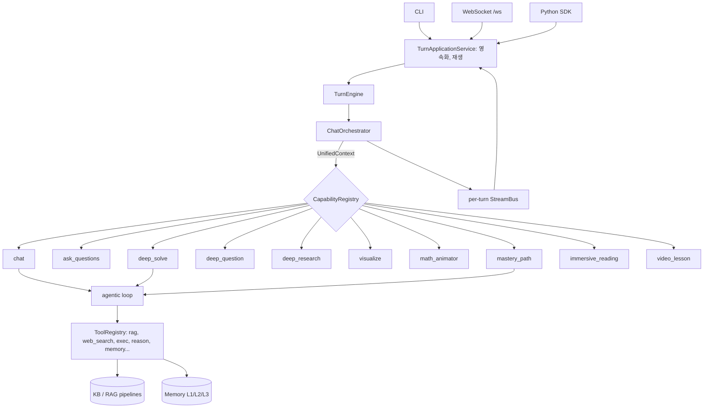

# DeepTutor: 핵심 원리 정리

> 원본: [HKUDS/DeepTutor](https://github.com/HKUDS/DeepTutor) (Apache-2.0) | 정리일: 2026-11-18 | 분석 기준: 4c1e000 (4c1e000d8563c5ac3b231baaaf149dc4dc4d2406)

설치와 실행 방법은 다루지 않는다. `deeptutor/` 소스(`runtime/agentic`, `capabilities`, `agents`, `services/memory`, `services/rag`, `learning`)와 `AGENTS.md`에서 읽은 구조와 알고리즘만 정리한다. 직접 읽지 못한 부분은 [미확인]으로 표시한다.

중요한 주의: 예전 문서나 홍보 글에 나오는 "planner / investigator / solver / verifier" 다단계 파이프라인은 현재 소스에 없다. `deep_solve`는 별도 파이프라인이 아니라 chat 에이전트 루프에 solve 전용 도구 3개를 얹은 형태로 바뀌어 있다(`capabilities/solve/capability.py` 독스트링: "There is no bespoke pipeline anymore").

## 1. 해결하려는 문제

- 학습 보조 에이전트는 한 번의 질의응답이 아니라 "풀이, 조사, 출제, 시각화, 장기 학습 경로"처럼 성격이 다른 작업을 한 앱 안에서 해야 한다. 작업마다 단계 구조가 다르지만 스트리밍, 도구, 비용 집계, 재시도는 공통으로 쓰고 싶다.
- 학습자의 과거 활동(대화, 노트, 퀴즈, 문서, 책)을 기억해 개인화하되, LLM이 기억을 과장하거나 지어내지 않게(근거 없는 단정) 통제해야 한다.
- 학습 진도는 LLM의 인상이 아니라 "증거로 계산되는 숙달(mastery)"에 근거해야 하고, 복습 시점은 망각 모델로 정해야 한다.
- 지식 베이스(KB) 기반 RAG는 임베딩 모델이나 엔진이 바뀌면 인덱스가 깨진다. 버전과 서명으로 안전하게 관리해야 한다.
- LLM이 생성하는 코드(Manim 수학 애니메이션)는 "렌더는 되는데 겹치거나 읽을 수 없는" 결과가 흔하다. 렌더 성공과 시각 품질을 분리해서 검증해야 한다.

## 2. 핵심 아이디어

1. 2계층 플러그인: Level 1 Tool(LLM이 고르는 단일 기능), Level 2 Capability(한 턴을 인수하는 다단계 파이프라인). 진입점은 CLI, WebSocket, Python SDK 셋이며 모두 `TurnApplicationService`(턴을 영속화하고 재생)를 거쳐 `TurnEngine -> ChatOrchestrator`가 `UnifiedContext`를 선택된 capability에 라우팅한다(기본은 `chat`).
2. "지능은 루프의 출구에, 결정적 뼈대는 엔진 상태에": 모델이 계획하고 푸는 것은 자유롭지만, "계획에 커밋, 단계 건너뛰기 금지, 재계획 횟수 제한" 같은 규율은 도구가 읽고 쓰는 엔진 상태(SolveSession, LearningProgress)로 강제한다(solve, mastery 공통의 설계 공리라고 코드 주석에 명시).
3. 라벨 프로토콜 기반 공유 에이전트 루프: `THINK / TOOL / APPEND / FINISH / OUTLINE / PLAN / SECTION ...` 같은 첫 줄 라벨로 LLM의 의도를 선언하게 하고, 루프는 라벨의 종류(terminal, intermediate, final)만 보고 반복한다. research, question이 같은 `run_agentic_loop`를 쓴다.
4. 메모리는 3층(L1 원시 trace, L2 surface별 사실 요약, L3 cross-surface 합성)이며 모든 항목이 footnote 인용으로 원본에 연결된다. 정리(consolidation)는 "새로 본 ID 집합의 차분"으로만 증분 처리한다.
5. 숙달 게이트는 순수 함수다: LLM 호출 없는 `policy.py`가 "숙달됐는가, 다음 목표는 무엇인가"를 계산하고, 진행은 단계 카운터가 아니라 증거에서 매번 재계산한다.
6. 모든 capability는 `emit_capability_result()`로 동일한 결과 봉투(응답 payload + `UsageTracker`의 `cost_summary`)를 낸다.

## 3. 아키텍처



- 턴마다 `StreamBus`가 있고, 오케스트레이터가 이벤트를 방출하고, 턴 런타임이 영속화하며, 어댑터가 소비자에게 재생한다.
- Capability 표(AGENTS.md 기준 단계):

| capability | 단계 |
|---|---|
| chat | exploring -> responding (단일 agentic loop, 기본) |
| ask_questions | responding (chat 루프에 `ask_user` 강제) |
| deep_solve | responding (chat 루프 + solve 계획 도구) |
| deep_question | ideation -> generation (코드상 exploring, planning, quizzing) |
| deep_research | rephrasing -> decomposing -> researching -> reporting |
| visualize | analyzing -> generating -> reviewing (SVG, Chart.js, Mermaid, HTML 또는 `render_type`으로 Manim 하위 단계) |
| math_animator | concept_analysis -> concept_design -> code_generation -> code_retry -> summary -> render_output |
| mastery_path | responding (chat 루프 + mastery 도구, 토픽 유형별 게이트) |
| immersive_reading | responding (문서 또는 타임스탬프 기반 미디어 읽기) |
| video_lesson | code_generation -> render_check -> render_output (Remotion, TTS 내레이션) |

- Tool 장착 정책(`agents/_shared/tool_composition.py`): 사용자 토글 가능 도구(brainstorm, web_search, paper_search, zotero_search, reason, geogebra_analysis, imagegen, videogen)와 컨텍스트 게이트 도구(`rag`는 `has_kb`, `read_memory`는 `has_memory`, `question_bank`는 `has_question_bank` 등)를 `ToolMountFlags`로 합성하는 순수 함수 `compose_enabled_tools`가 한 턴의 최종 도구 목록을 정한다. 항상 켜지는 도구: `write_memory`, `learning_status`, `learning_update`, `web_fetch`, `github`, `ask_user`, `cron`. quiz도 chat의 정책을 그대로 재사용한다.
- 레이어: 코어(CLI, SDK, 공통 런타임)와 기능 wheel 모듈 분리, 모듈 매니페스트가 의존성 그룹을 소유(1.7.0 레이아웃).

## 4. 핵심 알고리즘과 데이터 모델

### 4.1 공유 에이전트 루프 (runtime/agentic)

`LabelProtocol(allowed, terminal, intermediate, final, tool_label)`을 선언하고 `run_agentic_loop`가 한 반복마다 `run_labeled_step`을 호출한다.

```text
반복:
  LLM 호출 -> 첫 줄 라벨 분류 (find_inline_labels로 중복 라벨 검사)
  terminal 라벨      -> (final에 속하면 본문 스트리밍) 루프 종료, outcome.final_label 기록
  tool 라벨          -> assistant+tool 메시지 추가, host.dispatch_tools로 도구 병렬 실행(MAX_PARALLEL_TOOL_CALLS)
  intermediate 라벨  -> 본문을 assistant 컨텍스트로 보존 (THINK, APPEND 등)
  프로토콜 위반      -> 재시도 안내 + host.protocol_repair_message를 대화에 되먹임
  최대 반복 초과     -> host.force_finalize (answer-now 프로토콜)
```

- 루프 자체는 capability에 무관하고, 컨텍스트 윈도 가드, 트레이스 메타, 일시정지(ask_user), 종료 처리는 `LoopHost`가 맡는다.
- `final`은 `terminal`과 독립이다. intermediate 라벨이 본문을 사용자 말풍선에 스트리밍할 수도 있다(chat의 PAUSE).
- 네이티브 tool calling 가능 여부(`can_use_native_tool_calling`)에 따라 도구 호출 경로가 갈리고, DSML 형식 도구 호출 파서(`dsml_tool_calls.py`)와 `reasoning_recovery` 같은 보정 계층이 있다 [세부 미확인].

### 4.2 deep_solve

실제 구현은 `DeepSolveCapability.run`이 `context.metadata["solve_mode"]=True`와 `solve_session_id`(turn_id 우선, 안전 문자로 정제)를 세팅하고 `AgenticChatPipeline`을 돌리는 것이 전부다. `SolveLoopCapability`가 solve 도구와 플레이북 프롬프트를 장착한다.

```text
도구 3개: solve_plan / solve_finish_step / solve_replan
SolveSession (프로세스 내 bounded dict, 턴 단위 일회성):
  analysis, steps[{id: S1.., goal, done, summary}], replans, max_replans(기본 2), 최대 12 step
규칙:
  1. 가장 먼저 solve_plan(analysis, steps[{goal}]) 호출. 이미 계획이 있으면 plan_exists로 거부(진행 상황과 재계획 예산 우회 방지)
  2. step id는 서버가 S1, S2...로 부여한다(모델이 저장 키를 정하지 못함). goal 없는 step은 버린다
  3. 각 step 작업 후 solve_finish_step(step_id, summary) 호출 -> done 마킹, 다음 step 반환
     - 이 호출이 _context_checkpoint를 내보내 루프가 해당 step의 도구 출력을 한 줄 요약으로 접는다(context 절약)
     - checkpoint state에 progress_text(done/next/todo 표시된 계획)를 실어 접힌 뒤에도 계획이 보이게 한다
  4. 접근이 막히면 solve_replan(reason, 새 steps). 예산(max_replans) 소진 시 거부하고 "가진 최선으로 마무리"
  5. 모든 step 완료 후 최종 답: 정확한 결과 + 간결한 설명
도형 문제: geogebra_analysis로 그림을 GeoGebra 앱으로 재구성한 뒤 그것으로 풂
```

설계 의도: 구 파이프라인의 "step별 메시지 리셋"을 루프 네이티브 방식(체크포인트 접기)으로 대체했다. 검증(verifier) 단계는 별도 에이전트가 아니라 "step 요약 + 플레이북 규칙(미완료 step을 done 처리하지 말 것)"으로 흡수되어 있다. 매개변수(`max_rounds`, `max_replans`, temperature, max_tokens)는 설정 페이지의 `get_solve_params()`가 주입한다.

### 4.3 deep_research

`agents/research/pipeline.py`의 단계 구조(독스트링):

```text
Phase 1 Rephrase : THINK/TOOL/FINISH 미니 루프. 도구는 ask_user만. 최대 3라운드(라운드당 질문 1-4개). FINISH 텍스트 = 정제된 연구 주제. 모호하지 않으면 조기 종료
Phase 2 Decompose: OUTLINE 라벨 1회로 N개 하위 주제 생성. confirmed_outline=None이면 outline을 반환하고 종료해 UI가 미리보기로 보여 주고, 사용자가 확정하면 confirmed_outline과 함께 재호출
Phase 3 Research : DynamicTopicQueue의 각 TopicBlock마다 agentic loop(THINK/TOOL/APPEND/FINISH)
                   APPEND = 중간 라벨로 큐에 새 블록 추가(on_intermediate 훅). 외부 스케줄러가 큐를 직렬 또는 병렬로 소진, 추가된 블록은 다음 배치에서 처리
Phase 4 Reporting: 각 단계 단발 라벨 호출: OUTLINE(보고서 구조) -> INTRO -> 섹션별 SECTION -> CONCLUSION -> 조립
```

데이터 모델: `TopicBlock{block_id, sub_topic, overview, status(PENDING|RESEARCHING|COMPLETED|FAILED), tool_traces[], iteration_count}`, `ToolTrace`(raw_answer는 50KB로 절단, 요약 보존), `DynamicTopicQueue`는 "시스템의 핵심 메모리 및 스케줄링 중심".

- 블록 연구에 허용되는 도구는 화이트리스트(`rag, web_search, paper_search, preprint, research_audit, research_lit, exec, workspace_*`, 읽기 전용 obsidian 도구). 쓰기 도구는 금지(증거 수집만 한다).
- 인용: `CitationManager`가 증거를 관리하고 보고서 단계에서 앵커를 주입한다(`_linkify_report_citations`, 인용 번호를 첫 등장 순서로 매김, 섹션과 블록을 토큰 겹침 점수로 매칭하는 `_best_block_for_section` 등). 보고서 후처리로 섹션 커버리지를 복구하는 `_repair_report_section_coverage`가 있다.
- 모드(`mode_strategy.py`): `notes, report, comparison, learning_path` x 깊이 `quick, standard, deep, manual`. 하위 주제 수는 auto 모드 2/4/6, manual 2/3/4. 모드별 최소 섹션 길이(notes 260, report 650, comparison 520), 단일 패스 임계값을 갖는다. `validate_output`은 모드 계약 위반을 경고만 한다(notes는 Definition 박스와 Key Takeaway, comparison은 마크다운 표, learning_path는 Checkpoint 블록).

### 4.4 deep_question (출제)

`agents/question/pipeline.py`:

```text
Phase 1 Explore: THINK/TOOL/FINISH 루프. chat과 같은 도구 구성. 과거 퀴즈 이력을 넣어 "회피할 것, 약점 커버리지"를 명시하게 함. FINISH 텍스트는 사용자에게 보이는 짧은 서두로 스트리밍
Phase 2 Plan   : PLAN 라벨 1회, 도구 없음. JSON [{question_id, topic, question_type, difficulty}, ...]
Phase 3 Quiz   : 템플릿마다 별도 agentic loop. FINISH는 엄격한 JSON 1문항. 파싱 실패 시 1회 repair. 완성 즉시 quiz_question_emitted 이벤트로 프런트에 카드 렌더링
```

- 제약: `question_type`는 `choice, concept(true/false), fill_in_blank("____"), short_answer, written, coding` 등 enum, `difficulty`는 `easy|medium|hard`, 선택지는 A-D. 출력 필드: `question_id, question, question_type, correct_answer, explanation, options, topic, difficulty, metadata`.
- Mimic 모드: 시험지 PDF를 MinerU로 파싱하고 LLM 추출기로 문항별 type과 difficulty를 분류해 `QuizTemplate`(source=mimic, 원문 포함)으로 만들어 `templates_override`로 파이프라인에 주입. 분류 권한은 agents 레이어에 있고, 알 수 없는 유형은 `written`으로 후퇴한다.

### 4.5 채점

- LLM 판정 채점(`api/routers/quiz_judge.py`): WebSocket으로 학습자 답을 문제, 참조 답, 해설과 함께 LLM에 보내 "한 줄 판정(정답/부분 정답/오답) + 근거, 맞은 점, 틀린 점, 교정 방법"을 스트리밍한다. 여러 합당한 답이 가능하면 학습자의 합리적인 부분을 인정하도록 지시한다.
- 결정적 채점(`learning/grading.py`, Mastery Path용):

```text
choice : 공백 제거 후 소문자 비교 일치
short  : 완전 일치, 또는 기대 답 길이 <= 30일 때 SequenceMatcher ratio >= 0.85
open   : 기대 답을 , ; 。 줄바꿈으로 키워드 분해, 학습자 답에 포함된 비율 >= 0.6
빈 기대 답은 항상 False
classify_error: 빈 답이면 METACOGNITIVE, 아니면 APPLICATION_ERROR (세분 4유형은 오류 진단 단계에서 LLM이 재분류)
```

- 오류 유형 4종: `structural`(지식 구조), `deviation`(이해 편차), `application`(적용 오류), `metacognitive`(메타인지).

### 4.6 메모리 (L1 / L2 / L3)

디렉터리 레이아웃(`services/memory/paths.py`):

```text
trace/<surface>/<YYYY-MM-DD>.jsonl   L1, append-only
L2/<surface>.md                      L2, surface별 요약
L3/<recent|profile|scope|preferences>.md   L3, cross-surface
backup/<timestamp>/                  v1 마이그레이션 보관
surface = chat | notebook | quiz | kb | book | partner | cowriter
```

- L1 (원시): `TraceEvent{id, ts, surface, kind, payload, session_id, turn_id}`를 JSONL로 추가. surface별 asyncio 락으로 직렬화하며 "트레이스 기록은 생산 surface를 절대 깨뜨리면 안 되므로" 모든 append 실패를 로그만 남기고 삼킨다. 또 "snapshot"(존재하는 세션, 노트, 퀴즈 시도, 문서, 책, KB의 라벨과 타임스탬프)이 L1의 다른 축으로 있고, L2 갱신은 snapshot 엔티티를 입력으로 한다.
- L2/L3 문서 형식(`document.py`): 마크다운 + 각주 인용. 항목은 `- 텍스트 [^1][^2] <!--m_ULID-->`이고 정수 라벨은 문서 안에서 첫 등장 순으로 부여하며 같은 출처는 라벨을 공유한다. ID 앵커(`m_` + 26자 ULID 스타일)는 round-trip을 견디며 audit, dedup, 삭제에 쓰인다. 파싱과 직렬화는 순수 함수이고 `serialize(parse(x))`가 멱등이다. 구형 `[^m_xxx]` 형식도 읽는다.
- 갱신 알고리즘(`consolidator/modes/update.py`), 증분:

```text
1. *.meta.json의 "본 ID 집합"과 ID 집합 차분으로 새 입력을 계산
   - L2: snapshot 엔티티 (seen = "{surface}:{id}"). meta가 문서보다 오래 살아남은 경우(문서 삭제 등) seen을 무시하고 전부 새 것으로 간주
   - L3: 모든 surface의 L2 항목 중 meta.seen_l2_entry_ids에 없는 것 (ULID 오름차순)
2. 새 입력을 시간순(오래된 것 먼저)으로 이어 붙임
3. chunk_with_boundary: budget(L2 기본 20, L3 기본 10)개 이하 조각으로 자르되 오른쪽 경계를 다음 문단 또는 문장 경계까지 확장(문장 중간 절단 금지), 인접 조각은 overlap_ratio만큼 겹침
   목표 크기 = clamp(ceil(len/span), min, max), span = budget - (budget-1)*overlap_ratio
4. 조각마다 LLM 호출 -> 사실(fact) 파싱 -> 참조 풀로 ref 검증(validate_fact_refs, 풀 밖 ref는 버림=refs_dropped) -> AddOp로 문서에 추가
5. 원자적 flush + meta 갱신, dedup.auto_after_update가 켜져 있으면 dedup 이어서 실행
```

- 모드 3종 + merge: `update`(사실 추출), `audit`(원 증거 대비 줄 단위 편집), `dedup`(전체 문서 줄 단위 중복 제거, 반복 3회), `merge`(LLM 없이 중복 각주를 하나로). 설정 기본값: `auto_after_update/audit/dedup=True`.
- 루프 내 가드(`guards.py`): op를 방출하는 시점에 거부해 모델이 관찰로 받아 재작성하게 한다(사후 무음 폐기에서 변경). 도구 예산: read_entity 30, search 20, add/edit/delete 각 12, note 8, recent_changes 3. L3 객관성 가드: `deeply, truly, mastered, expert in, passionate, loves, hates, always, never, fully understands` 및 중국어 절대 표현(深刻, 彻底, 完全掌握, 专家, 热爱, 总是 등)을 포함한 텍스트의 op를 드롭한다. 단, 따옴표(「」 또는 "")로 인용된 학습자 원문은 예외다.
- L3 갱신: `preferences` 슬롯은 자동 정리 대상이 아니다(수동). 나머지 슬롯(recent, profile, scope)은 L2 새 항목을 입력으로 같은 chunk 알고리즘을 적용한다.
- 조회: `recall.py`는 "스탬프만 읽는" 안전한 경로다(메시지 본문, 문서 본문, 답을 읽지 않음). `RecallHit{surface, label, ts, days_ago}`를 newest-first로 정렬하고 같은 surface와 label(대소문자 무시) 중복은 한 건으로 합친다. 기본 7일, 한도 20(최대 100), 라벨은 200자로 절단. `days_ago`를 미리 계산해 주는 이유는 "모델에게 ISO 타임스탬프로 날짜 산술을 시키면 가끔 틀리기" 때문이라고 명시했다. 에이전트는 `read_memory`(has_memory 플래그로 장착)와 `write_memory`로 L2/L3 마크다운을 읽고 쓴다. 파트너(partner) 런타임은 `memory_path_service_override`로 소유자의 메모리 범위를 읽는다. 대화 프롬프트에 어떤 층이 자동 주입되는지는 [미확인].

### 4.7 지식 베이스와 RAG

- `rag/factory.py`: KB는 생성 시점에 하나의 provider에 묶이고, 이후 추가와 검색은 항상 같은 파이프라인을 거친다(라우터에서 강제). provider: `llamaindex`(기본, 로컬 벡터 + BM25 하이브리드 융합), `pageindex`, `pageindex-oss`, `graphrag`(microsoft/graphrag), `lightrag`(그래프 + 벡터, 멀티모달), `lightrag-server`(외부 서버 포인터), `ima`, `weknora`, `kiwix`(원격은 로컬 인덱스 없이 연결 포인터). 알 수 없는 문자열은 기본 provider로 후퇴하고 재인덱싱 힌트를 낸다.
- 인덱스 버전(`index_versioning.py`): `data/knowledge_bases/<kb>/raw/`(원본 불변) + `version-N/`(저장소 파일 + `meta.json{version, signature, model,...}`). `EmbeddingSignature{binding, model, dimension, base_url, api_version, role_semantics}`를 정렬된 JSON으로 SHA-256 해시한 앞 16자가 서명이다. 임베딩 설정이 바뀌면 서명이 달라져 새 version이 필요하다(구형 `llamaindex_storage/`, `index_versions/<signature>/` 레이아웃은 읽기 호환).
- LightRAG 역할 모델: EXTRACT(엔티티와 관계, 표, 수식 추출), KEYWORD(질의 키워드), QUERY(답 생성), VLM(이미지 분석, 기본 비활성). 인덱스는 게시 시점의 EXTRACT/VLM 신원을 고정(pin)하고, 기본값을 바꿔도 기존 인덱스는 안 바뀐다. VLM 또는 EXTRACT 교체는 전체 재빌드가 필요하다. 실패 또는 취소된 재빌드는 이전에 게시된 인덱스를 유지하고, KB당 동시 쓰기는 거부한다. 제공자 추론 흔적(reasoning trace)은 답에서 의도적으로 제거한다.
- 추가 처리: `book/kb_health.py`, `textbook_struct/`(헤더, 컬럼, 챕터 재구성), 문서 파싱 50여 파일(MinerU 등)은 파이프라인 전처리 계층이다 [세부 미확인].

### 4.8 Mastery Path (개인화 학습 경로)

데이터 모델(`learning/models.py`):
- `KnowledgeType`: `memory, concept, procedure, design`. `KnowledgePoint{id, name, type, module_id, prerequisite_ids, topic_source_ids, required_visual_tasks}`, `LearningModule`, `LearningProgress`(경로 집합), `LearningStage`: `diagnostic -> explain -> feynman_check -> practice -> error_diagnosis -> review -> completed`.
- 근거 출처 `TopicSourceKind`: goal, book, notebook, knowledge_base, file, chat, question_bank, cowriter, partner_group. 즉 "학습자가 실제로 한 것(대화, 틀린 답, 초안)"을 목표 설계의 재료로 쓴다.
- 이벤트 소싱 요소: `MasteryEvent{path_id, revision, event_type, payload}`와 경로당 하나의 변경 턴만 허용하는 `MasteryPathLease{path_id, session_id, turn_id}`.

판정 규칙(`policy.py`, LLM 호출과 I/O 없음):

```text
is_mastered(objective): 유형별 하드 게이트
  MEMORY, PROCEDURE : mastery >= 0.9 (정량; "Alpha School의 advance 전 90%"를 따름)
  CONCEPT, DESIGN   : 정성 게이트 = 튜터가 mastery_assess로 판정하는 Feynman식 설명 통과 (boolean; 지도 색은 1.0으로 표시)
next_objective: 숙달되지 않은 첫 목표를 계속 반환 (모듈 순서 -> 지식점 순서). 단계 카운터가 아니라 "숙달 상태에서 계산". 이미 증명한 목표는 건너뜀(test-out/압축 경로)
```

숙달 점수(`mastery.py`):

```text
recent = 최근 5회 시도 (정답 bool 또는 0..1 부분 점수)
weights = (0.5, 0.7, 0.85, 0.95, 1.0)  # 오래된 -> 최신, 최신일수록 가중
score = sum(w*c)/sum(w)
신뢰 상한: 시도 1회면 0.5, 2회면 0.8로 cap  # 한두 번 맞춰서 "숙달"이 되지 않게
교체 지점: compute_mastery 하나 (IRT/BKT로 교체 가능하다고 명시)
```

복습 스케줄(`scheduler.py`, `review_strategy.py`):

```text
INTERVAL_SEQUENCES (일): MEMORY [0,1,3,7,14,30,60], CONCEPT [3,7,14,30], PROCEDURE [3,7,14], DESIGN [14,28]
기본 목표 기억률 desired_retention = 0.9 (허용 0.7-0.99)
지수 망각 기반: stability = interval / -ln(retention),  interval = stability * -ln(retention)
유형별 초기 난이도 prior: memory 0.3, concept 0.4, procedure 0.5, design 0.6
실패 후 재스케줄: 간격을 절반(최소 0.1일)까지 줄임
같은 세션 연습(0.25일 이하 간격)은 내구성 있는 인출로 세지 않음 (#1541)
사용자 정의 간격은 기준 retention(0.9)에서의 stability로 환산한 뒤 현재 desired_retention으로 되돌려 적용
"FSRS에 맞춰 보정된 것이 아니라 유형별 콜드스타트 prior를 가진 지수 망각"이라고 docstring이 명시
```

- 프리셋 4종(`preset-daily-long-term`, `exam-cramming`, `language`, `science`)과 사용자 정의 템플릿. 경로에 바인딩되는 것은 템플릿의 "동결된 스냅샷"이라 템플릿을 고치거나 지워도 이미 선택한 경로의 스케줄은 안 바뀐다.
- 모드(`capabilities/mastery/mode.py`): `outline`(아웃라인을 학습자와 설계, 지도를 바꿀 수 있는 유일한 모드), `study`(기본), `review`(숙달한 것 재시험). 모드는 세션의 가변 상태이며 `mastery_mode` 도구나 UI 버튼으로 바뀐다. 핵심 결정: 모드별 도구를 "장착 시점"이 아니라 "호출 시점"에 `ensure_mode`로 강제한다. 턴의 도구 스키마와 시스템 프롬프트가 첫 라운드 전에 한 번 조립되므로, 장착 방식은 턴 중 모드 변경을 반영할 수 없기 때문이다. 대신 모든 mastery 도구를 항상 장착하고 거부 메시지가 "이 도구를 풀려면 어느 모드 도구를 호출하라"를 알려 준다. `mastery_mode`는 새 모드의 지침을 도구 결과에 실어 시스템 프롬프트를 보정한다.
- 질문 제시는 턴을 끝낸다(`final_text_override`): 엔진이 직접 질문 카드를 내고 학습자의 답은 다음 턴 시작에 일반 메시지로 커밋된다. 그래서 `ask_user`는 순수 "명료화 질문" 용도로만 남는다.
- 근거 자료는 `read_source`를 매 턴 매니페스트로만 알리고 강제 조사는 하지 않는다. 지식점마다 읽을지는 튜터가 결정한다(chat의 `explore_context` 사전 조사와 의도적으로 구분).

### 4.9 math_animator와 시각 검수 루프

단계: `ConceptAnalysisAgent`(learning_goal, math_focus, visual_targets, narrative_steps) -> `ConceptDesignAgent`(SceneDesign: title, scene_outline, visual_style, animation_notes, image_plan, code_constraints) -> `CodeGeneratorAgent`(Manim 코드 + rationale) -> 렌더 -> (선택) 시각 검수 -> `SummaryAgent`.

```text
사전: layout dry-run 최대 MAX_LAYOUT_ROUNDS=3 라운드 (수 초짜리 배치 검사)로 코드 레이아웃 수리 후 렌더
CodeRetryManager.render_with_retries(max_retries=4, repair_timeout 180s, review_timeout 120s):
  for attempt in 0..max_retries:
    render(code, output_mode, quality)
    - 렌더 실패(ManimRenderError): 오류 메시지를 repair_callback(code, error, attempt)에 넣어 수정 코드 생성 후 재시도
      단, 로컬 LaTeX 부재 같은 환경 오류는 재시도하지 않고 "Tex/MathTex를 피하라"는 안내와 함께 즉시 실패
    - 렌더 성공 & visual review 활성:
        VisualReviewService가 이미지면 산출물 그대로, 비디오면 ffprobe로 길이를 구하고 _choose_timestamps로 고른 시점에서 ffmpeg로 프레임 PNG 추출
        VisualReviewAgent(비전 모델)가 프레임 + 사용자 요청 + 렌더 JSON + 현재 코드를 보고 VisualReviewResult{passed, summary, issues[], suggested_fix, reviewed_frames} 반환
        passed=False면 "Visual review failed: <summary> Suggested fix: <fix>"를 RetryAttempt로 기록하고 repair_callback으로 코드 수정 후 재렌더
        마지막 시도에서도 실패하면 가장 나은 결과를 경고와 함께 반환 (실패로 내지 않음)
  검수 생략 조건: 프레임 없음, 또는 현재 모델이 이미지 입력 미지원이면 passed=True(skipped)로 통과
수리는 "작동하는 스크립트의 국소 수정"이므로 추론형 채팅 모델 대신 빠른 task model(task_model_agent)을 쓴다 (몇 분 vs 몇 초)
```

`video_lesson`도 유사하게 `layout_check.py`로 렌더 전 레이아웃을 검사한다 [세부 미확인].

## 5. 설계 판단과 이유

| 판단 | 이유 |
|---|---|
| deep_solve를 별도 파이프라인 대신 chat 루프 + 도구 3개로 | 모델의 추론은 루프에 맡기고 "계획 커밋, 단계 게이트, 재계획 예산"만 결정적으로 강제. 도구 출력 접기로 컨텍스트를 관리 |
| step id를 서버가 부여 | 모델이 저장 키를 통제하지 못하게 함 |
| 두 번째 solve_plan 거부 | 진행 상황 소거와 재계획 예산 우회 방지 |
| 라벨 프로토콜 + 공유 루프 | research, question, chat이 같은 반복, 재시도, 위반 복구 로직을 공유. capability는 라벨 어휘와 host 훅만 정의 |
| 연구 outline을 사용자 확정 후 재호출 | 비용이 큰 연구(Phase 3)에 들어가기 전에 방향을 사용자가 통제 |
| 연구 블록은 읽기 전용 도구 화이트리스트 | 증거 수집 단계에서 외부 상태 변경(쓰기)을 차단 |
| 메모리 L1은 append-only + 실패 삼킴 | 기록이 생산 surface를 절대 깨뜨리면 안 됨 |
| 정리는 ID 집합 차분 + meta 파일 | 재처리 없는 증분 갱신. 문서가 사라지면 meta를 무시해 재구성 가능 |
| L3 금지어 가드를 op 방출 시점에 적용 | 사후 무음 폐기 대신 모델이 관찰로 받아 고쳐 쓰게 함. 인용된 학습자 원문은 허용 |
| recall은 스탬프만 읽고 days_ago를 미리 계산 | 대화 중 호출해도 안전(본문 비접촉), LLM의 날짜 산술 오류 방지, 중복 label 병합으로 한 주제가 독점하지 않게 |
| 숙달은 증거에서 매번 재계산 | 단계 카운터는 상태 불일치를 만든다. "테스트 아웃"도 자연스럽게 지원 |
| 정량 0.9 게이트와 신뢰 상한 | 한두 번의 우연한 정답으로 숙달 선언 방지 |
| 개념, 설계형은 정성(Feynman) 게이트 | 정답이 하나로 정해지지 않아 문자열 채점이 부적절 |
| 복습 템플릿은 스냅샷 바인딩 | 템플릿 수정이 이미 진행 중인 경로의 일정을 바꾸지 않음 |
| 모드 강제를 호출 시점으로 | 턴 시작 때 고정되는 도구 스키마와 프롬프트로는 턴 중 모드 변경을 반영 못 함 |
| 임베딩 서명으로 인덱스 version 분리 | 모델, 차원 변경 시 호환 안 되는 벡터 혼용 방지, 실패한 재빌드는 이전 인덱스 유지 |
| 렌더 성공과 시각 품질을 분리 검증 | LLM 생성 코드는 "실행은 되지만 겹침, 잘림"이 흔함. 프레임 샘플링으로 검수 |
| 환경 오류는 재시도 금지, 마지막 검수 실패는 경고와 함께 반환 | 무한 재시도 방지, 쓸 만한 결과는 보존 |

## 6. 내 작업에 가져올 점

1. 다단계 에이전트를 만들 때 "라벨 첫 줄 프로토콜(terminal/intermediate/final)"로 루프를 일반화하면 단계마다 새 루프를 짤 필요가 없다. 위반 시 "무엇이 틀렸는지"를 대화에 되먹이는 복구 경로를 호스트에 둔다.
2. 계획 에이전트는 별도 서브 에이전트가 아니라 도구 3개(plan, finish_step, replan) + 상태 객체로 구현한다: 계획 커밋, 순서 게이트, 재계획 예산, 완료 단계의 컨텍스트 접기.
3. 장기 메모리는 3층(원시 trace, 사실 요약, 합성)으로 나누고, 항목마다 출처 인용(각주)과 ID 앵커를 붙인다. 증분 갱신은 "본 ID 집합 차분"으로, 합성 층에는 금지 표현 가드와 도구별 예산을 둔다. 조회는 본문 대신 라벨과 `days_ago`만 반환한다.
4. 진도와 숙달은 LLM 판단과 분리된 순수 함수(가중 최근성 + 신뢰 상한 + 유형별 게이트)로 계산하고, LLM은 정성 판정이 필요한 곳에만 쓴다.
5. 생성 코드 산출물은 "렌더 -> 프레임 샘플 -> 비전 검수 -> 국소 수리" 루프로 감싸고, 수리용으로는 빠른 모델을 따로 쓴다.
6. RAG는 임베딩 서명을 인덱스 버전의 키로 삼아 재빌드 실패에도 이전 버전을 유지한다.

재사용 가능한 프롬프트와 규칙 모음:

```text
[Solve 플레이북 (DeepTutor deep_solve 요약 재구성)]
1) 아무 작업 전에 solve_plan(analysis, steps)을 먼저 호출한다. 2-6단계, 사소하면 1단계.
2) 한 번에 한 단계씩 실제 도구로 작업한다. 단계가 끝나면 solve_finish_step(id, 핵심 결과 요약).
   작업이 끝나기 전에 done 처리하지 않는다. 단계를 건너뛰지 않는다.
3) 접근이 막히면 solve_replan(이유, 새 단계)을 쓴다. 예산이 한정되어 있으니 진짜 방향 전환일 때만.
   예산이 소진되면 가진 것 중 최선으로 마무리한다.
4) 모든 단계 완료 후: 정확한 결과 한 줄, 그 뒤에 간결한 구조화 설명.

[L3 메모리 객관성 규칙]
- 절대적 표현 금지: deeply, truly, mastered, expert in, passionate, loves, hates, always, never, fully understands.
- 학습자의 원문 인용(「」, "")에 한해 위 표현이 허용된다.
- 모든 사실에는 출처(footnote) 하나 이상을 붙이고, 참조 풀에 없는 출처는 폐기한다.
- 같은 사실은 중복해서 쓰지 말고 기존 항목을 edit 한다. (add 12, edit 12, delete 12, note 8 예산)

[숙달 규칙]
- score = 최근 5회 가중 평균(0.5, 0.7, 0.85, 0.95, 1.0). 시도 1회 상한 0.5, 2회 상한 0.8.
- 암기, 절차 유형은 score >= 0.9에서만 통과. 개념, 설계 유형은 학생이 직접 설명(Feynman)한 것을 평가해 통과 여부(boolean)로 판정.
- 다음 목표 = 숙달되지 않은 첫 목표. 이미 증명했다면 건너뛴다. 단계 카운터를 쓰지 않는다.
- 복습 간격(일): memory [0,1,3,7,14,30,60], concept [3,7,14,30], procedure [3,7,14], design [14,28]. 실패하면 간격을 절반으로.

[코드 산출물 검수 규칙 (math_animator 일반화)]
- 렌더 실패 -> 오류 문구를 그대로 수리 프롬프트에 넣어 국소 수정, 최대 4회.
- 환경 오류(예: LaTeX 없음)는 재시도하지 않고 환경 제약을 안내하며 즉시 중단.
- 렌더 성공 후 샘플 프레임을 비전 모델로 검수(겹침, 가독성, 프레임 안 배치) -> issues와 suggested_fix를 수리 프롬프트에 포함.
- 마지막 시도에서도 검수 실패면 최선의 결과를 경고와 함께 반환한다.
```
