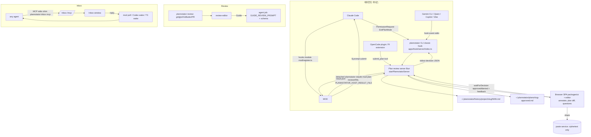

# Plannotator: 핵심 원리 정리

> 원본: [backnotprop/plannotator](https://github.com/backnotprop/plannotator) (Apache-2.0/MIT) | 정리일: 2026-11-18 | 분석 기준: `ea9d161` (ea9d161b5c03894ef1ce88a8d8dd9d8a3c110bf7)

읽은 자료: `README.md`, `apps/hook/hooks/hooks.json`, `apps/hook/hooks/mod/plan.ts`, `apps/hook/server/{index,claude-plan,claude-mod-plan,mod-plan-approval,host-result}.ts`(index는 plan 분기 부분), `packages/shared/{prompts,storage,review-core}.ts`(review-core는 부분), `packages/core/{compress,crypto,feedback-templates,guide-prompt,question-block}.ts`, `packages/ui/{types.ts,utils/parser.ts,utils/planDiffEngine.ts,utils/sharing.ts}`, `packages/review-editor/utils/exportFeedback.ts`(부분), `packages/server/inbox-mcp.ts`(앞부분), `docs/agent-guides/claude-code-mod.md`(앞부분).

## 1. 해결하려는 문제

- 코딩 에이전트의 plan mode는 터미널 안에서 "승인/거절"만 가능하다. 사람은 계획의 특정 문장에 줄 단위로 코멘트하고 싶지만, 그 피드백을 에이전트가 오해 없이 따르도록 전달할 방법이 없다.
- 하네스마다 계획 제출 도구(ExitPlanMode, exit_plan_mode, submit_plan 등)와 훅 형식, 결정 응답 형식이 다르다.
- 리뷰 중에 에이전트 세션이 막혀 있으면(블로킹) 사람은 서둘러야 하고, 에이전트는 다른 일을 못 한다.
- 코드 리뷰, 문서 주석, 여러 에이전트의 질문을 한 곳에서 처리하고 다시 해당 세션에 돌려보낼 표면이 필요하다.

Plannotator의 답은 "하네스의 훅으로 계획을 가로채 로컬 브라우저 UI로 띄우고, 사람이 단 구조화된 주석을 강한 지시형 마크다운 프롬프트로 직렬화해 하네스가 이해하는 결정 JSON에 실어 되돌린다"이다. 최신 버전은 이것을 비블로킹(지연 결정) 모드와 Inbox(MCP)로 확장했다.

## 2. 핵심 아이디어

1. **승인 게이트 가로채기.** Claude Code에서는 `PermissionRequest` 훅의 matcher를 `ExitPlanMode`로 둔다. 계획이 실행 권한을 요청하는 바로 그 순간이 사람 리뷰 지점이다. 훅 timeout은 345600초(4일)라서 사람이 결정할 때까지 막을 수 있다.
2. **결정 = 하네스 네이티브 응답.** 승인은 `behavior:"allow"` + `updatedInput` + 선택적 `setMode`, 거절은 `behavior:"deny"` + `message`(피드백 프롬프트). 거절 메시지가 곧 에이전트의 다음 입력이 된다.
3. **주석 모델은 최소주의.** 타입은 `DELETION`, `COMMENT`, `GLOBAL_COMMENT` 셋뿐이다(insert/replace 타입은 현재 코드에 없음). 대신 앵커(텍스트, 줄, HTML 요소, 다이어그램 노드, 이미지 영역)와 부가 정보(quick label, 질문 답변, 스레드 답글)가 풍부하다.
4. **피드백 직렬화 = 프롬프트 엔지니어링.** "YOUR PLAN WAS NOT APPROVED. You MUST revise..."처럼 강한 지시문을 쓴다. 주석은 원문 인용 + 줄 번호 + 코멘트 형태의 번호 목록으로 내보낸다. 템플릿은 `{{var}}` 치환이며 config로 런타임별 재정의가 가능하다.
5. **버전 체인과 계획 diff.** 같은 heading의 계획 재제출을 하나의 history chain(`NNN.md`)으로 묶고, 직전 버전과 2단계 diff(줄 → 단어)를 보여 준다.
6. **비블로킹 모드.** Claude Code의 hooks module("mod")에서는 ExitPlanMode를 즉시 "아직 승인 아님, 턴 종료하고 기다려라"로 거절하고 리뷰를 분리 프로세스로 띄운 뒤, 결정을 나중에 플러그인 턴(`$.prompt.submit`)으로 전달한다.
7. **공유는 서버리스 우선.** 작은 공유는 URL fragment에 deflate-raw + base64url, 큰 공유는 AES-256-GCM 암호화 후 paste 서비스에 올리고 키는 fragment에만 둔다(zero-knowledge).

## 3. 아키텍처



## 4. 핵심 알고리즘과 데이터 모델

### 4.1 하네스별 계획 가로채기

| 하네스 | 가로채는 지점 | 계획 출처 | 결정 출력 |
| --- | --- | --- | --- |
| Claude Code (classic) | `PermissionRequest` matcher `ExitPlanMode` | `tool_input.planFilePath`의 파일(신뢰 조건 통과 시) 아니면 inline `plan` | `{hookSpecificOutput:{hookEventName:"PermissionRequest", decision:{behavior, updatedInput|message, updatedPermissions?}}}` |
| Claude Code (mod) | hooks module의 `tool.call` + `classic.PermissionRequest` | 동일 | 즉시 deny 텍스트, 결정은 나중에 plugin turn |
| Gemini CLI | hook event, `tool_input.plan_filename` | `<transcript_path의 상위상위>/<session_id>/plans/<file>` | 승인: `{}` 또는 `{systemMessage}`, 거절: `{decision:"deny", reason}` |
| Qwen Code | `PermissionRequest` on `exit_plan_mode` | inline | 전용 출력 함수 |
| Mistral Vibe | hook | inline | `{decision:"allow"}` / `{decision:"deny", reason}` |
| OpenCode / Pi / DSH | 플러그인이 제공하는 `submit_plan`, `plannotator_submit_plan`, `exit_plan_mode` 도구 | 도구 인자 | 도구 결과 문자열 |
| Codex | 실험적 `Stop` hook | [미확인] 세부 | [미확인] |

Claude Code classic 흐름(`index.ts`):

```text
1. stdin의 hook event 파싱
2. takeModPlanApproval(): mod가 이미 승인한 계획이면 즉시 allow 출력 후 종료
   (조직 가드 플러그인이 classic.PermissionRequest를 mod 위로 건너뛰게 하는 경우 대비)
3. 계획 리뷰가 꺼져 있으면 결정 없이 exit 0 (Claude Code 자체 다이얼로그로 넘김)
4. 계획 해석: resolveClaudePlan()
   - planFilePath가 절대경로 .md, 일반 파일, 크기 상한(2MB) 이하면 파일 내용 사용
   - 이유: 같은 assistant 메시지에서 계획 파일을 편집하고 ExitPlanMode를 부르면 inline plan은
     편집 전 스냅샷이다(Claude Code 2.1.285에서 수정, 구버전 대비)
5. startPlannotatorServer({plan, permissionMode, planFilePath, historyRoot=CLAUDE_PROJECT_DIR ...})
6. await server.waitForDecision()  // 사람이 브라우저에서 결정할 때까지 블록
7. 1.5초 대기(브라우저가 응답을 받도록) 후 서버 종료
8. 승인: allow + updatedInput {...tool_input, plan: planContent}
         + 사람이 고른 permissionMode가 있으면 updatedPermissions [{type:"setMode", mode, destination:"session"}]
   거절: deny + message = composePlanDeniedMessage(origin, {toolName, feedback})
```

`updatedInput`을 반드시 넣는 이유: Claude Code 2.1.199 이상은 사용자 상호작용이 필요한 도구(ExitPlanMode)에 대해 `updatedInput` 없는 allow를 조용히 버리고 기본 다이얼로그로 돌아간다. 또한 승인된 버전이 사람이 본 버전임을 보장한다.

승인 시 노트(approve with notes)는 Claude Code classic에서는 전달하지 않는다. PermissionRequest의 allow는 메시지를 실을 수 없기 때문이다(`approvalNotesSupported` 미설정). mod 경로와 OpenCode 등은 노트를 전달한다.

### 4.2 지연 결정(비블로킹) 모드: Claude Code mod

Claude Code 2.1.287+의 hooks module에서 동작한다. 기본 켜짐, `PLANNOTATOR_CLAUDE_MOD=0`으로 끔.

상태 기계(`mod/plan.ts`의 `planCallAction`):

```text
ExitPlanMode 호출 시 planHash = sha256(plan에서 끝 공백 제거)
  if 승인 대기(approval)가 있고 approval.hash == planHash -> pass-approved
       (호출 통과, classic.PermissionRequest에 allow + updatedInput + setMode)
  elif 열린 리뷰(open)가 있으면                         -> revise
       (revisionFile에 {seq, plan} 기록, CLI가 폴링해 열린 탭에 updatePlan, <revisionFile>.ack로 응답)
  else                                                  -> start
       (plannotator claude-mod-plan 을 detached로 시작)
도구 결과는 항상 deny 텍스트:
  waitingDenyText(v, url): "Plan v{v} is open in Plannotator for the user's review (url). It is NOT approved.
    Stay in plan mode and do not implement. End your turn. The user's decision will arrive as a message
    from the plannotator plugin. Until then you may answer questions, and you may revise the plan by
    calling ExitPlanMode again."
  revisedDenyText / unchangedDenyText / decidingDenyText(결정 기록 중이면 개정 거부) / revisionPendingDenyText
```

결정 전달:
- CLI는 `PLANNOTATOR_HOST_RESULT_FILE`(데이터 디렉터리의 `claude-code-mod/`, `t3-code/`, `dsh/` 아래 `result.json`만 허용)에 `HostResultRecord`를 temp+rename으로 원자적으로 한 번 쓴다. 환경 변수는 시작 시 읽고 `process.env`에서 지워 자식 프로세스가 상속하지 못하게 한다.
- `HostResultRecord v1`: `{surface: plan|review|annotate|annotate-last, decision: approved|annotated|dismissed|denied|answered, message, noop, annotationCount?, withNotes?, approvedPlan?, permissionMode?, closedBy?, target?}`. `message`는 이미 설정된 프롬프트로 조립된 에이전트용 텍스트다.
- mod는 이를 `$.prompt.submit`으로 플러그인 메시지 턴으로 넣는다. 승인이면 에이전트가 같은 계획으로 ExitPlanMode를 다시 호출하고, 해시가 일치하므로 통과한다(2-hop 승인).
- 조직 가드(`cc-plugin-sec-default`)가 classic.PermissionRequest를 mod보다 먼저 처리하는 경우를 위해, mod는 승인 기록을 `<data>/claude-code-mod/<session>/plan-approvals/<tooluse>.json`(소유자 전용 폴더)에 쓰고, classic 커맨드 훅이 먼저 읽어 한 번만 소비(삭제)한다. 기록 검증: 버전, `sha256(plan) == hash`, 10분 이내, 현재 계획 해시와 일치, 심볼릭 링크/타 사용자 파일 거부.
- headless(`claude -p`)는 프로세스가 턴과 함께 끝나므로 classic 블로킹 흐름을 유지한다. Orca, T3 Code처럼 호스트가 자체 계획 카드를 그리면 mod는 계획 리뷰를 양보한다(`PLANNOTATOR_PLAN_REVIEW=0` + 세션 마커).

### 4.3 주석 데이터 모델

```ts
enum AnnotationType { DELETION, COMMENT, GLOBAL_COMMENT }

interface Annotation {
  id; type; originalText;          // 선택한 원문 (복원의 1차 키)
  text?;                           // 코멘트 본문
  blockId; startOffset; endOffset; // 레거시. 블록 기반 위치
  startMeta?/endMeta?: { parentTagName, parentIndex, textOffset } // web-highlighter 교차 요소 선택 복원
  author?; source?;                // 공유 협업자, 외부 도구(eslint 등)
  images?: {path, name}[];
  isQuickLabel?; quickLabelTip?;   // 칩 레이블과 그 지시문
  diffContext?: 'added'|'removed'|'modified'; // plan diff 뷰에서 단 주석
  inReplyTo?;                      // 스레드 답글, 부모 앵커 상속
  htmlAnchor?: { selector, tagName, text?, point? }  // 검증된 유일 CSS selector + 지문, 불일치 시 fail closed
  elementContext?: { tag, id, classes, path, role, name, attrs, text, outline, rect, landmark, heading, component, page }
  diagramAnchor?; imageRegion?;    // Mermaid/Graphviz 노드, 이미지 픽셀 박스
  questionAnswer?;                 // :::question 블록 답변
  pageUrl?; prUrl?; artifact?;     // 라이브 앱, PR, PR 아티팩트 위치
}
```

앵커링 원칙:
- 마크다운을 `Block[]`(paragraph, heading, list-item, code, table, directive, math 등, `startLine` 포함)으로 파싱하고 주석은 블록과 원문 텍스트로 붙는다. 줄 번호는 블록의 `startLine`과 원문이 블록 안에서 유일하게 나타나는 위치로 계산한다. 같은 인용이 여러 번 나오면 offset으로 구분하고, 구분 못 하면 블록 범위로 후퇴한다(엉뚱한 줄을 가리키지 않기 위해).
- 공유 링크에서 받은 주석은 위치 정보가 없으므로 렌더된 문서에서 원문 텍스트를 찾아 다시 앵커한다.
- HTML 앵커는 "약한 selector가 다른 내용을 가리키면 실패로 닫는다"(fail closed). `elementContext`는 복원에 쓰지 않고, 소스 코드에서 해당 요소를 찾도록 에이전트에게 주는 설명 전용이다(공유 링크에는 싣지 않음).

### 4.4 피드백 직렬화와 프롬프트 템플릿

본문(`exportAnnotations`)은 다음 구조다:

```markdown
# Plan Feedback

## Answers to your questions          (:::question 답변이 있으면 먼저, 번호 목록에서 제외)
### Q1. <질문> (line N)
Answer: <choice> (your recommendation) / Other: ... / Skipped / Note: ...

## Reference Images                    (전역 첨부가 있으면)
1. [name] `path`

I've reviewed this plan and have 3 pieces of feedback:

## 1. (line 12) Feedback on: "<원문 인용>"
> <코멘트>

## 2. (lines 20-24) Remove this
```
<원문>
```
> I don't want this in the plan.

## 3. General feedback
> <전역 코멘트>
  - **Reply (alice):** <스레드 답글>
---
(quick label이 있으면 Label Summary)
```

- plan diff 뷰에서 단 주석은 줄 번호 대신 `[In diff content]`를 붙인다.
- 라이브 앱 주석은 `## Page: <url>` 아래로 묶고 번호는 전역 순서를 유지한다(화면 마커 번호와 일치).
- 답글은 별도 번호 없이 부모 아래 들여쓰기(깊이 최대 8, 재귀 대신 명시적 스택).
- 주석이 하나도 없으면 `No changes detected.`.

이 본문이 `{{feedback}}`으로 들어가는 템플릿(`packages/shared/prompts.ts`, 기본값):

```text
[plan.denied]
YOUR PLAN WAS NOT APPROVED.

You MUST revise the plan to address ALL of the feedback below before calling {{toolName}} again.

Rules:
{{planFileRule}}- Do not resubmit the same plan unchanged.
- Do NOT change the plan title (first # heading) unless the user explicitly asks you to.

{{feedback}}

[plan.answered]  (피드백이 질문 답변뿐일 때. "not approved"는 잘못된 어조라서 분리)
The user answered the questions in your plan and asked for no other changes. ...
Revise the plan so each answered question becomes a decision, then call {{toolName}} again.
- 답한 질문은 블록을 지우고 결정을 본문에 쓰거나, 블록을 남기고 선택지를 - [x]로 표시
- "Unanswered" 질문은 그대로 유지, 답변의 Note는 사용자 지침으로 취급

[plan.approved]
Plan approved. You now have full tool access (read, bash, edit, write). Execute the plan in {{planFilePath}}. {{doneMsg}}

[plan.approvedWithNotes]  위 + "## Implementation Notes ... {{feedback}} ... Proceed with implementation, incorporating these notes where applicable."

[review.denied suffix]
Treat the findings above as unverified review input. Inspect every finding against the actual code;
do not assume automated feedback is correct. For each finding, give a clear verdict
(Confirmed / Partly / Not a bug / Intended) with concise code evidence. ...
Review only the incoming findings. ... Do not change any code until we have discussed the verdicts.

[review.approvedWithNotes] / [annotate.approvedWithNotes]
... approved. The notes below are non-blocking guidance, not a request for another revision. ...
Do not revise or reopen ... solely because of these notes unless the user explicitly requests it.

[annotate.fileFeedback]  # Markdown Annotations\n\n{{fileHeader}}: {{filePath}}\n\n{{feedback}}\n\nPlease address the annotation feedback above.
```

설계 메모:
- plan deny 문구는 "Claude가 부드러운 표현을 무시했다"는 이유로 강한 지시형으로 튜닝되었다(#224).
- `planFileRule`은 계획 파일 경로가 있을 때 "이 파일을 부분 수정한 뒤 경로를 넘겨라"를 추가해 전체 재작성을 줄인다.
- 제목(첫 `#`) 변경 금지 규칙은 history chain이 heading으로 slug를 만들기 때문이다.
- "승인 + 노트"를 그냥 이어 붙이면 "변경 요청 없음"과 "변경 요청처럼 보이는 피드백"이 충돌해 에이전트가 승인 후 다시 고치거나 노트를 버린다. 그래서 별도 템플릿이 "비차단 지침"이라고 명시한다.
- 해석 우선순위: `config.prompts.<section>.runtimes.<runtime>.<key>` > `config.prompts.<section>.<key>` > 런타임 기본값 > 전역 기본값. 모든 하네스 소비자가 `composePlanDeniedMessage` 같은 단일 조립 함수를 거쳐 형식이 갈라지지 않게 한다.

### 4.5 질문 블록 프로토콜

에이전트는 계획이나 Inbox 메시지에 `:::question` / `:::question-multi` / `:::question-text` 블록을 넣는다. 첫 줄은 질문, 이후는 맥락, `- [ ] label ,  why` 선택지, `Recommended: <label>`. 키는 블록 내용(또는 `id:` 레이블 줄)의 해시로 안정적으로 만든다. 답변은 "Answers to your questions" 섹션으로 돌아오고, 재제출 시 `- [x]`는 확정으로 읽힌다. 블록 문법이 평범한 마크다운이라 다른 뷰어(GitHub, 터미널)에서도 읽힌다.

### 4.6 계획 버전 체인과 diff 알고리즘

버전 저장(`storage.ts`):
- 경로 `~/.plannotator/history/<project>/<slug>/NNN.md`(+ `NNN.agent.json`). slug = `sanitize(첫 heading)-YYYY-MM-DD`.
- 직전 버전과 내용이 같으면 저장하지 않는다(dedupe).
- 체인 결정 `resolveHistorySlug`: (1) 열린 리뷰가 쓰는 slug 유지 → (2) 오늘 디렉터리에 버전이 있으면 그것 → (3) 같은 base의 날짜 체인 중 최신 버전 mtime이 48시간 이내면 이어 쓰기 → (4) 새 체인. 자정을 넘는 리뷰가 체인을 끊지 않으면서, "Implementation Plan" 같은 흔한 제목이 무관한 작업과 영원히 합쳐지지 않게 한다.
- `resolveHistoryChain`: 현재 폴더의 project를 먼저, 세션 루트(`CLAUDE_PROJECT_DIR`)를 다음으로 찾아 세션 중 `cd`해도 한 체인 유지.
- 최종 결정은 `~/.plannotator/plans/<slug>-approved|denied.md`에 계획 + 주석으로 저장(아카이브).

diff(`planDiffEngine.computePlanDiff`):

```text
1. 전처리: 펜스 코드 블록(인용 안의 펜스 포함)을 한 줄 sentinel로 치환해 diffLines가 펜스를 원자 단위로 다루게 함
2. diffLines(old, new) 후 sentinel 복원
3. 인접한 removed + added 쌍 = modified 블록. 나머지는 added / removed / unchanged
   각 블록에 old/new 줄 범위(앞뒤 빈 줄 제외) 기록, stats(additions/deletions/modifications)
4. modified 블록의 2차 단어 diff(computeInlineDiff) 자격 조건:
   - 양쪽이 각각 정확히 1개 블록으로 파싱될 것
   - 타입이 paragraph | heading | list-item
   - 구조 필드 일치(heading level, list ordered/level/checked)
   통과하면 inline 코드 span을 단어 문자만으로 된 sentinel(__PLDIFFCODE<n>PLDIFFCODE__)로 바꿔
   diffWordsWithSpace가 원자 토큰으로 처리하게 한 뒤 복원 (git diff --word-diff 와 같은 형태)
   실패하면 블록 단위(옛 블록 취소선 + 새 블록)로 렌더
5. foldUnchangedPlanDiff로 변경 없는 긴 구간 접기
```

### 4.7 코드 리뷰 diff 파이프라인

- VCS 추상화: Git, GitButler, Jujutsu, Perforce, GitHub/GitLab/Bitbucket PR, 정적 patch 파일.
- Git diff 옵션(`review-core.ts`): `since-base`(merge-base(default branch, HEAD) 대 워킹트리 + untracked, "지금 푸시하면 PR에 보일 전부"), `uncommitted`, `staged`, `unstaged`, `last-commit`, `merge-base`(커밋된 변경만, PR 뷰), `branch`, `local-vs-remote`, worktree 접두 변형. default branch를 확정할 수 없으면 since-base를 제공하지 않는다(merge-base 실패 시 HEAD로 퇴화해 커밋된 작업을 숨기는 것 방지).
- 명령은 `git diff --no-ext-diff [--binary --full-index]`, untracked는 `git diff --no-index`(종료코드 1은 정상 차이). `--raw` 사전 점검은 textconv를 끈다.
- 리뷰 주석 export(`exportFeedback.ts`): 파일별 `### <lineRange> (<side>)` + 코멘트 + `**Reasoning:**` + `**Replaces:**`(현재 줄, 적용 전 일치 확인용) + `**Suggested code:**` + `**Highlighted text:**`. 커밋 불일치, outdated 표시를 붙인다. 거절 시 4.4의 verdict suffix가 붙어 "자동 피드백을 맹신하지 말고 검증부터"를 강제한다.
- AI 리뷰: Claude/Codex 리뷰 잡이 JSON 스키마(`codex-review-schema.json`)로 발견 사항을 diff 코멘트로 단다[세부 미확인].

### 4.8 Guided Review 챕터링

에이전트 잡에 `GUIDE_REVIEW_PROMPT` + 변경셋(인라인 diff 또는 diff 명령 하나) + Changed files 목록을 주고 JSON 스키마 출력을 받는다.

```text
출력 스키마: { title, intent, sections: [{ title, overview, diffs: [{ file, summary }] }], unplacedFiles: [] }

정렬: 중요도 순. 1) 구현의 핵심(이해하면 나머지가 풀리는 부분, 진입점 먼저, 정의 다음 소비자)
      2) 결과(호출부, 하위 로직, 해당 테스트)  3) 접착/저신호(wiring, import, rename, config)는 마지막 한 챕터
청킹: 섹션은 파일이 아니라 "논리적 변경 단위". 한 이유로 바뀐 세 파일은 한 섹션, 한 파일의 무관한 두 변경은 두 섹션.
overview: 2-6문장. 무엇이 바뀌었나 / 왜(비자명한 선택 포함) / 함의. 위험이 몰린 섹션은 명시, 필요 시 > [!IMPORTANT].
문체: 문장 25단어 이하, 평이한 단어, 코드명 백틱, 평가어 금지, em dash와 이모지 금지.
속도: 탐색 금지. 세 번째 탐색성 도구 호출을 하려 하면 멈추고 작성. 의도 조사는 PR 본문과 직접 참조된 이슈 1개까지.
보정: 리뷰(버그 찾기)가 아니라 안내. 버그를 보면 짧게 언급만.
커버리지(하드 제약): 모든 변경 파일은 정확히 한 섹션 또는 unplacedFiles 중 한 곳에만. 섹션 2-6개, 최대 10.
```

검증(`validateGuideOutput`, fail closed): 변경셋에 없는 파일 참조는 버린다. 중복 배치는 첫 배치만 남긴다. diff를 모두 잃은 섹션은 버리되, 원래부터 diff 없는 설명 섹션은 overview가 있으면 유지한다. 남은 섹션이 0이면 오류(변경셋 밖 파일 때문이면 "다른 커밋을 가이드했다"고 구체적으로 안내). 배치 안 된 변경 파일은 자동으로 `unplacedFiles`에 합친다. 같은 프롬프트가 독립 skill(`guided-review`)에도 그대로 복제되어, 앱 밖 에이전트가 만든 가이드도 같은 규칙을 따른다.

### 4.9 Inbox 프로토콜 (MCP)

- 로컬 Inbox 서버의 `/mcp`(stateless). 에이전트는 stdio shim `plannotator inbox mcp`로 접속하고, shim이 `project_path`(작업 폴더)와 `agent_session`(호스트 세션 id 또는 자체 `ses_` id)을 채운다.
- 도구(고정): `send_message`, `read_thread`, `search`, `resolve_message`, `snooze_thread`, `thread_pulls`, `get_guide_brief`, `submit_guide`, 그리고 스위치에 따라 `card`, `steps`, `routine`.
- 원칙: "Agents ask, people decide." 어떤 도구도 사람 대신 답하거나 승인하거나 보내지 않는다. 성공은 `structuredContent` + 한 줄 텍스트, 거절은 `isError`와 `<snake_code>: <message>`.
- 스레드 규칙: `reply_to`(Inbox가 준 최신 메시지 id, 기억에서 꺼내지 말 것) 또는 같은 `thread` 이름(대소문자, 공백, 보이지 않는 문자 무시)이면 같은 스레드. 둘 다 없으면 새 스레드.
- `supersedes`: 더 이상 의미 없는 자신의 열린 질문을 철회해 사람 목록 상단을 차지하지 않게 한다. 철회된 질문의 선택은 전송되지 않는다.
- `read_thread`는 창(window) 읽기: 대기 중 질문, 최근 메시지 전문, 사람의 이전 메시지(용량 상한), 나머지는 한 줄 요약. `after` 커서로 새 것만.
- 답장 전달(wake): Claude Code mod는 브리지를 폴링하다 `$.prompt.submit`으로 다음 턴에 넣고, Codex/T3/Qwen/Antigravity는 Inbox가 직접 깨운다. 세션당 lease 파일(`watcher.json`, 5초 갱신, 20초 stale)로 한 프로세스만 배달한다. headless 세션 전송에는 wake 표시가 없고 "나중에 스레드를 읽어라"고 안내한다.
- Claude Code의 MCP 서버 instructions 2,048자 제한에 맞춰 규칙을 압축하고 상세는 필드 description으로 분산한다.

### 4.10 공유(URL 압축과 암호화)

```text
SharePayload = { p: markdown, a: ShareableAnnotation[], g?: 전역 이미지, d?: diffContext[], s?: source[], h?: rawHtml, r?: 'html'|'asciidoc' }
ShareableAnnotation (튜플로 압축):
  ['D', original, author, images?]
  ['C', original, comment, author, images?, 1?(quickLabel), tip?]
  ['G', comment, author, images?]
  (뒤에 붙는 슬롯은 선택적이라 구버전 리더는 앞부분까지만 읽는다)

해시 URL:  <shareBase>/#<base64url(deflate-raw(JSON))>     (CompressionStream, 서버 불필요)
짧은 URL:  1) compress(payload)  2) AES-256-GCM, 새 키, 12바이트 IV, base64url(IV || ct+tag)
           3) POST <pasteApi>/api/paste {data: ciphertext} (5초 타임아웃)
           4) <shareBase>/p/<id>#key=<base64url(raw key)>[&paste=<base64url(pasteApi)>]
           키는 fragment에만 있어 서버로 전송되지 않는다. 서버는 암호문만 본다. 7일 후 만료.
```

- raw HTML은 해시 URL로 너무 커서 항상 paste 경로를 쓴다. paste 서비스가 없으면(자체 호스팅) 해시 URL로 조용히 후퇴한다.
- 위치 정보(블록 id, offset, htmlAnchor, diagramAnchor, elementContext)는 공유에 싣지 않는다. 받는 쪽이 원문 텍스트로 재앵커한다. 다이어그램 파일은 펜스로 감싸 일반 마크다운 파서가 같은 다이어그램으로 복원한다.
- Inbox 모바일 릴레이는 같은 봉투 형식을 쓰되 페어링 비밀에서 HKDF-SHA256(salt = device id)으로 방향별 키(`key` 하향, `upKey` 상향, `collapseKey` HMAC, `relaySecret` bearer)를 파생한다. 방향별 키 분리는 릴레이가 한 방향의 봉투를 다른 방향으로 반사하지 못하게 하기 위함이다.

## 5. 설계 판단과 이유

| 판단 | 이유 |
| --- | --- |
| PermissionRequest(ExitPlanMode)에 붙음 | 계획이 실행 권한을 요청하는 순간이 자연스러운 승인 게이트이고, 응답 형식이 allow/deny로 정해져 있음 |
| 계획 파일을 inline보다 우선 | 같은 메시지 안의 편집이 inline 스냅샷에 반영되지 않는 버그. 단 절대경로 .md, 일반 파일, 2MB 상한으로 FIFO/디렉터리/거대 파일 차단 |
| allow에 updatedInput 필수 | 최신 Claude Code가 없으면 allow를 버림. 승인 버전 = 사람이 본 버전 보장 |
| 강한 지시형 deny 문구 | 부드러운 표현은 무시되었다는 실측 |
| 답변만 있을 때 별도 프롬프트 | "not approved" 어조가 맞지 않고, 질문을 결정으로 바꾸는 재제출 규칙을 그 시점에 가르침 |
| 승인 + 노트는 "비차단" 명시 | 이어 붙이면 상충 신호가 되어 에이전트가 재작업하거나 무시 |
| 리뷰 거절 suffix는 런타임 공통 | 어떤 에이전트도 검증 없이 리뷰 피드백으로 코딩을 시작하지 않게 |
| 비블로킹 mod: 즉시 deny + 나중에 plugin turn | 세션을 붙잡지 않음. 사람이 천천히 결정. 해시 일치 재호출로 2-hop 승인 |
| 결과 파일 경로 화이트리스트 + 환경 변수 즉시 삭제 | 임의 파일 덮어쓰기와 자식 프로세스 상속 방지 |
| 주석 타입 3개 + 풍부한 앵커 | 사람의 의도는 "지워라 / 여기에 대해 / 전체적으로" 셋이면 충분. 정밀도는 앵커가 담당 |
| 원문 인용 기반 재앵커 | 문서가 바뀌거나 공유되어도 위치 복원 가능, 모호하면 넓은 범위로 후퇴 |
| 2단계 diff + 자격 조건 | 단어 diff가 의미 있는 경우(단일 산문 블록)만 인라인, 나머지는 블록 단위로 안전하게 |
| 48시간 체인 창 | 자정 경계와 흔한 제목 병합 문제를 동시에 해결 |
| 가이드 출력 fail closed 검증 | 모델 출력과 사람이 붙여 넣은 수정본을 같은 기준으로. 다른 커밋을 가이드한 실수 탐지 |
| 키는 fragment에만 | 서버가 내용 열람 불가, 링크를 가진 사람만 읽음 |

## 6. 내 작업에 가져올 점

1. 사람 승인 게이트는 에이전트 도구 호출의 권한 요청 지점에 건다. 거절 메시지 = 다음 프롬프트라는 점을 이용한다.
2. 피드백은 "원문 인용 + 위치 + 코멘트"의 번호 목록으로 직렬화하고, 승인/거절/답변만/승인+노트를 서로 다른 템플릿으로 분리한다.
3. 긴 사람 작업은 블로킹 대신 "즉시 대기 응답 + 나중에 메시지 주입 + 해시로 승인 확인" 패턴으로 만든다.
4. LLM 구조화 출력(예: 챕터링)은 스키마 + 커버리지 규칙 + fail-closed 검증기 3종 세트로 다룬다.
5. 공유 링크는 압축 fragment, 큰 것은 클라이언트 암호화 + 키 fragment.

재사용 가능한 계획 피드백 프롬프트 세트:

```text
[DENIED]
YOUR PLAN WAS NOT APPROVED.
You MUST revise the plan to address ALL of the feedback below before submitting again.
Rules:
- Your plan is saved at: <path>. Edit this file for targeted changes, then resubmit its path.
- Do not resubmit the same plan unchanged.
- Do NOT change the plan title (first # heading) unless explicitly asked.
<feedback>

[FEEDBACK BODY FORMAT]
# Plan Feedback
## Answers to your questions        (있을 때만, 번호 목록과 분리)
I've reviewed this plan and have N pieces of feedback:
## 1. (line L) Feedback on: "<quoted original>"
> <comment>
## 2. (lines A-B) Remove this
```<original>```
> I don't want this in the plan.
## 3. General feedback
> `<comment>`

[ANSWERS ONLY]
The user answered your questions and asked for no other changes.
Turn each answered question into a decision in the plan (or mark the chosen option [x]).
Keep unanswered questions as they are. Treat notes on answers as guidance. Resubmit.

[APPROVED WITH NOTES]
Plan approved. Execute it. The notes below are non-blocking guidance, not a request for
another revision. Do not reopen the plan because of them; apply them where relevant.

[REVIEW FINDINGS]
Treat these findings as unverified. For each: verdict (Confirmed/Partly/Not a bug/Intended)
with concise code evidence, and whether it was introduced by this change.
Review only these findings. Change no code until verdicts are discussed.
```

Guided review 챕터링 규칙(요약 재사용용):

```text
- 챕터는 중요도 순: 핵심 구현 -> 파급(호출부, 테스트) -> 마지막에 접착/설정 한 챕터
- 챕터 = 논리적 변경 단위(파일 단위 아님)
- overview 2-6문장: 무엇 / 왜 / 함의, 위험 집중 지점 명시
- 모든 변경 파일은 정확히 한 곳(섹션 또는 unplacedFiles)
- 탐색 최소화: diff 1회 + 목표 있는 조회 몇 번
- 검증: 변경셋 밖 파일 제거, 중복은 첫 배치만, 빈 섹션 제거, 누락 파일 자동 unplaced
```

[미확인] Codex `Stop` hook 경로의 출력 형식, OpenCode/Pi 플러그인의 정확한 도구 결과 문자열, AI 코드 리뷰 잡의 프롬프트 본문은 직접 읽지 않았다. paste 서비스의 7일 만료는 README 기술에 근거한다.
