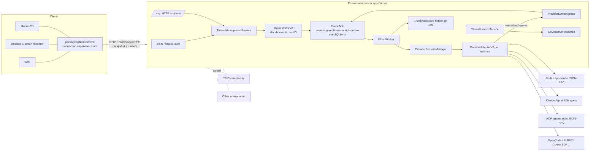

# T3 Code: 핵심 원리 정리

> 원본: [pingdotgg/t3code](https://github.com/pingdotgg/t3code) (MIT) | 정리일: 2026-11-18 | 분석 기준: `08f3249` (08f324988ef17b04aa51e27f456678a7a2555b4d)

읽은 자료: `docs/internals/{overview,glossary,providers,remote,connection-runtime,t3-connect,adding-a-provider,devices}.md`, `docs/orchestration-v2/{README,core-graph-and-data-model,provider-capability-system,orchestrator-mcp-server}.md`, `docs/user/{permission-modes,providers-acp}.md`, 소스 `packages/provider-core/src/server/ProviderAdapter.ts`, `apps/server/src/orchestration-v2/{EventSink,EffectOutbox,RuntimePolicy,ThreadLaunchService}.ts`, `Adapters/{ClaudeAdapterV2,CodexAdapterV2}.ts`(부분), `apps/server/src/vcs/{GitVcsDriverCore,GitVcsDriver}.ts`(부분), `apps/server/src/checkpointing/CheckpointStore.ts`, `packages/shared/src/git.ts`.

## 1. 해결하려는 문제

- 코딩 에이전트(Codex, Claude Code, Cursor, OpenCode, Pi, Grok, ACP Registry 에이전트 등)는 각자 프로토콜, 세션 모델, 권한 모델, 식별자 체계가 다르다. 하나의 UI에서 이들을 "같은 대화"처럼 다루려면 공통 도메인 모델이 필요하다.
- 에이전트는 워크스페이스가 있는 머신에서 돌아야 한다. 그런데 사용자는 데스크톱, 웹, 모바일, 원격(Tailscale/SSH/릴레이)에서 같은 작업을 보고 승인하고 싶어 한다.
- 프로세스 크래시, 서버 재시작, 재연결, 명령 재시도에서도 대화와 승인 요청, 체크포인트가 일관되게 살아남아야 한다.
- 스레드마다 독립된 git 작업 공간, 턴 단위 diff와 되돌리기, PR 연결이 필요하다.

T3 Code의 답은 "실행은 환경(environment) 서버가 소유하고, 클라이언트는 인증된 RPC로 조종만 한다"와 "provider 차이는 어댑터 경계에서 정규화하고, 오케스트레이션은 이벤트 소싱 + outbox로 처리한다"이다.

## 2. 핵심 아이디어

1. **Environment = 실행 소유자.** provider 프로세스, 터미널, git, 프로젝트 파일, 영속 상태는 서버가 가진다. 원격 클라이언트는 자기 파일시스템이나 자격 증명을 대신 쓰지 않는다. 데스크톱 앱도 서버를 번들할 뿐 같은 경계를 따른다.
2. **App id가 1차, provider id는 ref.** 스레드, run, 노드 id는 앱이 발급한다. provider의 thread/turn/item id는 상관관계용 참조로만 붙는다. 그래서 provider 교체, 포크, 약한 id를 가진 provider도 같은 모델에 들어온다.
3. **Run(사용자 턴)과 ProviderTurn, ExecutionNode를 분리.** Codex app-server 실측 결과(자식 subagent turn이 부모보다 먼저 끝남, interrupt 응답 후 terminal이 나중에 옴 등)를 반영해 "루트 노드만 run을 끝낼 수 있다"는 불변식을 둔다.
4. **이벤트 소싱 + 트랜잭셔널 outbox.** Orchestrator는 I/O 없이 명령을 직렬화하고 이벤트를 결정한다. EventSink가 이벤트, 프로젝션, 명령 영수증(receipt), outbox effect를 한 트랜잭션에 커밋한다. 부작용(provider 호출, 체크포인트)은 EffectWorker가 커밋 이후에 수행하고 결과를 다시 명령으로 넣는다.
5. **Capability 기반 저하(degradation).** provider 이름으로 분기하지 않는다. 어댑터가 보고한 capability 플래그와 정책으로 fork, rollback, steering, 승인 UI를 결정한다.
6. **체크포인트는 숨은 git ref.** 사용자 브랜치에 커밋을 추가하지 않고 임시 index와 별도 object 디렉터리로 tree/commit을 만들어 ref에 걸어 둔다.
7. **T3 자체를 MCP 서버로 노출.** 각 provider 세션에 스레드 범위 토큰을 가진 `t3-code` MCP 서버를 주입해 에이전트가 하위 작업 위임, 스레드 생성/조회/대기, 예약 작업을 할 수 있게 한다.

## 3. 아키텍처



주요 패키지 역할:

| 위치 | 역할 |
| --- | --- |
| `packages/contracts` | 클라이언트와 서버 사이 RPC 계약, V2 도메인 스키마(Effect Schema). 독립 버전 클라이언트/서버의 경계 |
| `packages/client-runtime` | 연결 수명, 재시도, 다중 환경 레지스트리, 프로젝션 상태. web/desktop/mobile 공용 |
| `packages/provider-core` | `ProviderAdapterV2` 인터페이스, id 할당기, 텍스트 생성 프롬프트, 오케스트레이션 지시문 |
| `packages/provider-<name>` | 드라이버별 패키지. `./settings`, `./client`, `./server`, `./testing` 내보내기 |
| `packages/effect-acp`, `effect-codex-app-server` | ACP, Codex app-server 프로토콜 스키마를 코드 생성해 Effect 기반 JSON-RPC 클라이언트로 감싼 것 |
| `apps/server/src/orchestration-v2` | Orchestrator, EventSink, EffectOutbox/Worker, 어댑터, 세션 매니저, 체크포인트, 정산 서비스 |
| `infra/relay` | T3 Connect 릴레이(Cloudflare Worker, Durable Object) |

## 4. 핵심 알고리즘과 데이터 모델

### 4.1 도메인 그래프

```text
Project
  AppThread                (사용자에게 보이는 대화. provider 프로세스가 죽어도 남는다)
    Run 1..n               (카운트되는 사용자 턴. ordinal, status, userMessageId)
      RunAttempt           (재시도/steering 재시작/복구마다 하나. 최종 선택 attempt만 완료 처리)
      ExecutionNode tree   (root_turn, assistant_message, reasoning, plan, todo_list,
                            tool_call, approval_request, user_input_request, subagent, hook, system)
    ProviderThread handles (provider 네이티브 대화 핸들. appThreadId 또는 ownerNodeId에 붙음)
    ContextTransfer        (fork | provider_handoff | merge_back | subagent_spawn | subagent_result)
    ContextHandoff         (portable 요약 아티팩트. delta_since_target_last_seen | full_thread_summary ...)
    CheckpointScope/Checkpoint
  RuntimeRequest           (provider가 먼저 보낸 승인/질문 콜백)
```

V2 불변식(문서 `orchestration-v2/README.md`):

1. App id가 1차, provider id는 ref.
2. provider 이벤트를 다른 provider 이벤트처럼 재작성하지 않는다.
3. 자식 실행 완료는 부모 run을 닫지 않는다.
4. 루트 run 체크포인트만 앱 run 카운트를 진행시킨다. subagent 체크포인트는 중첩 scope(`advancesAppRunCount=false`).
5. rollback은 앱 run 카운트로 표현하고 provider 대화 상태와 조정한다.
6. 모든 명령은 app id를 대상으로 하고 어댑터가 가장자리에서 provider ref로 번역한다.
7. 없는 capability는 명시적으로 표현하고 정책으로 처리한다.
8. provider 전환은 명시적 handoff 아티팩트를 만든다. 숨은 프롬프트 해킹이 아니다.
9. 포크는 앱 lineage를 먼저 기록하고, 네이티브 fork 또는 portable context 중 무엇을 쓸지는 첫 run 시작 시점에 지연 결정한다.

### 4.2 명령 → 이벤트 → 프로젝션 → outbox

```text
client/MCP command (commandId)
  -> OrchestratorV2: 직렬화, 현재 상태로 이벤트 결정 (I/O 금지)
  -> EventSink 단일 SQLite 트랜잭션:
       append events (store가 단조 증가 sequence 부여)
       apply projections
       write command receipt (idempotency)
       enqueue outbox effects
  -> commit 후 구독자에게 publish
EffectWorker
  -> claim(lease) -> provider/fs 작업 -> 결과를 명령으로 다시 dispatch -> succeeded/failed/pending(backoff)
```

- **명령 ack의 의미**: 의도가 커밋되었다는 뜻이지 provider 작업 완료가 아니다. 같은 commandId 재시도는 receipt에서 같은 결과를 돌려주고 부작용을 다시 실행하지 않는다.
- **Outbox effect 종류**(`EffectOutbox.ts`): `provider-turn.start/interrupt/steer/restart`, `runtime-request.respond`, `provider-thread.rollback`, `checkpoint.capture`, `provider-session.detach/apply-model-selection/apply-thread-title`, `provider-runtime.continue`, `thread-title.generate`, `delegated-tasks.stop`, 각종 cleanup.
- **클레임 규칙**: SQL 술어로 "같은 thread에 running인 effect가 있거나, 나보다 rowid가 작은 pending이 있으면 클레임 불가"를 강제한다. 즉 스레드별 FIFO 직렬 실행이다. 단 `thread-title.generate`는 별도 레인이고 전체 동시 실행 수 상한이 있다. 재시도 backoff 중인 effect도 뒤 effect를 막아 "턴이 대기 중인 rollback을 추월"하지 못하게 한다.
- **복구**: 죽은 provider 프로세스에 묶인 effect는 단순 재생할 수 없으므로 복구 시 retire하고 새 작업을 받는다.
- **이벤트 로그 보존**: 약 하루치만 유지(재연결 replay, commandId 재시도용). `ProjectionMaintenance`가 프로젝션이 반영한 오래된 이벤트를 지운다. 따라서 프로젝션은 로그로 재구축할 수 없고, 프로젝션이 진실의 원천이다. 스트림별 최신 이벤트, `thread.created`, `running` run 업데이트, subagent가 참조하는 prompt anchor는 남긴다.
- **클라이언트 커서**: `snapshotSequence = N`인 스냅샷을 읽고 `sequence > N` 이벤트만 스트리밍. 커서가 pruned-through 시퀀스보다 아래면 스냅샷부터 재개한다. replay 읽기 후 그 시퀀스를 다시 검사한다(읽는 도중 prune 가능).
- **저장 이벤트 호환성**: 보존 이벤트는 replay 시 디코드 가능해야 한다. 스키마 변경은 라이브 RPC뿐 아니라 오래된 환경의 시작 시점에도 영향을 준다(예: 파일 첨부 도입 시 이미지 전용 서버가 replay에서 기동 실패 가능).

### 4.3 Provider 어댑터 계약 (`ProviderAdapterV2`)

서비스 수준: `getCapabilities()`, `planSelectionTransition()`, `openSession()` → `ProviderAdapterV2SessionRuntime`.

세션 런타임 주요 메서드: `ensureThread`, `resumeThread`, `injectHistory?`, `startTurn`, `resumeTurn?`, `compactThread?`, `steerTurn`, `interruptTurn`, `respondToRuntimeRequest`, `readThreadSnapshot`, `rollbackThread`, `forkThread`, `stopSubagent?`, `awaitBackgroundTasks?`, `applyModelSelection?`, `mcpApps?`, `hasPendingBackgroundWork?`, `events: Stream<ProviderAdapterV2Event>`.

어댑터가 내보내는 정규화 이벤트 union:

```text
app_thread.created | provider_session.updated | provider_thread.updated
provider_turn.updated | node.updated | subagent.updated | message.updated
turn_item.updated | steer.updated(pending/completed/cancelled)
background_work.updated | command_output.delta (비영속) | prompt_suggestion.updated (비영속)
runtime_request.updated | plan.updated
turn.terminal { status: completed|interrupted|cancelled|failed, threadDisposition: reusable|broken,
                retainedRuntimeRequestIds, failure, retry, childTurnsContinue }
```

`threadDisposition`은 "이 provider thread를 다음 run에 재사용해도 되는가"를 어댑터가 판정해 넘기는 값이다. `retainedRuntimeRequestIds`는 턴이 끝나도 열려 있어야 할 질문(예: Codex 비동기 질문)을 지정한다.

Capability 묶음(`provider-capability-system.md`): sessions, threads(rollback/fork), turns(`supportsActiveSteering`, `supportsSteeringByInterruptRestart`, `terminalStatusQuality`), streaming, tools, approvals(`approvalCallbacksAreLiveOnly` 등), planning, subagents, context(`supportsDeltaHandoff`), checkpointing(`providerCanRollbackConversation`), identity(`strong|weak|none`).

저하 정책 예:

```text
active steering 미지원  -> 진행 중 턴 interrupt 후 같은 RunId에 replacement attempt 생성
fork 미지원             -> 앱 프로젝션 기반 synthetic fork(portable context)
rollback 미지원         -> 파일시스템 체크포인트 복원, provider 컨텍스트 재시작, divergent 표시
                           (단, revert는 파일을 건드리기 전에 거부하는 것이 현재 규칙)
id strength weak/none   -> native id + ordinal/fingerprint, 또는 scoped ordinal로 id 할당
structured approval 없음 -> provider 샌드박스 정책으로 실행, 승인 UI 없음
```

### 4.4 Provider별 통합 방식

- **Codex**: `codex app-server`를 stdio JSON-RPC로 띄우고, 프로토콜 스키마를 `packages/effect-codex-app-server`에서 코드 생성해 쓴다. 승인은 provider가 보내는 JSON-RPC request(`item/commandExecution/requestApproval` 등)로 오며 thread/turn/item 범위다. `turn/completed`만 권위 있는 종료 신호로 본다. T3는 `turn/diff/updated`를 opt-out하고 diff를 자체 체크포인트로 계산한다. 비동기 질문은 알림으로 오고 새 user message로 답하므로 `responseCapability: {type:"message"}`로 저장해 재시작 후에도 답할 수 있다. `/goal`처럼 Codex가 스스로 다음 턴을 시작하면 하나의 run이 여러 native turn을 소유한다.
- **Runtime mode → Codex 파라미터**(`codexRuntimeModeTurnDefaults`):

| T3 mode | approvalPolicy | approvalsReviewer | sandbox |
| --- | --- | --- | --- |
| approval-required (Supervised) | `untrusted` | user | readOnly |
| auto-accept-edits | `on-request` | user | workspaceWrite |
| auto | `on-request` | `auto_review` | workspaceWrite |
| full-access | granular(mcp_elicitations만 true) | user | dangerFullAccess |

  full-access에서 `never` 대신 granular를 쓰는 이유는 `never`가 브라우저/앱 접근 프롬프트까지 클라이언트에 오기 전에 거부하기 때문이다.
- **Claude**: `@anthropic-ai/claude-agent-sdk`의 `query()`를 사용. 모든 모드에서 `canUseTool` 콜백을 설치한다(AskUserQuestion, ask 규칙 때문). 콜백 흐름: 승인 불필요면 즉시 allow → bypass 모드의 위험 rm 경고는 "사용자가 거절한 것이 아니다, 우회하지 말라"는 deny 메시지로 변환 → 그 외에는 approval 노드, RuntimeRequest, turn item을 이벤트로 내보내고 `Deferred`로 사용자 결정을 기다린다. 결정은 `permissionResultFromDecision`이 SDK `PermissionResult`로 바꾼다: `accept`는 일회 허용, `acceptForSession`은 SDK의 suggestions를 `destination:"session"`으로 바꿔 `updatedPermissions`로 넣는다(없으면 `addRules [{toolName}]`), `decline`은 피드백이 있으면 `"The user declined this tool call and said:\n<feedback>"`, `cancel`은 `interrupt:true`. 관리 정책 상한이 있으면 `setMode` 제안을 제거해 Claude가 모드를 올리지 못하게 한다. MCP 서버는 `mcpServers["t3-code"] = {type:"http", url, headers:{Authorization}}` + `allowedTools: ["mcp__t3-code__*"]`로 주입한다. Claude 네이티브 subagent는 시스템 프롬프트를 못 보므로 `SubagentStart` hook으로 지시 블록을 전달한다.
- **ACP**: `packages/effect-acp`가 ACP v1과 v2 preview 스키마를 생성하고 협상한다. `packages/provider-acp`의 공용 어댑터가 표준 동작을 처리하고 Grok, Antigravity는 그 위의 얇은 flavor다. Registry 에이전트는 per-agent 분기 없이 스펙만 따른다(에이전트 id 분기 금지). ACP에는 네이티브 subagent, active steering, conversation rewind가 없으므로 각각 오케스트레이터 소유 자식 스레드, cancel-and-restart, "롤백 후 다음 턴은 새 세션 + 남은 대화 전달"로 대체한다. 승인은 thread의 모드로 자동 응답: Supervised는 표시, Auto-accept edits는 편집만 승인, Auto/Full은 자동 승인, 파일 읽기/검색은 대기 없음.
- **OpenCode**: 1.x는 스레드당 T3 관리 서버(디렉터리 범위 MCP 등록 충돌 방지), 2.x는 인스턴스당 서버 하나 + 스레드별 `t3-code-<thread>` MCP 항목과 다른 스레드 항목 deny 규칙. "always" 승인이 프로젝트 전체에 저장되는 문제 때문에 자동 승인은 `once`로 답한다.
- **Pi**: 사용자의 `pi`를 RPC 모드로 실행하고 T3 MCP 브리지 extension만 주입한다(`pi --mode rpc --extension ...`).

공통 원칙: 드라이버 kind가 아니라 **instance**로 라우팅한다(같은 드라이버의 두 계정이 상태를 공유하지 않게). 상태 점검이 세션을 열어 MCP 서버, hook, 로그인을 유발하면 안 된다. provider가 네이티브로 강제하지 못하는 권한 모드는 제공하지 않는다(T3가 승인을 대신 흉내 내면 provider 자체 강제보다 약하다). 미지원 모드로 저장된 스레드는 `approval-required`로 실행한다(`RuntimePolicy.providerRuntimeMode`).

### 4.5 승인/권한 흐름과 다중 기기

```text
provider callback (Codex JSON-RPC request / Claude canUseTool / ACP request_permission)
  -> adapter: ExecutionNode(approval_request) + RuntimeRequest(kind, nativeRequestRef,
              responseCapability live|not_resumable|message) + TurnItem 을 이벤트로 발행
  -> EventSink 커밋 -> 모든 연결된 클라이언트의 thread-detail 스트림에 동일하게 반영
  -> 어느 기기든 runtime-request.respond 명령 (decision, feedback, answers)
  -> Orchestrator가 영속 request를 읽고 검증, resolution을 커밋 (receipt로 중복 방지)
  -> outbox runtime-request.respond -> adapter.respondToRuntimeRequest -> Deferred 해제
```

- 승인 상태는 서버 프로젝션에만 존재하므로 웹에서 띄운 요청을 모바일에서 승인해도 같다. 두 기기가 동시에 응답해도 receipt와 status 전이로 한 번만 반영된다.
- `responseCapability`가 live가 아니면(프로세스 재시작으로 콜백 소멸) 요청은 보이되 응답 불가로 표시한다. Codex 비동기 질문처럼 메시지로 답하는 유형은 턴 종료, provider 종료, 서버 재시작 후에도 남는다.
- subagent 승인은 부모 대화에 subagent 이름과 함께 표시된다.
- 네이티브 옵션 id(예: "allow for session")는 정규화 후에도 보존해야 한다. 표시 레이블이 유효한 응답값이라는 보장이 없기 때문이다.
- 관리 정책(`managedPolicy.limits.maxRuntimeMode`)은 orchestrator 디스패치 시점과 `RuntimePolicy.resolve` 시점 양쪽에서 상한을 강제한다(재시작 후 재개되는 run까지 잡기 위해).
- peer link로 전달된 호출은 `T3-Mode-Limit` 헤더로 호출 에이전트의 모드를 실어 보내고 수신 측은 이를 좁히는 방향으로만 적용한다. plan 모드 에이전트가 full-access 링크를 통해 full-access 작업을 시작할 수 없다.

### 4.6 스레드별 git worktree 알고리즘 (`ThreadLaunchService`, `GitVcsDriverCore.createWorktree`)

워크스페이스 전략: `root`(프로젝트 루트, 브랜치 미지정 시 현재 브랜치 기록) | `existing_worktree` | `worktree { baseRef, branch?, startFromOrigin? }`.

```text
1. 사전 검사(checkWorktreeBase): repo 여부 -> baseRef 존재 -> 브랜치 중복/충돌 순서로 오류.
   명시 브랜치가 기존 브랜치와 prefix 충돌(a/b vs a)하면 거부. 임시 이름은 거부하지 않고 나중에 평탄화.
2. 브랜치 이름:
   - 미지정이면 임시 이름 t3/<8hex> (UUID에서 추출). static naming 모드면 prefix/<8hex>.
   - 임시 이름의 상위 경로(refs/heads/t3)가 이미 브랜치로 존재하면 '/'를 '-'로 평탄화
     (git은 t3 브랜치가 있으면 t3/xxx를 만들 수 없음).
3. base 해석: startFromOrigin이면 원격을 해석하고 해당 ref를 fetch(최대 5분)해
   remote commit sha를 시작점으로, baseRefName = refs/remotes/<remote>/<ref>. 원격이 브랜치를
   지웠을 수 있으므로 이름을 믿지 않고 원격에 묻는다. "-"는 @{-1}로 바꾼다.
4. 경로: <worktreesDir>/<repoName>/<branch를 '-'로 치환한 앞 23바이트>-<sha256(gitCommonDir \0 branch) 앞 16hex>
   이미 폴더가 있으면 -2, -3... 접미사. 브랜치별로 안정적인 이름이지만 잔여 폴더가 막지 않게.
5. git branch <new> <start> 를 먼저 만들고, git -c checkout.workers=N worktree add [--no-checkout]
   [--lock --reason t3-create-<uuid>] -- <path> <branch>.  lock reason으로 취소 시 소유권을 증명.
   sparse 패턴(t3.json)이 있으면 --no-checkout 후 sparse 적용. 서브모듈은 별도 단계로 초기화하며
   진행률을 1초에 한 번만 웹소켓으로 보낸다. 빠른 체크아웃 캐시(worktreeCheckoutCache)는 sparse가 아닐 때만.
6. thread.metadata.update 명령으로 branch, worktreePath 기록.
7. 첫 메시지가 있고 임시 브랜치였다면 텍스트 생성기로 브랜치 이름 생성(20초 타임아웃) 후
   git branch rename (uninterruptible, expectedBranch 조건부 metadata 갱신). 실패하면
   "Branch not renamed" system_notice turn item을 남기고 임시 이름 유지.
8. 프로젝트 setup script 실행 단계(run-setup-script). peer link 출신 작업은 setup script를 건너뜀.
```

`delegate_task`의 `isolation:"worktree"`는 부모의 커밋에서 별도 체크아웃을 만든다. 부모의 커밋되지 않은 변경은 복사하지 않는다. 클라이언트가 보낸 경로와 브랜치는 신뢰하지 않고 관리 폴더/저장소/브랜치와 일치하는 실제 경로만 재생성한다(`makeIsManagedWorktreePath`).

### 4.7 체크포인트와 턴 diff

- 캡처: 임시 index 파일(`GIT_INDEX_FILE`)과 private object 디렉터리(`GIT_OBJECT_DIRECTORY`, `GIT_QUARANTINE_PATH`)로 워킹트리를 `write-tree` → `commit-tree`(부모: HEAD와 turn 시작 커밋)한 뒤 숨은 ref에 기록한다. 사용자 브랜치, 사용자 index에는 흔적이 없다. 서브모듈도 개별 캡처한다.
- `previousCheckpointRef`를 받아 브랜치를 바꾼 턴도 "착지한 곳"에서 다음 비교가 시작되게 한다.
- 턴 diff = baseline 체크포인트와 턴 종료 체크포인트의 diff. `listAuthoredPaths`는 HEAD가 바뀐 경우 이 턴이 작성한 경로만 골라낸다.
- run 종료(provider turn 끝)와 후속 작업 정산(체크포인트, diff, PR 발견)은 별개 마일스톤이다. 늦은 체크포인트가 provider 소요 시간을 늘리거나 UI에 "작업 중"을 유지하면 안 된다.
- revert: 대화 rollback이 불가능한 provider(Antigravity 등)는 파일을 바꾸기 전에 거부한다. ACP는 파일 복원 후 다음 턴을 새 세션으로 시작해 남은 대화를 전달한다.

### 4.8 Provider 전환과 포크

- provider 전환은 새 AppThread를 만들지 않는다. 다음 run에 ContextHandoff를 붙인다. 이전 provider로 돌아갈 때는 `delta_since_target_last_seen`(그 provider가 쉬는 동안의 run만 요약)을 우선하고, resume 실패나 품질 문제가 있으면 `full_thread_summary`.
- 포크는 새 AppThread + lineage + pending source point만 기록한다. 첫 run에서 네이티브 fork 가능하면 사용, 아니면 portable context. `visibleTurnItems` 프로젝션이 상속 항목과 "forked from" 마커를 합쳐 보여준다.

### 4.9 원격 동기화와 접근 경로

- 연결 = 클라이언트 하나와 환경 하나의 HTTP + WebSocket. Direct, Tailscale, SSH, T3 Connect는 "어떻게 도달하느냐"만 바꾸고 실행 모델은 같다.
- 환경 id는 재시작, 엔드포인트 변경에도 유지되며 원자적으로 초기화한다.
- 저장된 환경은 순서 있는 route 목록을 가진다. 각 direct route는 공개 descriptor로 먼저 확인해 다른 머신이 응답하는 LAN 주소에 자격 증명을 보내지 않는다. 뒤 route로 연결 중이면 supervisor가 앞 route를 인가까지 포함해 preflight하고 성공 시 교체, 실패 route는 cooldown.
- 서버가 보고하는 LAN/tailnet 주소를 learned route로 저장한다. HTTPS로 페어링한 토큰은 평문 HTTP 주소로 학습되지 않는다.
- 재연결: jitter 지수 backoff(최대 5분), 연결 유지 후에만 리셋. 포그라운드 복귀 시 500ms 무응답이면 descriptor를 새 요청으로 물어 소켓 생사를 판정.
- 데이터 신선도와 전송 건강은 분리한다. 소켓이 열려도 초기 서버 config가 오기 전에는 ready가 아니다. 캐시된 프로젝션은 오프라인에서 읽을 수 있지만 라이브 데이터를 덮어쓰면 안 된다.
- T3 Connect: Clerk 인증, 릴레이는 환경 링크와 터널 할당만 관리하고 앱 트래픽은 프록시하지 않는다. 릴레이가 환경에 DPoP 키에 묶인 일회용 bootstrap 자격 증명 발급을 요청하고 클라이언트가 환경과 직접 교환한다. 릴레이는 세션 토큰을 보지 못한다. `requireConnectDeviceApproval`을 켜면 새 기기 키는 `access:write` 보유자가 승인해야 사용 가능.
- Peer link: 한 환경이 다른 환경의 `/mcp`에 OAuth 클라이언트로 로그인. 링크 출신 작업에는 불변 `linkOrigin`이 찍히고, full access 미만 링크는 같은 origin 스레드만 수정 가능, 프로젝트/설정/예약 작업 변경 불가. 원격 대기 호출은 50초 단위로 쪼갠다(릴레이 엣지가 약 100초 idle 요청을 끊음).

### 4.10 MCP 서버 노출

- 엔드포인트 `http://127.0.0.1:<port>/mcp`, 서버 키 `t3-code`. `ProviderSessionManager`가 세션을 열기 전 `McpSessionRegistry`에서 (환경, 부모 스레드, provider 인스턴스, provider 세션) 범위 자격 증명을 발급. 최대 수명, idle 만료, 세션 해제 시 폐기. 토큰은 오케스트레이션 상태에 저장하지 않는다.
- 도구: `orchestrator_capabilities`, `delegate_task`(mode async|wait), `task_status`, `task_cancel`, `create_threads`(1-20개), `t3_thread_launch`, `t3_thread_list`, `t3_thread_read`(약 30,000자 상한, 커서 페이지), send/steer/wait/interrupt, `t3_pending_request`, 예약 작업, PR 연결, device 도구 4종.
- 위임 규칙: 자식은 task prompt와 선택적 role 지시만 받는다(부모 대화 복사 없음). provider/model/mode는 생략 시 상속. 자식이 대상 provider가 제공하지 않는 모드를 상속하면 제공되는 가장 넓은 모드로 내린다. 새 스레드는 호출자보다 넓은 runtime/interaction 모드를 가질 수 없다. `wait` 타임아웃은 자식을 취소하지 않는다(`waitTimedOut:true`). 결과에 `next`가 있으면 완료 시 부모가 깨어나므로 폴링하지 말 것.
- Codex Code Mode는 약 30초 후 스크립트를 yield하므로 `t3_thread_wait`/`delegate_task`만 담은 `t3-code-direct`를 별도 등록해 직접 호출로 만든다.
- 스레드 언급은 `<t3-thread://v2/<environmentId>/<threadId>>` 링크로 한다(제목은 바뀌므로).
- 도구 사용법(예: device 조작)은 상시 프롬프트가 아니라 도구 응답(`device_open`)으로 전달한다. 쓰지 않는 스레드는 비용이 0이고 CLI 버전과 어긋나지 않는다.

## 5. 설계 판단과 이유

| 판단 | 이유 |
| --- | --- |
| 실행은 서버가, UI는 RPC로 | 원격 클라이언트가 다른 머신의 파일/자격 증명을 대체하는 사고 방지. 여러 기기의 일관성 |
| Orchestrator에서 I/O 금지, outbox로 부작용 분리 | 재시도 idempotency, 프로젝션이 이벤트 로그보다 앞서지 않음, 재시작 복구 가능 |
| 스레드별 FIFO effect 클레임 | 턴 시작이 rollback을 추월하는 경쟁 조건 차단 |
| Run/Attempt/ProviderTurn/Node 분리 | 자식 turn 조기 완료, interrupt 지연 terminal 등 실측 프로토콜 현실 반영 |
| capability 플래그 + 저하 정책 | provider 이름 분기가 도메인과 클라이언트에 퍼지는 것 방지. "켜두고 런타임 실패"는 버그로 간주 |
| 미지원 권한 모드는 제공 안 함 | T3의 승인 흉내는 provider 네이티브 강제보다 약함 |
| 체크포인트를 숨은 ref + 임시 index로 | 사용자 브랜치와 index를 오염시키지 않고 diff/restore 가능 |
| 임시 브랜치 후 LLM 이름으로 rename | 에이전트 시작을 막지 않음(20초 타임아웃), 실패해도 작업은 진행 |
| worktree 경로에 sha256(commonDir+branch) | 저장소/브랜치별 안정적 경로, 이름 충돌 회피, Windows 경로 길이 대비 23바이트 prefix |
| replay fixture 우선 테스트 | 손으로 쓴 프레임은 프로토콜에 대한 추측. 실제 provider transcript를 실제 orchestrator에 재생 |
| 승인 응답을 명령 + receipt로 | 여러 기기의 중복 응답, 네트워크 재시도에도 한 번만 반영 |
| raw provider 프레임은 회전 로그 | 진실의 원천은 정규화 이벤트. 64KiB 예산으로 진단만 |

## 6. 내 작업에 가져올 점

1. 에이전트 하네스를 여러 개 다룰 때 "app id 1차, provider id는 ref" 원칙과 capability 플래그 + 저하 정책 표를 먼저 설계한다.
2. 부작용 있는 에이전트 시스템은 "결정(순수) / 커밋(이벤트+프로젝션+영수증+outbox 단일 트랜잭션) / 실행(worker)" 3단 분리를 기본으로 한다.
3. 승인 요청은 일급 엔티티(RuntimeRequest)로 영속화하고 `responseCapability`로 "보이지만 응답 불가" 상태를 표현한다.
4. git worktree 격리는 임시 브랜치 → 비동기 이름 생성 → rename 패턴과 해시 기반 경로를 그대로 쓸 만하다.
5. 체크포인트는 사용자 git 상태를 건드리지 않는 숨은 ref 방식이 안전하다.

새 provider/에이전트 통합을 검토할 때 쓸 체크리스트:

```text
[Provider 통합 규칙]
1. 라우팅 키는 driver가 아니라 instance다. 인스턴스가 설정하지 않은 ambient 자격 증명은 제거한다.
2. capability 플래그는 provider가 실제로 하는 것만 true로 한다. 켜두고 런타임에 실패하면 버그다.
3. provider가 네이티브로 강제하지 못하는 권한 모드는 제공하지 않는다. 저장된 미지원 모드는 가장 보수적인 모드로 실행한다.
4. 승인/질문 옵션 id는 provider 원본을 그대로 전달한다. 레이블을 응답값으로 쓰지 않는다. 모든 요청에 provider가 존중하는 거절 경로가 있어야 한다.
5. 상태 점검/모델 목록 갱신은 MCP 서버, hook, 로그인을 유발하는 세션을 열지 않는다.
6. terminal 신호는 provider의 권위 있는 이벤트 하나로 정한다(idle 상태 변화로 추론하지 않는다).
7. 턴 시작 전 Stop, provider가 스스로 시작한 후속 작업, run보다 오래 사는 subagent, 실패/중단 후 열린 항목 정리를 각각 replay fixture로 검증한다.
8. 사용량 한도는 일반 실패가 아니라 usage_limit + reset 시각으로 분류한다.
9. 심볼릭 링크 워크스페이스(macOS /tmp)에서 경로 비교가 깨지지 않는지 확인한다.
10. 부작용은 커밋된 의도 이후에만 실행하고, 결과는 다시 명령으로 넣는다. ack는 "의도 커밋"을 뜻한다.
```

[미확인] `ProjectionStore.ts`(430KB)와 `Orchestrator.ts`(637KB) 본문의 개별 decide 규칙, 클라이언트 측 낙관적 업데이트 여부는 직접 읽지 않았다. 체크포인트 ref의 정확한 이름 규칙(`refs/...` 경로)도 확인하지 못했다.
